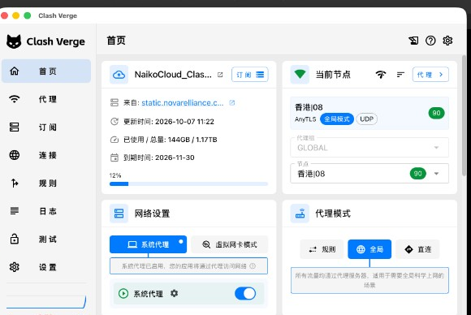
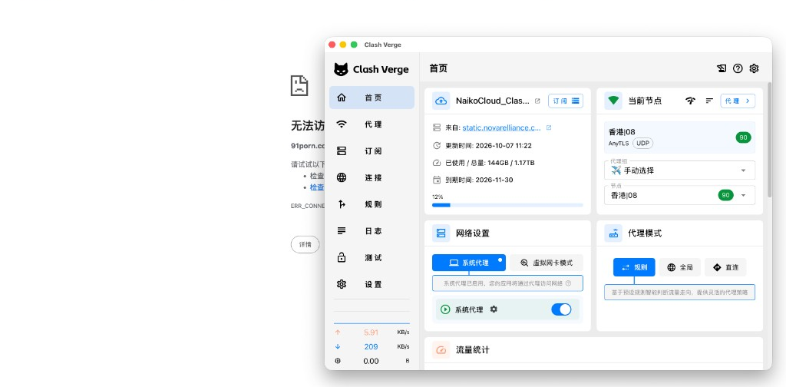
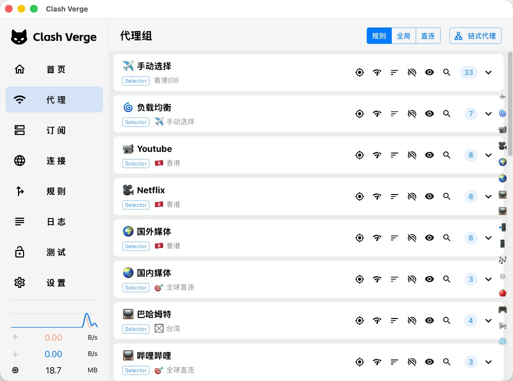
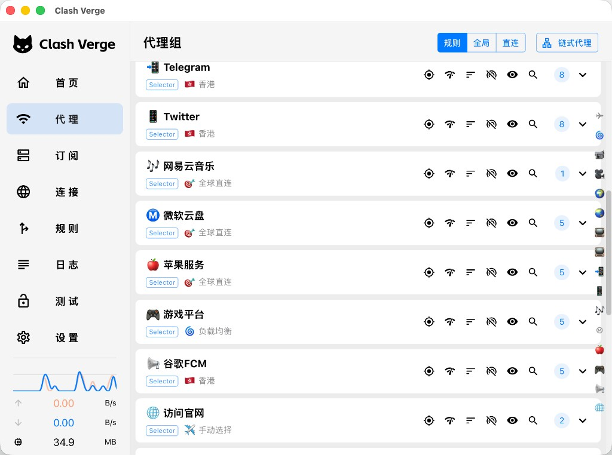

# Clash Verge 规则模式打不开、全局模式可以的排查

> 日期：2026-10-07
> 版本：v0.2
> 关联： [Colima + Clash 代理下 Docker 拉取镜像失败排查与修复](./colima-docker-proxy-troubleshooting.md)

### 变更记录

| 版本 | 日期 | 变更说明 |
|------|------|----------|
| v0.1 | 2026-10-07 | 初版：Naiko Cloud 规则模式走直连的案例，以及以后同类问题的排查步骤 |
| v0.2 | 2026-10-07 | 补充直连走国内 DNS 的判断依据：运行配置里的 nameserver，以及直连与代理的解析差异 |

---

## 1. 现象

订阅为 Naiko Cloud（`NaikoCloud_Clash.yaml`），节点 `香港|08` 延迟正常，系统代理已开。

- 代理模式选 **全局**：Google、91porn 可以打开。
- 代理模式选 **规则**：同一节点、同一系统代理，浏览器报 `ERR_CONNECTION…`，页面打不开。

全局能开，说明节点、订阅和系统代理是通的。规则不能开，说明流量没有进这个节点。

全局模式。当前节点卡片是 `GLOBAL` → `香港|08`，代理模式为「全局」。此图只保留 Clash Verge 窗口。



规则模式。模式已切到「规则」，节点卡片仍显示 `香港|08`，但页面无法访问。



## 2. 原因

首页「当前节点」只表示你正在看的那一个策略组，不表示规则把流量送进了这个组。

这两类域名在订阅规则里都进入 **🌀 负载均衡**：

| 域名 | 命中规则 | 策略组 |
|------|----------|--------|
| `www.google.com`、`google.com` | `DOMAIN-KEYWORD,google` | 🌀 负载均衡 |
| `91porn.com`、`www.91porn.com` | `DOMAIN-KEYWORD,porn` | 🌀 负载均衡 |

「🌀 负载均衡」的类型是 `select`，不是负载均衡算法。当时它选的是 **🎯 全球直连**，而「全球直连」里只有 `DIRECT`。

规则模式的实际路径：

```text
域名 → 🌀 负载均衡 → 🎯 全球直连 → DIRECT
```

全局模式不看这套规则，`GLOBAL` 固定为 `香港|08`，所以能打开。直连时由本机 Clash 用国内 DNS 解析目标域名，连接被重置或污染，浏览器就是 `ERR_CONNECTION…`。判断依据见 [2.1](#21-怎么判断直连走国内-dns)。

当时跟着「负载均衡」一起被直连的还有 YouTube、Netflix、国外媒体、Twitter、游戏平台，以及最后的「🕹 规则之外」。GitHub 等命中该组的域名同样直连。

### 2.1 怎么判断直连走国内 DNS

这是读内核正在加载的配置，不是抓包。

Clash Verge 生成并加载的文件是：

```text
~/Library/Application Support/io.github.clash-verge-rev.clash-verge-rev/clash-verge.yaml
```

其中 `dns.nameserver` 只有国内公共 DNS：

| 配置项 | 服务 |
|--------|------|
| `119.29.29.29`、`https://doh.pub/dns-query` | DNSPod |
| `180.184.1.1` | 火山引擎公共 DNS |
| `https://dns.alidns.com/dns-query` | 阿里 DNS |

`default-nameserver` 是 `119.29.29.29`、`180.184.1.1`、`223.5.5.5`。没有 `fallback`，也没有单独的 `direct-nameserver`，直连没有另一套境外 DNS。

Clash Verge 自己的 DNS 覆盖是关的。`verge.yaml` 里 `enable_dns_settings: false`，当前订阅的 `profile_dns_settings` 也是 `enabled: false`。因此没有启用同目录的 `dns_config.yaml`（那份里才有 `8.8.8.8`），订阅里的这段 DNS 原样进了内核。外部控制接口的 `/configs` 不返回 `dns` 字段，不能用它核对解析器。

当前是系统代理，TUN 关着。浏览器把域名交给 `127.0.0.1:7890`，本机系统 DNS 并不因此改成上面这几台。分流之后的解析分成两条：

- 规则落到 `DIRECT`：本机 Clash 用 `nameserver` 解析，再从本机连出去。
- 规则落到代理节点：域名交给远端节点解析，不走这份国内 DNS。全局模式所有流量都进节点，同样是远端解析。

`proxy-server-nameserver` 只用来解析节点地址本身，不负责网站域名。这次它碰巧也是同一批国内 DNS。

## 3. 处理

在「代理」页把 **🌀 负载均衡** 从 **🎯 全球直连** 改成 **✈️ 手动选择**（或直接选一个地区组）。「手动选择」保持 `香港|08`。

改完后的路径：

```text
域名 → 🌀 负载均衡 → ✈️ 手动选择 → 香港|08
```

保持规则模式再打开页面即可。挂在「负载均衡」下面的组会跟着恢复。也可以把 YouTube、Netflix 等组直接选成「香港」，不经过负载均衡。

调整后的策略组（上半部分）。「负载均衡」已指向「手动选择」。



调整后的策略组（下半部分）。游戏平台仍走「负载均衡」，访问官网走「手动选择」。



国内媒体、哔哩哔哩、网易云音乐、微软云盘、苹果服务保持「全球直连」是预期行为，不用改。

## 4. 以后怎么查

先分清是节点坏了，还是分流送错了。

| 现象 | 说明 |
|------|------|
| 只有全局能开 | 节点正常，查规则和策略组当前选项 |
| 全局也打不开 | 查节点、订阅、系统代理，先不要看规则 |
| 直连能开、规则不能 | 这条流量被送进了代理，或被拒绝 |
| 只有某一个站不行 | 查这个域名命中的规则，以及该组的当前选项 |

然后按这个顺序：

1. **在「代理」页顺着组往下点。** 找到规则使用的那个组，看它选中的是节点、另一个组，还是「全球直连」/ `REJECT`。组可以套组，要点到最后一跳。最后一跳是直连或拒绝时，规则模式会失败，即使「手动选择」里已经选了可用节点。
2. **在「连接」页对真实出口。** 打开打不开的网站，看这一条的规则名和链路。末端是 `DIRECT` 就是走了直连；是 `REJECT` 就是被广告拦截或应用净化拦了。
3. **连接页对不上时再搜订阅。** 当前配置在：

```text
~/Library/Application Support/io.github.clash-verge-rev.clash-verge-rev/profiles.yaml
```

`current:` 指向正在用的 yaml。在该文件 `rules:` 里搜域名，第一条命中的生效。顺序是 `DOMAIN`（精确）、`DOMAIN-SUFFIX`（后缀）、`DOMAIN-KEYWORD`（子串），然后才是 `GEOIP` 和最后的 `MATCH`。子串会提前命中，例如域名里带 `google`、`porn` 会先撞上对应的 `DOMAIN-KEYWORD`。

4. **规则和组都正确、仍然失败时，再看两处。**
   - 订阅把某些子域写死成直连。Google 常见的是 `www.gstatic.com`、`fonts.gstatic.com`、`ssl.gstatic.com`、`safebrowsing.googleapis.com`。主站走代理、静态资源直连时，页面会缺资源。
   - DNS 全是国内解析。核对方法见 [2.1](#21-怎么判断直连走国内-dns)。这只解释直连失败时长什么样，不说明节点故障。

内核在跑、又需要看实时选择时，用外部控制套接字。`secret` 以同目录 `config.yaml` 里的值为准：

```bash
SOCK=$(ls /var/folders/*/*/T/verge-mihomo.sock 2>/dev/null | head -1)
curl -sS --unix-socket "$SOCK" \
  -H "Authorization: Bearer <config.yaml 里的 secret>" \
  http://localhost/proxies
```

看对应组的 `now`。`/connections` 里每条连接的 `rule`、`rulePayload`、`chains` 就是实际路径。
