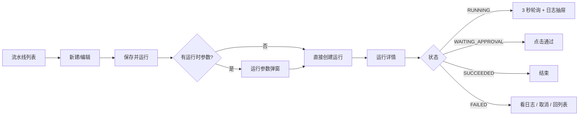
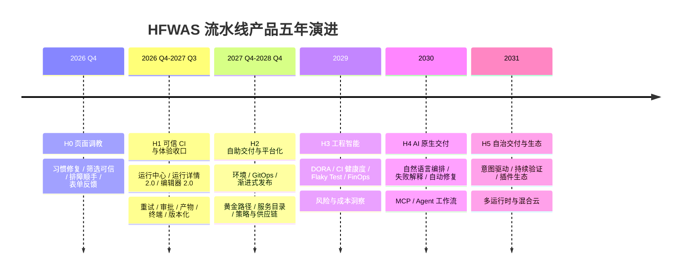
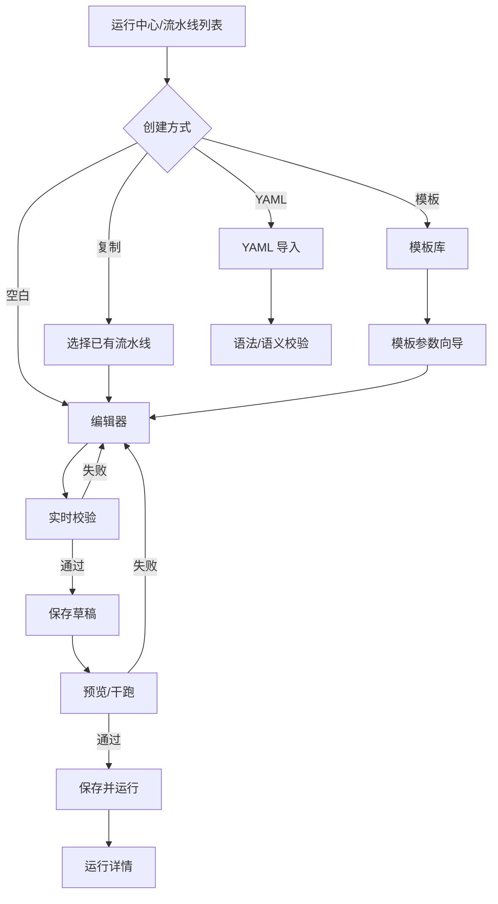
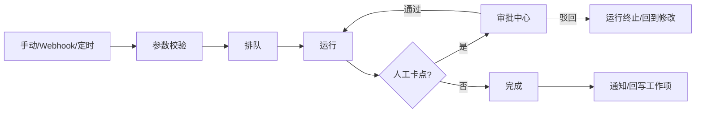
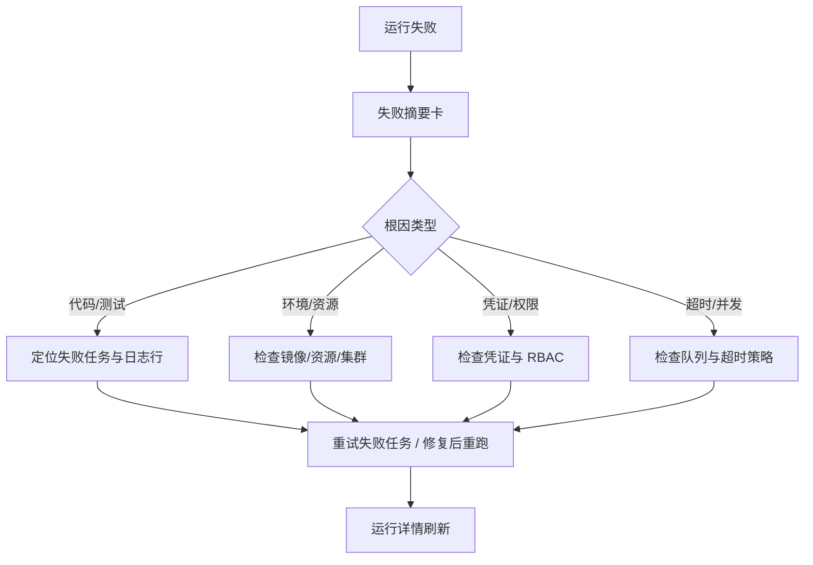
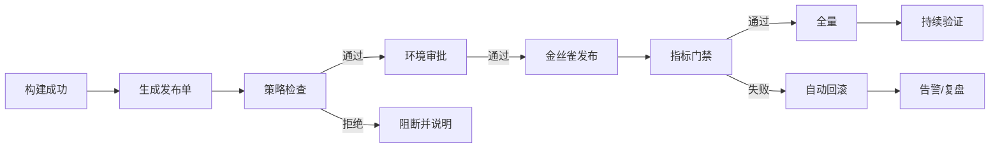

# HFWAS DevOps 流水线产品五年规划（2026-2031）

> 日期：2026-10-18
> 版本：v0.1
> 状态：规划稿（待产品 / 前端 / 后端 / 测试评审）
> 范围：流水线（CI/CD）产品的前端页面体验、功能演进与平台化路线
> 不含：交付运维平台（Delivery Ops，独立局点产品，见 `docs/superpowers/specs/2026-09-16-delivery-ops-platform-design.md`）

### 变更记录

| 版本 | 日期 | 变更说明 |
|------|------|----------|
| v0.1 | 2026-10-18 | 初版：现状基线、行业对标结论、五年五阶段路线、目标信息架构、关键页面流转、未来 1-2 季度前端优化清单与功能 Backlog |

---

## 0. 结论摘要

1. **当前产品已经跨过“能跑”阶段，但还没到“敢用、好用、规模化”阶段。** 流水线定义、Tekton 执行、任务市场、凭证、审批、SBOM 主链路已经打通；前端仍是“配置表单 + 泳道图 + 3 秒轮询日志”的形态，缺少运行中心、实时日志、重试、审批驳回、产物/终端入口和版本化。
2. **与业界成熟产品的差距不在执行引擎，而在控制面体验。** GitHub Actions、GitLab CI、Harness、Argo 的共同点是：以“运行（Run）”为中心组织信息、以“模板/黄金路径”降低创建成本、以“实时可观测 + 一键重试”缩短排障时间、以“环境/审批/策略”把 CI 延伸到 CD。
3. **五年主线：从“CI 执行器”演进为“软件交付控制面”，再演进为“AI 原生、可自治的交付平台”。** 执行层继续复用 Tekton / Argo / Kubernetes，不在本产品内重造 runtime；控制面、体验、治理与数据是自研护城河。
4. **未来 1-2 个季度的最高 ROI 不是加新任务类型，而是把运行链路做顺。** 优先做全局运行中心、运行详情 2.0（实时日志 / 重试 / 审批 / 产物 / 终端）、编辑器 2.0（模板 / 版本 / YAML 双向 / 校验）、审批中心与信息架构收口。
5. **差异化切口保持不变：PM 深度 + 流水线回写 + 私有化 / 内网交付。** 对标 GitLab 的一体化与 GitHub Actions 的生态，但不追求 Marketplace 规模；先把“需求 → 构建 → 部署 → 验证”闭环做深。
6. **执行顺序调整：先做 H0 页面调教，再进入 H1 能力扩展。** 现有页面的习惯问题会放大新入口的迷路成本；详见 [`pipeline-ux-audit.md`](./pipeline-ux-audit.md)。

---

## 1. 现状基线（As-Is）

### 1.1 产品与页面现状

当前流水线模块共有 10 条前端路由，侧边栏只有“流水线 / 任务市场 / 凭证”三个入口。

| 页面 | 路由 | 当前能力 | 主要问题 |
|------|------|----------|----------|
| 流水线列表 | `/pipeline/pipelines` | 分页、搜索、状态快捷筛选、运行、编辑、历史、删除 | 状态筛选只作用于当前页；无收藏/标签/负责人；无成功率、平均耗时 |
| 流水线详情 | `/pipeline/pipelines/:id` | 只读定义画布、仓库/分支/阶段/最近运行概览 | 信息层级偏静态；无版本、无最近趋势、无快捷操作 |
| 运行历史页签 | `/pipeline/pipelines/:id/history` | 状态/时间/关键词筛选、成功率、进入运行详情 | 一次最多 200 条；本地筛选分页；无法跨流水线查看 |
| 新建/编辑 | `/pipeline/pipelines/new`、`/:id/edit` | 阶段泳道、任务拖拽、参数绑定、工具链联动、校验、保存并运行 | 无模板、无版本/回滚、无 YAML 双向、无撤销重做、无 dry-run、无触发器配置 |
| 运行详情 | `/pipeline/pipelines/:id/runs/:runId` | 阶段泳道、三级日志抽屉、通过审批、取消 | 3 秒轮询；无重试/重跑；无驳回；无产物/终端/参数回显；无失败摘要 |
| 任务市场 | `/pipeline/task-kinds` | 卡片墙、分组筛选、管理员编辑、参数/版本/启停 | 全量加载无分页；无使用统计；无“从任务创建流水线” |
| 任务详情 | `/pipeline/task-kinds/:kind` | 概览、参数编辑器、版本发布/激活 | 参数 schema 可读性一般；无版本 diff |
| 凭证列表 | `/pipeline/credentials` | 分页、搜索、新建、删除 | 无连接测试；无引用统计；可重名 |
| 凭证详情 | `/pipeline/credentials/:id` | 编辑、密钥留空不修改、删除 | 同上 |
| 依赖分析 | 无独立页面 | 运行详情/接口 | 扫描任务列表恒空；无组件趋势与风险视图 |

后端已经具备、但前端尚未接入的能力：

- Pod 终端：容器查询 + WebSocket `/ws/exec/{pipelineId}/{runId}/{jobId}`，支持 exec / ephemeral / debug Pod。
- 运行产物：上传、列表、下载、最新 SBOM。
- Argo Workflows：工作流、模板、运行、日志、事件（独立产品入口，当前无前端路由）。
- 依赖扫描与组件聚合接口。

### 1.2 当前核心流程



流程断点集中在四处：

1. **创建断点**：从零开始配置，缺少模板、示例和运行前校验，第一次成功运行成本高。
2. **观测断点**：日志轮询、纯文本拼接、无搜索/下载/失败摘要，排障依赖人工翻日志。
3. **处置断点**：没有重试失败任务、按原参数重跑、审批驳回、产物下载、Pod 终端。
4. **治理断点**：没有流水线版本、变更审计、环境/发布、权限细分与策略门禁。

### 1.3 能力成熟度评估

采用 L1-L5 五级模型（L1 手工、L2 可用、L3 标准化、L4 数据驱动、L5 自治）。

| 能力域 | 当前 | 2027 目标 | 2029 目标 | 2031 目标 |
|--------|:----:|:---------:|:---------:|:---------:|
| 编排与创建 | L2 | L3 | L4 | L5 |
| 触发与调度 | L1 | L3 | L4 | L5 |
| 运行与观测 | L2 | L3 | L4 | L5 |
| 审批与治理 | L2 | L3 | L4 | L5 |
| 制品与供应链 | L2 | L3 | L4 | L5 |
| 部署与发布 | L1 | L2 | L4 | L5 |
| 数据分析与洞察 | L1 | L2 | L3 | L5 |
| AI 辅助 | L0 | L1 | L3 | L5 |
| 权限与多租户 | L2 | L3 | L4 | L5 |
| 生态与扩展 | L1 | L2 | L3 | L5 |

> 评分口径：L1 仅有基础能力；L2 主流程可用但依赖人工；L3 有标准模板、约束与可重复流程；L4 有度量、推荐与自动优化；L5 能在策略约束下自治运行。

### 1.4 必须优先偿还的债

| 类别 | 事项 | 影响 |
|------|------|------|
| 正确性 | PIPE-901/902/903/904/911/915/916/917 | 数据残留、级联缺失、并发绕过、跨租户访问、路径穿越 |
| 安全 | 产物租户校验、文件名清洗、任务类型租户隔离、凭证重名 | 多租户产品的上线底线 |
| 可观测 | 日志轮询非流式、512KB 截断、无归档/搜索 | 排障效率与审计能力 |
| 体验 | 无运行中心、无重试、无审批驳回、无产物/终端入口 | 用户仍需回到 kubectl / 命令行 |
| 文档 | PIPE-907、脚本模板状态、历史 Vue 描述与代码漂移 | 规划与验收失真 |

**原则：体验优化与正确性修复并行推进，不允许用“先做新页面”掩盖多租户与安全问题。**

---

## 2. 行业对标结论

完整对标见 [`pipeline-industry-benchmark.md`](./pipeline-industry-benchmark.md)。

**2026 年行业数据校准**（JetBrains《State of CI/CD 2026》等）：

- 自托管/自管云仍是主流：72.8% 的主 CI/CD 不在纯托管服务上，纯 on-prem 30.5%。这与本产品的私有化、多租户定位一致，**不是过渡形态**。
- AI 主要在流水线“周边”：48.8% 至少在一个环节使用 AI，但仅 8% 在构建步骤内运行 AI step；28% 已通过 MCP 或 agent skills 访问 CI/CD 工具。
- AI 的瓶颈从“生成”转向“验证”：37% 称 AI 变更量拖慢 review，36% 难以判断变更可靠性。**这直接决定 H3 的度量与 H4 的治理必须先于自治。**
- 多工具并存：25% 组织同时使用 2 套以上 CI/CD，工具链整合是换工具的前三大原因。产品应优先做“统一控制面”，而不是再增加一个孤立的执行器。

### 2.1 三代产品形态

| 代际 | 时间 | 代表 | 核心特征 | 对本产品的启示 |
|------|------|------|----------|----------------|
| 第一代：CI 工具 | 2015-2020 | Jenkins、Travis CI | 作业配置、插件、构建农场 | 只解决“跑起来”，控制面弱 |
| 第二代：云原生 CI/CD | 2020-2025 | GitHub Actions、GitLab CI、Argo、Tekton | YAML 即代码、Marketplace/模板、DAG、GitOps | 以运行和可复用组件为中心 |
| 第三代：平台工程与 AI 原生 | 2025-2031 | Harness、Backstage/Port、GitHub Copilot、GitLab Duo | 黄金路径、环境/策略、工程智能、AI 生成与自治 | 从“工具”升级为“交付控制面” |

### 2.2 最值得借鉴的 12 个模式

| # | 模式 | 来源 | 当前差距 | 采用阶段 |
|---|------|------|----------|----------|
| 1 | 以 Run 为中心的信息架构：全局运行列表 + 运行详情 | GitHub Actions、GitLab、Buildkite | 只有流水线内历史 | H1 |
| 2 | 步骤级时间线与内联日志 | GitHub Actions、CircleCI | 只有阶段泳道 + 文本日志 | H1 |
| 3 | 失败任务重试 / 按原参数重跑 | GitLab、Harness | 无 | H1 |
| 4 | 实时日志流（SSE/WebSocket）+ 搜索/下载 | Buildkite、Harness | 3 秒轮询 | H1 |
| 5 | 环境 + 保护规则 + 必填审批 | GitHub Environments、GitLab | 只有单段审批通过 | H1-H2 |
| 6 | 审批驳回、意见、多人/超时 | Harness、Azure DevOps | 只有通过 | H1 |
| 7 | 可复用模板 / 黄金路径 | Backstage、GitLab、云效 | 无模板入口 | H1-H2 |
| 8 | 流水线版本化、diff、回滚 | GitLab、Harness | 无 | H1 |
| 9 | 产物 / SBOM / 签名与运行绑定 | GitHub Actions、GitLab | 后端有、前端无 | H1 |
| 10 | GitOps + 渐进式发布（金丝雀/蓝绿/回滚） | Argo CD / Rollouts、Harness | 仅有 DEPLOY/KUBECTL | H2 |
| 11 | 工程智能：DORA、失败率、耗时、Flaky Test | Harness、DX、LinearB | 只有成功率 | H3 |
| 12 | AI 辅助编写、失败解释、自动修复 | GitHub Copilot、GitLab Duo、Harness AI | 无 | H4 |

### 2.3 不照搬的部分

- **不做通用 Marketplace 的规模竞赛。** 任务市场先服务内部租户与私有化场景，重“可控、可审计”，不重数量。
- **不做自由画布式 DAG 作为默认编辑器。** CI 的主模型仍是“阶段 → 任务”，自由 DAG 作为高级模式在 H2 引入。
- **不把 CD 直接塞进流水线脚本。** 部署应建模为环境、发布单与 GitOps 收敛，而不是生产环境里的 `kubectl apply`。
- **不把 AI 做成无约束的自动执行器。** 所有写操作走策略与人工审批门禁，保留可追溯的变更证据。

### 2.4 差异化机会

| 机会 | 说明 | 相对竞品 |
|------|------|----------|
| PM ↔ 流水线闭环 | 需求/缺陷状态触发运行，运行结果回写工作项 | GitLab 有一体化但工作流精细度弱；GitHub 依赖 Projects |
| 私有化 / 内网交付 | 离线镜像、Helm、K8s 多集群、信创环境 | SaaS 产品难以覆盖 |
| 任务市场 + 工具链 | 平台团队统一维护构建/扫描/部署能力 | 比 Actions Marketplace 更可控 |
| 多租户 + 局点 | 租户隔离、局点交付、审计 | 国内一体化平台常见但体验粗 |
| 中文与本地化运维 | 中文界面、国内镜像/仓库/审批习惯 | 国际产品本地化不足 |

### 2.5 如果资源只够做三件事

1. **运行图 + 实时上下文**：让每一次运行可看、可查、可处置。
2. **环境级审批 + 策略外置**：让发布风险可控、可审计，流水线作者无法绕过。
3. **供应链证明 + 可观测**：SBOM、签名、provenance、OpenTelemetry trace，让“构建成功”等于“可信”。

如果还能再做三件：

- AI 失败诊断与修复建议（在故障现场，而不是另开聊天窗口）。
- Flaky Test 检测、隔离与选择性重跑。
- 运行级成本、排队时间与缓存命中洞察。

---

## 3. 五年目标与原则

### 3.1 产品定位

> **HFWAS DevOps 流水线 = 面向私有化与多租户场景的软件交付控制面。**
> 向上承接需求与代码，向下编排 Tekton / Kubernetes / Argo，向内提供模板、审批、制品、策略与洞察，向外通过 API / Webhook / MCP 连接研发生态。

三个关键词：

- **控制面**：不重造执行引擎，重造“人如何定义、观察、治理交付”。
- **黄金路径**：让 80% 的常规交付通过模板在 10 分钟内完成。
- **可解释的自动化**：从数据洞察到 AI 建议，再到受策略约束的自治。

### 3.2 北极星指标

**北极星：每周成功完成的交付运行数（Successful Delivery Runs / Week）。**

拆解为四层指标：

| 层级 | 指标 | 现状基线 | 2027 | 2029 | 2031 |
|------|------|----------|------|------|------|
| 采用 | 周活跃流水线数 | 待采集 | +100% | +300% | +500% |
| 效率 | 首次成功运行耗时（中位数） | 待采集 | ≤ 10 分钟 | ≤ 5 分钟 | ≤ 3 分钟 |
| 质量 | 运行成功率 | 待采集 | ≥ 85% | ≥ 92% | ≥ 96% |
| 恢复 | 失败平均恢复时间（MTTR） | 待采集 | ≤ 30 分钟 | ≤ 15 分钟 | ≤ 5 分钟 |
| 体验 | 运行详情首屏 p95 | 待采集 | ≤ 2s | ≤ 1.5s | ≤ 1s |
| 体验 | 日志端到端延迟 p95 | 3s 轮询 | ≤ 2s | ≤ 1s | ≤ 500ms |
| 自助 | 模板创建占比 | 0 | ≥ 40% | ≥ 70% | ≥ 85% |
| 智能 | AI 建议采纳率 | — | — | ≥ 30% | ≥ 60% |

> 基线数据需在 H1 建立埋点后补齐；未采集前不以估算值对外发布。

### 3.3 演进原则

1. **运行优先**：所有新能力的入口最终都收敛到“运行详情”，避免页面孤岛。
2. **先闭环再扩展**：每个阶段必须形成“可演示、可回滚、可度量”的闭环，不堆积半成品。
3. **控制面与执行面解耦**：通过 `PipelineExecutor` 抽象保持 Tekton 可替换；Argo 作为独立 runtime。
4. **模板先于自由**：先提供黄金路径与受约束编辑器，再开放自由 DAG / 自定义 DSL。
5. **策略先于自治**：AI 与自动化写操作必须有策略、审批、审计三件套。
6. **原型先行**：每个页面类需求先冻结高保真原型，再进入测试用例与编码（见 `docs/frontend/prototype-first-standard.md`）。
7. **度量驱动**：没有指标的功能不进入下一阶段；每半年复盘一次路线假设。

### 3.4 五年总图



### 3.5 年度主题速览

| 年度 | 阶段 | 一句话主题 | 关键交付 | 成功标志 |
|------|------|------------|----------|----------|
| 2026 Q4 | H0 | 先让现有页面顺手 | 导航/返回、列表筛选、日志抽屉、表单反馈、术语统一 | 10 个验收任务成功率 ≥ 90% |
| 2026 Q4 – 2027 | H1 | 让流水线敢用、好用 | 运行中心、运行详情 2.0、编辑器 2.0、审批、产物/终端 | 80% 日常操作不离开控制台 |
| 2027 Q4 – 2028 | H2 | 从 CI 到自助交付 | 环境、GitOps、渐进式发布、模板、服务目录、策略 | 新服务 1 天接入，发布可回滚 |
| 2029 | H3 | 用数据优化交付 | DORA、CI 健康度、Flaky、测试智能、FinOps | MTTR 下降 30%，优化建议可执行 |
| 2030 | H4 | AI 成为交付搭档 | NL 编排、失败解释、受控自动修复、MCP | 60% 流水线有 AI 参与 |
| 2031 | H5 | 走向自治与生态 | 意图驱动、持续验证、插件生态、多运行时 | 低风险变更可自治，高风险可审计 |

---

## 4. 分阶段路线

### H0：页面调教（2026 Q4，4-6 周）

**主题：先让现有页面符合用户习惯，再谈新能力。**

**目标**

- 修复会让用户走错路、丢上下文、误操作或无法完成任务的问题。
- 让列表筛选、运行历史、日志抽屉、表单反馈达到成熟 CI 产品的基本预期。
- 不新增页面、不引入实时日志/重试/审批驳回等需要后端模型的能力。

**范围**

- 全局壳：搜索行为、侧栏分组、返回来源、面包屑。
- 列表：行可点、操作收敛、服务端状态筛选、最近运行信息。
- 运行历史：服务端分页与筛选、去重指标卡、触发人/失败原因。
- 运行详情：失败摘要与下一步、触发方式统一、刷新提示、返回来源。
- 日志抽屉：任务切换、搜索、下载、复制、宽度调整。
- 运行参数：任务归属、api_select 下拉、字段级错误、布尔参数。
- 编辑器：未保存状态、撤销重做、危险图标收敛、字段级校验、术语。
- 任务市场/凭证：分页、空错态、动态字段、表单错误、连接测试。
- 全局：空态/错误态/加载态统一、术语与文案统一。

**退出条件**

- [`pipeline-ux-audit.md`](./pipeline-ux-audit.md) 的 10 个验收任务成功率 ≥ 90%。
- P0 问题全部关闭；P1 完成 ≥ 80%。
- 不引入新的 P0 可用性问题。

详见 [`pipeline-ux-audit.md`](./pipeline-ux-audit.md) 第 6-7 节。

---

### H1：可信 CI 与体验收口（2026 Q4 – 2027 Q3）

**主题：把“能跑”变成“敢用、好用”。**

**目标**

- 关闭 PIPE-9xx 中影响正确性、安全与多租户的全部 P0 项。
- 建立以 Run 为中心的信息架构，运行详情成为排障与处置的唯一入口。
- 编辑器支持模板、版本、YAML 双向与运行前校验。
- 前端接入产物、SBOM、Pod 终端与审批中心。

**关键结果（KR）**

| 编号 | KR | 验收口径 |
|------|----|----------|
| H1-KR1 | 运行中心上线 | 跨流水线筛选、分页、批量取消/重试可用 |
| H1-KR2 | 运行详情 2.0 | 实时日志、搜索/下载、失败摘要、重试、按原参数重跑 |
| H1-KR3 | 审批闭环 | 通过/驳回/意见/待办列表/审计可查 |
| H1-KR4 | 编辑器 2.0 | 模板创建、版本 diff/回滚、YAML 双向、dry-run |
| H1-KR5 | 可观测与产物 | 产物列表/下载/SBOM、Pod 终端入口 |
| H1-KR6 | 安全债清零 | PIPE-916/917/911/912 等全部关闭并有自动化用例 |
| H1-KR7 | 触发扩展 | Webhook / 定时触发可用，手动不再是唯一方式 |

**前端页面改造**

- 新增：运行中心 `/pipeline/runs`、审批中心 `/pipeline/approvals`、运行详情 Tab（概览/日志/产物/终端/参数）。
- 重构：运行详情、编辑器、流水线列表、任务市场、凭证。
- 导航：`流水线 / 运行 / 审批 / 任务市场 / 凭证`，为 H2 的“环境 / 制品 / 洞察”预留位置。

**功能**

- 运行：重试失败任务、按原参数重跑、批量取消、排队位置、超时策略、并发组。
- 编排：模板库、复制流水线、版本快照、diff/回滚、草稿自动保存、撤销重做。
- 触发：Webhook（GitHub / GitLab / 通用）、Cron、手动；PR/MR 事件留到 H2。
- 治理：项目/流水线级 RBAC、审批权限、操作审计、凭证连接测试与引用统计。
- 可观测：SSE 实时日志、日志归档与检索、运行事件时间线、通知中心。

**技术**

- 前端：TanStack Query 增量缓存、虚拟列表、SSE、React Flow（只读 DAG + 阶段编辑）、CodeMirror/Monaco（YAML）。
- 后端：运行事件表、日志分片/归档、重试与 rerun API、审批模型扩展、触发器模型、审计表。
- 数据：流水线版本表、审批记录表、运行事件表、触发器表。

**退出条件**

- 80% 的日常操作可在控制台完成，无需 `kubectl` 或命令行。
- 首次成功运行中位数 ≤ 10 分钟。
- 关键页面有埋点与 p95 性能基线。
- H1-KR1 ~ KR7 全部验收通过。

**不做**

- 自由 DAG、条件分支、矩阵构建（留到 H2）。
- 完整 GitOps / 环境管理（H2）。
- AI 生成（H4）。

---

### H2：自助交付与平台化（2027 Q4 – 2028 Q4）

**主题：从 CI 到 CD，从单条流水线到黄金路径。**

**目标**

- 建立“服务 / 环境 / 发布”模型，支持 GitOps 与渐进式发布。
- 让新服务通过模板与自助向导在 1 天内完成接入。
- 把供应链安全与策略门禁变成默认能力，而不是可选插件。

**关键结果**

| 编号 | KR | 验收口径 |
|------|----|----------|
| H2-KR1 | 环境与发布中心 | 环境列表、部署历史、漂移检测、回滚可用 |
| H2-KR2 | GitOps 集成 | Argo CD Application 可视化，Git 声明与集群状态对比 |
| H2-KR3 | 渐进式发布 | 金丝雀/蓝绿策略配置、指标门禁、自动回滚 |
| H2-KR4 | 黄金路径 | 服务模板库、创建向导、模板版本与升级 |
| H2-KR5 | 服务目录 | 服务、负责人、依赖、流水线、环境一页可见 |
| H2-KR6 | 策略与供应链 | OPA/Kyverno 策略、SLSA/Sigstore、SBOM 门禁 |
| H2-KR7 | 构建加速 | 依赖缓存、远程缓存、monorepo affected build、矩阵构建 |

**前端页面**

- 新增：环境列表/详情、发布单、服务目录、模板库、策略中心、制品浏览、依赖图。
- 重构：流水线详情增加“环境 / 发布 / 版本 / 设置”页签；运行详情增加“部署结果 / 漂移”。

**功能**

- 环境模型：开发/测试/预发/生产，保护规则、变量、密钥、审批人。
- 发布：部署单、审批、窗口期、回滚、冻结期、变更日历。
- GitOps：Argo CD 集成、ApplicationSet、同步状态、漂移修复。
- 渐进式发布：Argo Rollouts / Flagger 策略、指标查询、自动回滚。
- 模板：服务模板、流水线模板、任务模板、组织级模板继承。
- 供应链：制品仓库、签名、provenance、SBOM 策略、漏洞门禁。
- 构建：缓存策略、远程缓存、affected 计算、矩阵、ARM/GPU runner。

**技术**

- 前端：DAG 自由编辑（React Flow）、环境拓扑、图表与趋势（遵守 dataviz 规范）。
- 后端：环境/发布/策略/模板/目录领域模型；Argo CD / Rollouts API 适配器；缓存服务。
- 数据：环境、发布、模板、服务目录、策略、制品元数据。

**退出条件**

- 70% 新服务通过自助模板接入，平均接入时间 ≤ 1 天。
- 生产发布 100% 经过环境与审批，支持一键回滚。
- 关键服务具备 SBOM、签名与策略门禁。

**不做**

- 通用低代码平台 / 任意可视化编程。
- 自研 GitOps 控制器（复用 Argo CD / Flux）。
- 自研容器运行时或镜像仓库内核。

---

### H3：工程智能（2029 Q1 – 2029 Q4）

**主题：用数据解释交付，用洞察驱动优化。**

**目标**

- 建立 DORA + CI 健康度 + 成本三位一体的度量体系。
- 把“失败后排查”变成“失败前预警”。
- 为 H4 的 AI 提供高质量、可解释的数据底座。

**关键结果**

| 编号 | KR | 验收口径 |
|------|----|----------|
| H3-KR1 | DORA 看板 | 部署频率、前置时间、变更失败率、恢复时间可按团队/服务/租户切片 |
| H3-KR2 | CI 健康度 | 成功率、耗时 p50/p95、排队时间、失败原因 Top N |
| H3-KR3 | Flaky Test 治理 | 自动识别、隔离、重跑、趋势与责任人 |
| H3-KR4 | 测试智能 | 基于变更的受影响测试选择，平均测试时长下降 ≥ 30% |
| H3-KR5 | FinOps | 每次运行/每条流水线/每个租户的成本与碳排估算 |
| H3-KR6 | 风险洞察 | 依赖漏洞、过期镜像、高风险变更的聚合视图 |
| H3-KR7 | 推荐引擎 | 给出可执行的优化建议（缓存、并行、拆分、超时） |

**前端页面**

- 新增：交付洞察 `/pipeline/insights`、CI 健康度、Flaky Test、成本中心、风险中心。
- 重构：列表页增加趋势 sparkline；详情页增加“健康度 / 风险 / 建议”侧栏。

**功能**

- 指标采集：运行、阶段、任务、测试、部署、审批全链路埋点。
- 分析：趋势、对比、下钻、异常检测、根因候选。
- 测试：受影响测试选择、Flaky 隔离、自动重跑策略。
- 成本：资源用量、时长、缓存命中、按租户/项目分摊。
- 建议：缓存优化、并行化、镜像瘦身、超时调整、依赖升级。
- **AI 影响度量**：记录 AI 参与的需求/变更从提交到部署的价值流，识别“PR 增加但 review 变慢、bug 率上升”的生产力悖论，避免只考核代码产出量。

**技术**

- 数据：事件表 + 聚合表 + 可选 OLAP（ClickHouse/DuckDB）；保留原始事件用于回放。
- 前端：图表体系、下钻路由、导出与订阅。
- 后端：指标计算任务、异常检测、推荐规则引擎。

**退出条件**

- 管理层与团队各有可用看板，数据延迟 ≤ 15 分钟。
- 至少 3 类优化建议可一键跳转到具体运行/配置。
- MTTR 相比 H1 基线下降 ≥ 30%。

**不做**

- 通用 BI 平台。
- 与财务系统深度对接（先做估算与导出）。

---

### H4：AI 原生交付（2030 Q1 – 2030 Q4）

**主题：AI 从“助手”走向“受控代理”。**

**目标**

- 自然语言生成/修改流水线，带校验、预览与回滚。
- 失败自动解释、定位到具体步骤与日志行，并给出修复建议。
- 在策略与审批约束下，执行低风险自动修复（重试、回滚、依赖升级）。

**关键结果**

| 编号 | KR | 验收口径 |
|------|----|----------|
| H4-KR1 | 自然语言编排 | 从描述生成可运行草稿，校验通过率 ≥ 80% |
| H4-KR2 | 失败解释 | 80% 失败运行可给出可读根因与下一步建议 |
| H4-KR3 | 配置审查 | 对安全、缓存、超时、资源给出改进建议 |
| H4-KR4 | 自动修复 | 低风险场景（重试/回滚/依赖补丁）自动执行率 ≥ 40% |
| H4-KR5 | MCP 集成 | 代码、K8s、可观测、工单四类工具可被代理调用 |
| H4-KR6 | 可追溯 | 每次 AI 写操作有 prompt、diff、审批人、结果四元组审计 |

**前端页面**

- 全局 AI 侧栏：上下文感知（当前流水线/运行/日志）。
- 编辑器内联建议：命令、参数、资源、缓存、安全。
- 运行详情“AI 诊断”卡片：根因、证据、建议操作。
- 审批页“AI 风险评估”：变更影响、历史相似运行、风险等级。

**功能**

- 编排：NL → 草稿、配置解释、迁移建议、模板生成。
- 排障：日志摘要、错误聚类、相似运行检索、修复建议。
- 测试：用例生成、断言建议、覆盖率缺口。
- 运维：自动重试、自动回滚、依赖升级 PR、告警关联。
- 代理：MCP 工具注册、权限边界、人工确认、审计。
- **安全模型**：Agent 默认只读、网络隔离、依赖 SHA 固定；写操作通过“safe outputs”或人工确认落地，每次执行记录 prompt、工具调用、diff、审批人与结果。
- **治理**：工具级审批策略、AI 审计事件、评测集与回归、模型/提示版本追踪、租户级配额与成本控制。

**技术**

- AI 网关：多模型路由、租户隔离、数据脱敏、配额与成本控制。
- 检索：运行/日志/文档/代码的向量检索与混合检索。
- 代理：工具调用框架、策略引擎、审批钩子、回放与评估集。
- 前端：Vercel AI SDK + AI Elements / assistant-ui；流式输出与工具调用 UI。

**退出条件**

- 60% 的流水线创建/修改有 AI 参与。
- 40% 的失败运行由 AI 完成初步分诊。
- 所有自动写操作 100% 可审计、可回滚。

**不做**

- 无审批的全自动生产变更。
- 用 AI 替代策略引擎与审计。

---

### H5：自治交付与生态（2031 Q1 – 2031 Q4）

**主题：意图驱动、持续验证、开放生态。**

**目标**

- 从“人配置流水线”转向“人表达意图，系统生成并持续优化交付路径”。
- 建立插件 / 模板 / 策略的开放生态，支持多运行时与混合云。
- 在受监管场景提供可证明的合规证据链。

**关键结果**

| 编号 | KR | 验收口径 |
|------|----|----------|
| H5-KR1 | 意图驱动 | 目标/约束描述可生成多套方案并评估取舍 |
| H5-KR2 | 持续验证 | 发布后自动验证 SLI，异常自动回滚 |
| H5-KR3 | 数字孪生 | 变更前模拟影响面与风险 |
| H5-KR4 | 多运行时 | Tekton / Argo / 主机 / 边缘统一控制面 |
| H5-KR5 | 插件生态 | 任务、策略、报表、通知可第三方扩展 |
| H5-KR6 | 合规证据 | 一键生成审计包与合规报告 |

**前端页面**

- 交付驾驶舱：全局健康、风险、成本、待办。
- 意图工作台：目标、约束、方案对比、模拟结果。
- 插件市场：安装、权限、版本、评分。
- 合规中心：证据链、报告导出。

**功能**

- 意图模型：服务级别目标、变更策略、成本/合规约束。
- 方案生成：多方案对比、影响模拟、渐进落地。
- 持续验证：SLI/SLO、异常检测、自动回滚、根因归档。
- 生态：插件 SDK、Webhook/事件总线、模板市场、社区治理。
- 多运行时：统一抽象、能力协商、成本/延迟路由。

**退出条件**

- 高风险评估变更 100% 人工确认；低风险变更可自治。
- 插件生态有真实第三方贡献与版本治理。
- 合规报告可覆盖主要审计场景。

---

## 5. 目标信息架构与页面清单

### 5.1 导航目标态

```text
交付（Delivery）
├── 交付概览            /pipeline/overview          H3
├── 流水线              /pipeline/pipelines         H1（已有）
│   ├── 列表
│   ├── 新建（模板 / 空白 / YAML）
│   ├── 详情（定义 / 运行 / 版本 / 设置）
│   └── 编辑器（可视化 / YAML / 校验 / 预览）
├── 运行                /pipeline/runs              H1
│   └── 运行详情（概览 / 日志 / 产物 / 终端 / 参数 / AI 诊断）
├── 审批                /pipeline/approvals         H1
├── 环境与发布          /pipeline/environments      H2
│   └── 环境详情（部署历史 / 漂移 / 回滚 / 保护规则）
├── 制品                /pipeline/artifacts         H2（与制品仓库产品协同）
├── 任务市场            /pipeline/task-kinds        H1（已有）
├── 凭证与变量          /pipeline/credentials       H1（已有，扩展）
├── 模板库              /pipeline/templates         H2
├── 服务目录            /pipeline/catalog           H2
├── 洞察                /pipeline/insights          H3
├── 策略与合规          /pipeline/policies          H2-H5
└── 设置                /pipeline/settings          H1
```

### 5.2 页面清单与阶段

| 页面 | 路由 | 核心用户 | 核心能力 | 阶段 |
|------|------|----------|----------|------|
| 交付概览 | `/pipeline/overview` | 负责人/SRE | 健康、风险、待办、趋势 | H3 |
| 流水线列表 | `/pipeline/pipelines` | 研发 | 搜索、筛选、收藏、批量操作 | H1 |
| 流水线详情 | `/pipeline/pipelines/:id` | 研发 | 定义、运行、版本、设置 | H1 |
| 编辑器 | `/pipeline/pipelines/:id/edit` | 研发 | 可视化/YAML、模板、校验、预览 | H1 |
| 运行中心 | `/pipeline/runs` | 研发/SRE | 全局运行、筛选、批量处置 | H1 |
| 运行详情 | `/pipeline/runs/:runId` | 研发/SRE | 实时日志、重试、审批、产物、终端 | H1 |
| 审批中心 | `/pipeline/approvals` | 审批人 | 待办、通过/驳回、意见、审计 | H1 |
| 环境列表 | `/pipeline/environments` | SRE | 环境、保护规则、状态 | H2 |
| 环境详情 | `/pipeline/environments/:id` | SRE | 部署历史、漂移、回滚 | H2 |
| 发布单 | `/pipeline/releases/:id` | 研发/SRE | 发布审批、窗口、回滚 | H2 |
| 模板库 | `/pipeline/templates` | 平台/研发 | 模板浏览、版本、创建 | H2 |
| 服务目录 | `/pipeline/catalog` | 研发/SRE | 服务、负责人、依赖、健康 | H2 |
| 制品 | `/pipeline/artifacts` | 研发/SRE | 制品、SBOM、签名、漏洞 | H2 |
| 洞察 | `/pipeline/insights` | 负责人 | DORA、健康度、成本、Flaky | H3 |
| 策略 | `/pipeline/policies` | 平台/安全 | 策略、门禁、豁免、审计 | H2 |
| AI 工作台 | 侧栏/抽屉 | 全体 | 生成、解释、修复、问答 | H4 |

### 5.3 页面设计原则

1. **一个运行一个 URL**：`/pipeline/runs/:runId` 为规范地址，流水线内运行地址保留兼容跳转。
2. **状态可分享**：筛选、页签、日志焦点、时间范围写入 URL，复制链接即可复现现场。
3. **渐进披露**：默认展示结论（失败摘要、建议动作），细节按需展开。
4. **危险操作二次确认 + 可撤销**：删除、取消、回滚、批量操作统一模式。
5. **实时但不打扰**：运行中自动刷新，用户上滚即暂停跟随；重要状态变化用通知而非全屏打断。
6. **所有空态都有下一步**：空列表给出创建/模板/文档入口，失败态给出重试与排障入口。

---

## 6. 关键页面流转设计

### 6.1 创建到首次成功运行



关键体验要求：

- 模板向导只问 3-5 个业务问题（仓库、分支、技术栈、环境），其余用默认值。
- 编辑器内联显示“为什么不能保存”，点击错误直接定位到字段。
- 干跑展示编译后的阶段/任务、预计耗时与资源，不真正执行。
- 首次运行失败时，运行详情直接给出“下一步”（看日志、修复建议、重新运行）。

### 6.2 日常运行与审批



关键体验要求：

- 审批中心是独立待办入口，支持批量审批但高风险变更必须逐条确认。
- 审批详情展示变更 diff、影响环境、历史相似运行与 AI 风险评估（H4）。
- 驳回必须填写意见，运行状态与工作项同步。

### 6.3 失败排障



关键体验要求：

- 失败摘要默认展开：失败任务、退出码、错误行、耗时异常、可能原因、建议动作。
- 日志支持按级别/关键词过滤、跳转到错误行、下载与复制。
- 重试可选择“仅失败任务”或“整条运行”，并保留原参数快照。
- 支持从失败任务直接打开 Pod 终端（在权限允许时）。

### 6.4 发布与回滚（H2）



### 6.5 AI 辅助交付（H4）

```text
用户意图（自然语言 / 目标 / 约束）
  → AI 生成方案（流水线 / 发布策略 / 测试）
  → 静态校验 + 策略检查 + 影响模拟
  → 人工确认（低风险可配置自动）
  → 执行
  → 结果解释与复盘
  → 反馈进入评估集，持续改进
```

---

## 7. 未来 1-2 个季度前端操作优化

> 目标：不新增执行引擎能力，先把现有链路的操作效率提升一个代际。
> 估算口径：1 名前端 + 1 名后端 + 0.5 名测试，按双周迭代粗估；实际以拆分后的任务为准。
> **阶段归属**：H0 只做“现有页面调教”（见 [`pipeline-ux-audit.md`](./pipeline-ux-audit.md)）；运行中心、实时日志、重试、审批中心、产物/终端属于 H1。

### 7.1 P0（必须做，直接影响“敢用”）

| # | 阶段 | 改造 | 页面 | 具体动作 | 后端依赖 | 验收 |
|---|:----:|------|------|----------|----------|------|
| P0-1 | H1 | 全局运行中心 | 新增 `/pipeline/runs` | 跨流水线列表；状态/流水线/分支/触发人/时间筛选；服务端分页；行内取消/重试/审批；URL 持久化；保存视图 | 新增跨流水线运行分页接口；运行列表返回 pipelineName、trigger、triggeredBy | 任意一次运行 3 次点击内可达；筛选刷新后保持 |
| P0-2 | H0+H1 | 运行详情 2.0 | `/pipeline/runs/:runId` | H0：失败摘要、返回来源、触发方式、刷新提示、参数回显；H1：三栏布局、重试、按原参数重跑、审批驳回 | 重试/rerun API；审批驳回；SSE 日志流；产物接口 | 排障平均点击 ≤ 4 次；日志延迟 ≤ 2s |
| P0-3 | H1 | 实时日志 | 运行详情 | SSE 增量推送、断线重连、虚拟滚动、级别过滤、跳转错误行 | 日志流接口；日志分片/归档 | 1 万行日志滚动不卡顿 |
| P0-4 | H1 | 审批中心 | 新增 `/pipeline/approvals` | 待办列表；详情；通过/驳回/意见；审计记录；通知 | 审批模型扩展、审批记录表 | 审批人无需进入具体运行即可处理 |
| P0-5 | H0+H1 | 编辑器 2.0 | `/pipeline/pipelines/*/edit` | H0：未保存状态、撤销重做、危险图标收敛、字段级校验；H1：模板、版本 diff/回滚、YAML 双向、dry-run | 流水线版本表；编译预览接口；YAML 转换 | 模板创建 ≤ 5 步；保存前可看到编译结果 |
| P0-6 | H1 | 产物与终端 | 运行详情 | 产物列表/下载/SBOM Tab；Pod 终端入口与权限校验 | 已有接口 | 产物与运行绑定可追溯；终端仅授权用户可见 |
| P0-7 | H0 | 信息架构收口 | 全局导航 | 搜索行为、侧栏分组、面包屑与返回路径统一 | 无 | 任一页面 2 次点击回到来源 |
| P0-8 | H1 | 正确性与安全 | 全模块 | PIPE-901/902/903/904/911/915/916/917 修复；错误态统一重试 | 后端修复 | 对应自动化用例通过 |

### 7.2 P1（体验增强，1-2 个季度内）

| # | 改造 | 页面 | 具体动作 | 验收 |
|---|------|------|----------|------|
| P1-1 | 列表增强 | 流水线列表 | 服务端状态筛选、收藏、标签、负责人、成功率/平均耗时、批量操作 | 筛选翻页结果稳定 |
| P1-2 | 任务市场增强 | 任务市场 | 分页/虚拟滚动、使用统计、版本 diff、参数 schema 预览、从任务创建流水线 | 任务查找 ≤ 3 次点击 |
| P1-3 | 凭证增强 | 凭证 | 连接测试、引用列表、轮换提示、重名校验 | 创建前可验证连通性 |
| P1-4 | 运行历史 | 流水线详情 | 服务端分页与筛选、趋势 sparkline、对比两次运行 | 可查看 200 条以前记录 |
| P1-5 | 通知与订阅 | 全局 | 运行失败/审批/完成订阅；站内信 + Webhook | 关键事件 1 分钟内触达 |
| P1-6 | 空态与引导 | 全局 | 首次使用向导、空态下一步、示例流水线 | 新用户 10 分钟内完成首次运行 |
| P1-7 | 可访问性与性能 | 全局 | 键盘操作、焦点管理、骨架屏、错误边界、性能预算 | Lighthouse ≥ 90；核心页面 p95 ≤ 2s |

### 7.3 P2（可排入 H1 末期或 H2 初）

- 运行对比（两次运行的阶段耗时、参数、产物差异）。
- 流水线依赖图（流水线之间、服务之间）。
- 移动端只读监控（运行状态、审批）。
- 自定义仪表盘与导出。
- 深色主题细节打磨与高对比度模式。

### 7.4 页面级改造明细

| 页面 | 现状问题 | 目标形态 | 优先级 | 粗估（人日） |
|------|----------|----------|:------:|-----:|
| 流水线列表 | 筛选仅当前页、信息密度低 | 运行态势列表 + 服务端筛选 + 收藏/标签 | P0/P1 | 8-10 pd |
| 流水线详情 | 静态、无版本/趋势 | 定义/运行/版本/设置四页签 + 健康度 | P0 | 10-12 pd |
| 编辑器 | 无模板/版本/YAML/撤销 | 可视化 + YAML 双模 + 模板 + 预览 | P0 | 18-22 pd |
| 运行详情 | 轮询、无处置、无产物 | 三栏 + 实时日志 + 重试/审批/产物/终端 | P0 | 20-25 pd |
| 运行中心 | 不存在 | 全局运行工作台 | P0 | 6-8 pd |
| 审批中心 | 不存在 | 待办 + 审批详情 + 审计 | P0 | 6-8 pd |
| 任务市场 | 全量加载、无统计 | 分页 + 使用统计 + 版本 diff | P1 | 6-8 pd |
| 凭证 | 无连接测试/引用 | 测试 + 引用 + 轮换 | P1 | 4-6 pd |
| 依赖分析 | 无页面、接口空实现 | 组件/风险视图（可并入洞察） | P2 | 8-10 pd |

> 合计约 86-109 人日（含前后端）。若只有 1 名前端 + 1 名后端，P0 约需 2 个季度；若 2 名前端 + 2 名后端，可压缩到 1 个季度。

### 7.5 第一个双周迭代建议

按“先骨架、再处置、后增强”的顺序拆成 5 个可演示任务：

| 顺序 | 任务 | 交付物 | 依赖 |
|:----:|------|--------|------|
| 1 | 运行中心骨架 | `/pipeline/runs` 列表、筛选、URL 持久化、跨流水线分页接口 | 后端运行分页 |
| 2 | 运行详情信息架构 | 三栏布局 + 概览/参数/产物 Tab 骨架（日志暂沿用轮询） | 无 |
| 3 | 运行处置 | 重试失败任务、按原参数重跑、取消级联修复 | 重试/rerun API、PIPE-903 |
| 4 | 审批闭环 | 审批中心 + 驳回/意见 + 审计记录 | 审批模型扩展 |
| 5 | 产物与终端入口 | 产物列表/下载、SBOM 摘要、Pod 终端入口 | 已有后端接口 |

**迭代出口**：可以用一条真实流水线演示“从运行中心进入 → 看到失败 → 重试 → 审批通过 → 下载产物”的完整闭环，且全程不离开控制台。

### 7.6 验收标准

- 所有 P0 页面完成高保真原型冻结并通过评审。
- 关键流程有自动化测试（组件测试 + 端到端冒烟）。
- 埋点覆盖：创建、运行、失败、重试、审批、产物下载、终端打开。
- 性能与可访问性达到 §7.2 P1-7 的预算。
- 安全债 P0 项全部关闭，并有回归用例。

---

## 8. 功能 Backlog（按能力域）

| 能力域 | 功能 | 阶段 | 优先级 | 依赖 | 备注 |
|--------|------|:----:|:------:|------|------|
| 编排 | 模板库/黄金路径 | H1-H2 | P0 | 模板模型 | 先内部模板，后组织级继承 |
| 编排 | 流水线版本化/diff/回滚 | H1 | P0 | 版本表 | 与编辑器 2.0 同批 |
| 编排 | YAML 双向编辑 | H1 | P0 | 编译器/YAML 转换 | 保留可视化为主 |
| 编排 | 自由 DAG/条件分支/汇合 | H2 | P1 | 图模型升级 | 与 Tekton when/runAfter 对齐 |
| 编排 | 矩阵构建 | H2 | P1 | 编译器 | 多语言/多版本测试 |
| 触发 | Webhook（GitHub/GitLab/通用） | H1 | P0 | 触发器模型 | 签名校验、幂等 |
| 触发 | 定时/Cron | H1 | P0 | 调度器 | 时区、并发策略 |
| 触发 | PR/MR 事件与状态回写 | H2 | P1 | SCM App | 与 PM 工作项联动 |
| 执行 | 重试失败任务/按原参数重跑 | H1 | P0 | 运行服务 | 保留参数快照 |
| 执行 | 超时/并发组/取消级联 | H1 | P0 | 执行器 | 修复 PIPE-903/904 |
| 执行 | 弹性 Runner/自托管 Agent | H2 | P1 | K8s/ARC | 按租户配额 |
| 观测 | SSE 实时日志 | H1 | P0 | 日志流 | 断线重连 |
| 观测 | 日志归档/检索 | H1-H2 | P1 | 存储 | 按租户保留策略 |
| 观测 | 运行事件时间线 | H1 | P1 | 事件表 | 审计与排障 |
| 审批 | 通过/驳回/意见/多级 | H1 | P0 | 审批模型 | 支持超时与转交 |
| 审批 | 审批中心/待办 | H1 | P0 | 通知 | 批量但有风险分级 |
| 制品 | 产物列表/下载/SBOM | H1 | P0 | 已有接口 | 前端接入 |
| 制品 | 签名/Provenance/SLSA | H2 | P1 | Sigstore | 与制品仓库协同 |
| 部署 | 环境模型/保护规则 | H2 | P0 | 环境表 | 变量、密钥、审批人 |
| 部署 | GitOps/Argo CD 集成 | H2 | P0 | Argo CD API | 同步/漂移/回滚 |
| 部署 | 渐进式发布 | H2 | P1 | Argo Rollouts | 指标门禁 |
| 治理 | 项目/流水线 RBAC | H1 | P0 | 权限模型 | 与租户角色对齐 |
| 治理 | 操作审计 | H1 | P0 | 审计表 | 全量写操作 |
| 治理 | 策略即代码/门禁 | H2 | P1 | OPA/Kyverno | 可豁免与审计 |
| 治理 | 成本/配额 | H3 | P1 | 用量采集 | 租户配额 |
| 洞察 | DORA/健康度 | H3 | P0 | 事件与聚合 | 可下钻 |
| 洞察 | Flaky Test | H3 | P1 | 测试结果 | 隔离与重跑 |
| 洞察 | 测试智能 | H3 | P1 | 变更图 | 受影响测试选择 |
| AI | NL 编排 | H4 | P1 | AI 网关 | 草稿 + 校验 |
| AI | 失败解释/修复建议 | H4 | P1 | 日志/知识库 | 证据可追溯 |
| AI | 受控自动修复 | H4 | P2 | 策略/审批 | 低风险优先 |
| 生态 | 插件 SDK/事件总线 | H5 | P2 | 扩展点 | 任务/策略/报表 |
| 生态 | 多运行时 | H5 | P2 | 执行器抽象 | Tekton/Argo/主机 |

---

## 9. 前端技术架构演进

### 9.1 现状

- React 19 + TypeScript + Vite + React Router + TanStack Query + Zustand + Tailwind v4 + shadcn/ui。
- 列表/详情/状态/日志使用 `components/console` 共享模式。
- 图表能力尚未体系化；实时能力为轮询；编辑器为自研泳道 + HTML5 拖拽。

### 9.2 目标架构

```text
页面层（routes/pages）
  ├── 交付域页面（pipeline / runs / approvals / environments / insights）
  ├── 共享模式（DataTable / DetailShell / LogPanel / StatusIcon / EmptyState）
  └── 领域组件（DAG、YAML 编辑器、日志流、时间线、指标卡）

状态层
  ├── TanStack Query（服务端状态、增量刷新、SSE 合并）
  ├── Zustand（编辑器草稿、布局、偏好）
  └── URL 状态（筛选、页签、日志焦点、时间范围）

能力层
  ├── 实时通道（SSE 优先，WebSocket 用于终端）
  ├── 图编辑（React Flow）
  ├── 代码编辑（CodeMirror 6 / Monaco）
  ├── 图表（按 dataviz 规范选型）
  └── AI（Vercel AI SDK + AI Elements / assistant-ui）

基础层
  └── 设计 token / 组件 / 测试 / 埋点 / 权限
```

### 9.3 关键选型

| 能力 | 选型 | 理由 | 阶段 |
|------|------|------|------|
| 实时日志 | SSE + 增量合并 | 单向、易重连、经网关友好 | H1 |
| 终端 | WebSocket（已有） | 双向交互 | H1 |
| DAG 编辑 | React Flow | 生态成熟、可定制、与 React 一致 | H1-H2 |
| YAML 编辑 | CodeMirror 6 | 轻量、可扩展、移动端友好 | H1 |
| 图表 | 遵循 `dataviz` 规范，优先 Recharts/Visx | 与设计系统一致 | H3 |
| AI UI | Vercel AI SDK + AI Elements | 仓库规范已选定 | H4 |
| 表格 | TanStack Table + 虚拟滚动 | 大数据量运行列表 | H1 |
| 编辑器状态 | Zustand + 命令模式 | 撤销重做、草稿、脏检查 | H1 |

### 9.4 性能与可访问性预算

| 指标 | 预算 |
|------|------|
| 首屏 LCP（运行详情） | ≤ 2.0s（H1）→ ≤ 1.5s（2029） |
| 交互 INP | ≤ 200ms |
| 1 万行日志滚动 | ≥ 50 FPS |
| 运行列表 1 万条 | 虚拟滚动，筛选响应 ≤ 300ms |
| 键盘可达 | 核心流程全键盘可完成 |
| 对比度 | WCAG AA |
| 错误边界 | 页面级隔离，不白屏 |

### 9.5 工程约束

- 页面类需求必须先冻结原型（`docs/frontend/prototype-first-standard.md`）。
- 功能开发遵循三文档 + 独立 agent 校验（`AGENTS.md`）。
- 接口变更同步 Markdown + Postman（`AGENTS.md`「接口变更」）。
- 数据库变更走新增迁移文件（下一个编号 17）。
- 前端禁止引入 Vue / 第二套原子化 CSS / 私有表格皮肤。

---

## 10. 交付与运营

### 10.1 节奏

- 双周迭代；每阶段按季度设置阶段门禁。
- 每半年复盘一次路线假设与指标，必要时调整阶段范围。
- 每个 P0 功能必须经过：原型冻结 → 测试用例 → 编码 → 自动化测试 → 独立 agent 校验 → 灰度。

### 10.2 团队假设

| 角色 | H1 | H2 | H3-H5 |
|------|----|----|-------|
| 产品 | 1 | 1 | 1-2 |
| 前端 | 2 | 2-3 | 3-4 |
| 后端 | 2 | 2-3 | 3-4 |
| 测试 | 1 | 1-2 | 2 |
| 设计 | 0.5 | 1 | 1 |
| SRE/平台 | 0.5 | 1 | 1-2 |
| AI/数据 | — | — | 1-2 |

> 若团队规模不足，优先保 H1 的 P0 清单，H2 之后的自由 DAG、渐进式发布、AI 可延后，但数据埋点与权限模型不能延后。

### 10.3 评审机制

- 阶段入口：目标、范围、非目标、指标、风险。
- 阶段出口：KR 验收、演示、复盘、下一阶段假设。
- 每月一次“体验走查”：按真实用户旅程录屏，记录点击数与卡点。
- 每季度一次“竞品扫描”：更新对标文档与差距矩阵。

---

## 11. 风险与假设

| 风险 | 影响 | 概率 | 应对 |
|------|------|:----:|------|
| Tekton/K8s 依赖限制体验 | 中 | 中 | 保持执行器抽象；Argo/主机 runtime 作为补充 |
| 多租户与安全债拖延 | 高 | 中 | H1 设为硬门禁，未清零不进入 H2 |
| 团队规模不足 | 高 | 高 | 保 P0，砍自由 DAG/AI；先做模板与运行链路 |
| 自由 DAG 复杂度失控 | 中 | 中 | 默认阶段模型；DAG 作为高级模式 |
| AI 幻觉/越权 | 高 | 中 | 策略门禁、人工确认、审计、评估集 |
| 数据平台成本 | 中 | 中 | 先 SQLite/聚合表，量大再引入 OLAP |
| 竞品快速迭代 | 中 | 高 | 聚焦私有化/多租户/PM 闭环差异化 |
| 文档与代码漂移 | 中 | 高 | 每阶段做文档-代码一致性校验；独立 agent 校验 |

**关键假设**

1. 执行面继续以 Kubernetes + Tekton 为主，Argo 作为通用工作流与 GitOps 补充。
2. 产品主要服务私有化/内网/多租户场景，而非公有云 SaaS 海量开发者。
3. 团队在 H1 能投入至少 2 名前端与 2 名后端。
4. 用户愿意从“命令行 + kubectl”迁移到控制台，前提是控制台覆盖 80% 日常操作。
5. AI 能力依赖可用的模型服务与数据治理；若模型不可用，H4 降级为规则引擎 + 检索。

---

## 12. 附录

### 12.1 现状页面 → 目标页面映射

| 现状 | 目标 | 处理方式 |
|------|------|----------|
| `/pipeline/pipelines/:id/history` | `/pipeline/runs?pipelineId=:id` | 保留旧路由重定向 |
| `/pipeline/pipelines/:id/runs/:runId` | `/pipeline/runs/:runId` | 保留兼容跳转 |
| 任务市场详情三页签 | 保留，增加版本 diff 与使用统计 | 渐进增强 |
| 凭证列表/详情 | 保留，合并为“凭证与变量” | 渐进增强 |
| 依赖分析接口 | 并入洞察/风险中心 | H2-H3 |
| Argo 工作流 | 独立产品入口，与流水线共享终端/日志组件 | 不并入 CI 主模型 |

### 12.2 术语

| 术语 | 含义 |
|------|------|
| Run | 一次流水线运行实例 |
| Stage | 阶段，按顺序执行，阶段内任务可并行 |
| Job | 阶段内的任务实例 |
| Task Kind | 任务市场中的任务类型 |
| Golden Path | 组织认可的标准化交付路径 |
| DORA | 部署频率、前置时间、变更失败率、恢复时间 |
| SLSA | 供应链完整性等级 |
| GitOps | 以 Git 声明为唯一事实源，控制器收敛集群状态 |

### 12.3 参考

- 页面习惯审计：[`pipeline-ux-audit.md`](./pipeline-ux-audit.md)
- 行业对标：[`pipeline-industry-benchmark.md`](./pipeline-industry-benchmark.md)
- 现有功能规格：[`../product/02-features/modules/pipeline.md`](../product/02-features/modules/pipeline.md)
- 现有 UI 原型：[`pipeline-management-ui-prototype.md`](./pipeline-management-ui-prototype.md)
- 技术选型：[`cicd-tech-selection.md`](./cicd-tech-selection.md)
- 前端规范：[`../frontend/ai-collaboration-frontend.md`](../frontend/ai-collaboration-frontend.md)、[`../frontend/prototype-first-standard.md`](../frontend/prototype-first-standard.md)
- PM 演进参考：[`../pm/pm-evolution-roadmap.md`](../pm/pm-evolution-roadmap.md)
