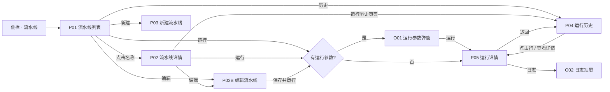
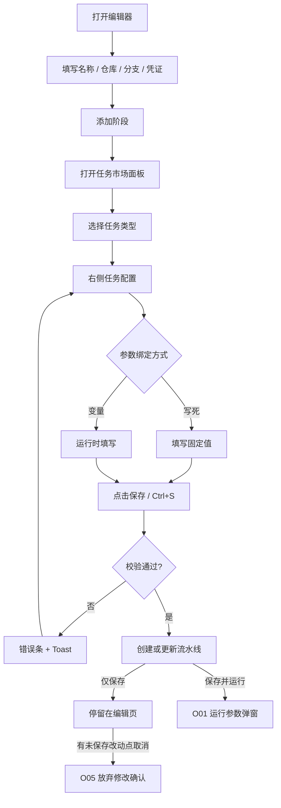
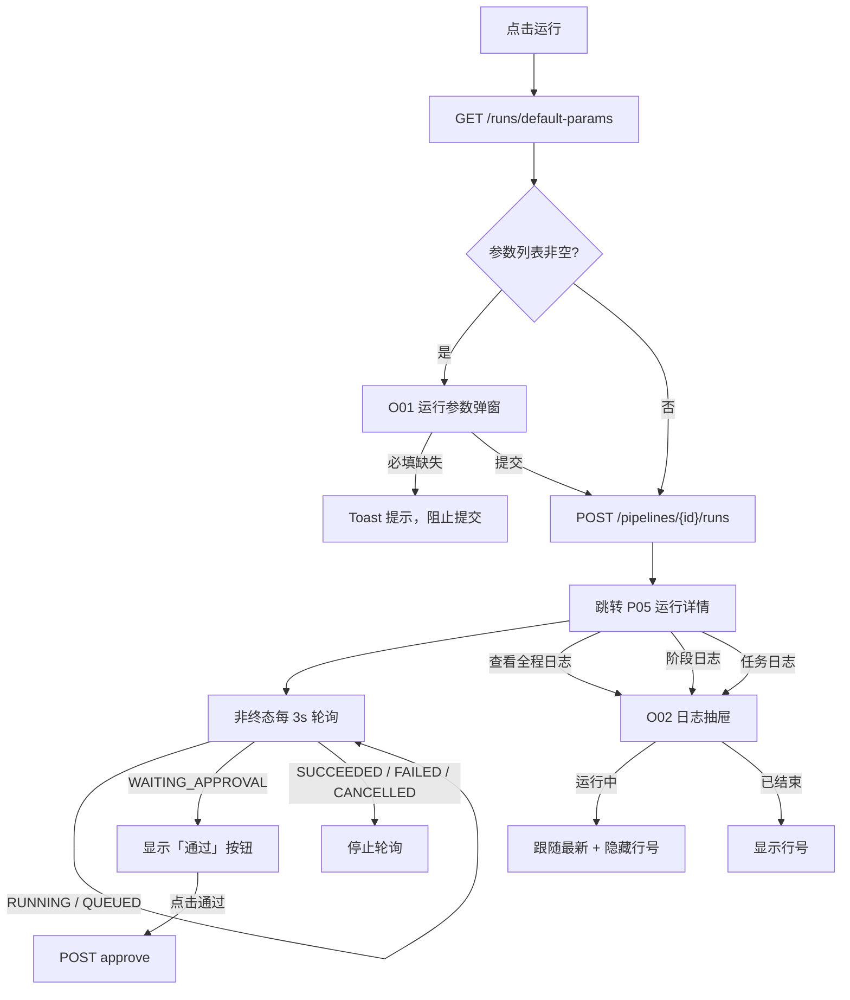
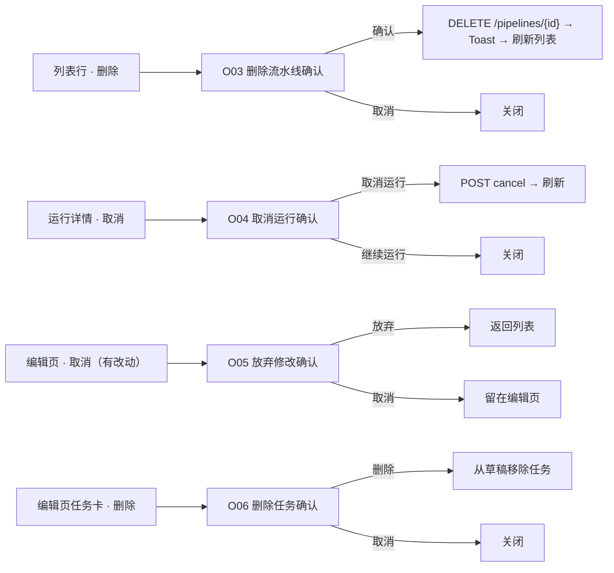
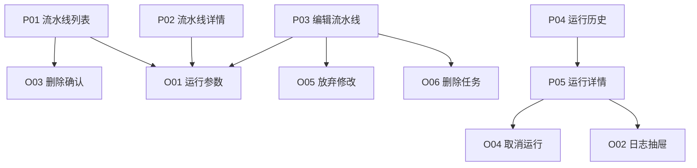

# 流水线管理可点击原型规格（Figma / 原型工具导入版）

> 日期：2026-10-18
> 版本：v0.8

### 变更记录

| 版本 | 日期 | 变更说明 |
|------|------|----------|
| v0.1 | 2026-10-17 | 初版：基于 pipeline 模块代码输出 Frame 结构、组件清单、交互流程、弹窗逻辑、状态与机器可读 JSON 清单 |
| v0.2 | 2026-10-18 | 页面调教第 1 批增量：侧栏“配置”分组、流水线作用域顶栏搜索、整行可点 + `⋯` 菜单、运行详情来源感知返回、触发方式中文、凭证页与校验失败态；同步 `pipeline-management-prototype-spec.json` v0.2 |
| v0.3 | 2026-10-18 | 编辑器重构：名称内联、移除基本信息、克隆检查器配置仓库/分支/凭证、移除缩放、阶段自动命名、最近克隆回显；详情增加 Commit 指标；弹框统一 Kite 风格；同步 JSON v0.3 |
| v0.4 | 2026-10-18 | 编辑页任务名称与类型只读；新建页保持可编辑；同步 JSON v0.4 |
| v0.5 | 2026-10-18 | CLONE 任务隐藏高级设置（技术栈/运行时/工具版本）；同步 JSON v0.5 |
| v0.6 | 2026-10-18 | 移除流水线列表行内“历史”入口；同步 JSON v0.6 |
| v0.7 | 2026-10-18 | 编辑器阶段之间补连接箭头，与实现对齐；同步 JSON v0.7 |
| v0.8 | 2026-10-18 | 新建页任务名称/类型也设为只读；同步 JSON v0.8 |

---

## 0. 如何导入

Figma 没有通用的 Markdown 原型格式，本规格按 Figma 的 **Page / Frame / Auto Layout / Component / Variant / Interaction** 组织，提供三种用法：

1. **AI 原型工具**（Figma Make、v0、UX Pilot、Uizard、Motiff 等）：把第 1～8 节和文末 JSON 一起作为输入，附加下面这段提示词。
2. **手工搭建**：按第 5 节结构树建 Frame，按第 4 节组件清单建 Component Set，按第 7 节交互表连 Prototype。
3. **脚本 / MCP 导入**：解析同目录的 [`pipeline-management-prototype-spec.json`](pipeline-management-prototype-spec.json)。

可直接使用的提示词：

```text
根据这份流水线管理后台原型规格生成可点击原型：
- 1440×900 桌面端，左侧 256px 可折叠侧栏，顶部 56px 全局导航
- 页面：流水线列表、流水线详情、新建/编辑流水线、运行历史、运行详情、右侧日志抽屉
- 严格使用文档中的 Frame 命名、组件清单、字段、状态和交互 ID
- 所有列表、空态、错误态、加载态都要出画板
- 弹窗按“弹窗触发逻辑”一节出独立 Frame，并连好打开/关闭交互
```

Frame 命名约定：

```text
P01_PipelineList_Desktop
P02_PipelineDetail_Desktop
P03_PipelineEditor_New_Desktop
P03B_PipelineEditor_Edit_Desktop
P04_PipelineHistory_Desktop
P05_RunDetail_Desktop
O01_RunParams_Dialog
O02_LogDrawer_Right
O03_ConfirmDeletePipeline
O04_ConfirmCancelRun
O05_ConfirmDiscardChanges
O06_ConfirmDeleteJob
```

---

## 1. 全局设计规格

### 1.1 画布与栅格

| 项 | 值 |
|----|----|
| 主画板 | 1440 × 900 |
| 最小支持宽度 | 1024 |
| 侧栏 | 展开 256px；图标态 48px；移动端 288px |
| 顶栏 | 56px，sticky |
| 内容区内边距 | 16px；≥1024px 时左右 24px |
| 内容区纵向间距 | 16px；≥768px 时 24px |
| 断点 | sm 640 / md 768 / lg 1024 / xl 1280 |

### 1.2 Design Token（对应 Figma Variables）

| Figma Variable | CSS 变量 | Light (OKLCH) | Dark (OKLCH) |
|----------------|----------|---------------|--------------|
| color/background | `--background` | `oklch(1 0 0)` | `oklch(0.141 0.005 285.823)` |
| color/foreground | `--foreground` | `oklch(0.141 0.005 285.823)` | `oklch(0.985 0 0)` |
| color/card | `--card` | `oklch(1 0 0)` | `oklch(0.21 0.006 285.885)` |
| color/primary | `--primary` | `oklch(0.55 0.22 235)` | `oklch(0.65 0.18 235)` |
| color/primary-foreground | `--primary-foreground` | `oklch(0.98 0.01 235)` | `oklch(0.15 0.02 235)` |
| color/muted | `--muted` | `oklch(0.967 0.001 286.375)` | `oklch(0.274 0.006 286.033)` |
| color/muted-foreground | `--muted-foreground` | `oklch(0.552 0.016 285.938)` | `oklch(0.705 0.015 286.067)` |
| color/border | `--border` | `oklch(0.92 0.004 286.32)` | `oklch(1 0 0 / 10%)` |
| color/destructive | `--destructive` | `oklch(0.577 0.245 27.325)` | `oklch(0.704 0.191 22.216)` |
| color/term-bg | `--term-bg` | `oklch(0.18 0.01 235)` | 同左，日志区固定深色 |
| color/term-fg | `--term-fg` | `oklch(0.85 0.005 235)` | 同左 |

状态语义色建议在 Figma 中另建一组：

| 状态语义 | 建议色 | 用于 |
|----------|--------|------|
| success | 绿色 | 成功、运行中（圆点） |
| failed | 红色 | 失败 |
| warning | 黄色/琥珀 | 排队中、待审批、已取消 |
| progress | 蓝色 | 运行中（图标） |
| neutral | 灰色 | 未运行 |

### 1.3 字体

| Figma Text Style | 字体 | 用途 |
|------------------|------|------|
| text/body | 系统 Sans | 正文、标题 |
| text/mono | Maple Mono | 仓库名、分支、运行编号、命令、日志 |
| text/console | Maple Mono + 系统 Sans 回退 | 名称类中英混排 |

字号：页面标题 20/24 semibold；详情标题 24/32 bold；正文 14；辅助 12；日志 12/20 等宽。

### 1.4 圆角与阴影

| Token | 值 |
|-------|----|
| radius/sm | 4px |
| radius/md | 6px |
| radius/lg | 8px（卡片、表格、输入框） |
| radius/xl | 12px |
| shadow/card | `0 1px 2px rgba(0,0,0,.05)` |
| shadow/popover | 系统浮层阴影 |

---

## 2. 应用外壳（Shell）

### 2.1 结构树

```text
AppShell                                  Auto Layout: horizontal, fill
├─ Sidebar                                256 / 48, inset, collapsible=icon
│  ├─ ProductSwitcher                     顶部产品切换器
│  └─ NavGroup "流水线"
│     ├─ 流水线        → /pipeline/pipelines      （当前高亮）
│     ├─ 任务市场      → /pipeline/task-kinds
│     └─ 凭证          → /pipeline/credentials
└─ SidebarInset                           Auto Layout: vertical, fill
   ├─ Header                              56px, sticky, border-bottom
   │  ├─ SidebarTrigger
   │  ├─ Breadcrumb                       「流水线 / …」当前项截断
   │  ├─ GlobalSearch                     256×32，md 以上显示
   │  ├─ TenantSwitcher                   仅多租户时显示
   │  ├─ ThemeToggle                      明暗切换
   │  └─ AvatarMenu                       账号设置 / 退出登录
   └─ Content                             padding 16/24, gap 16/24
```

### 2.2 面包屑规则

| 路径 | 面包屑 |
|------|--------|
| `/pipeline/pipelines` | 流水线 |
| `/pipeline/pipelines/new` | 流水线 / 新建流水线 |
| `/pipeline/pipelines/:id` | 流水线 / 流水线名称 |
| `/pipeline/pipelines/:id/history` | 流水线 / 流水线名称 / 运行历史 |
| `/pipeline/pipelines/:id/edit` | 流水线 / 流水线名称 / 编辑 |
| `/pipeline/pipelines/:id/runs/:runId` | 流水线 / 流水线名称 / 运行 #ID |

### 2.3 侧栏状态

| 状态 | 表现 |
|------|------|
| 展开 | 256px，显示图标 + 文本 |
| 折叠 | 48px，仅图标，hover 显示 tooltip |
| 选中 | `sidebar-primary` 图标 + 强调底色 |
| 移动端 | 抽屉式，288px，带遮罩 |

---

## 3. 页面 / Frame 清单

| Frame | 页面 | 路由 | 数据源 | 入口 | 出口 |
|-------|------|------|--------|------|------|
| `P01_PipelineList_Desktop` | 流水线列表 | `/pipeline/pipelines` | `POST /pipeline/pipelines/page` | 侧栏「流水线」 | 新建、详情、编辑、历史、运行详情 |
| `P02_PipelineDetail_Desktop` | 流水线详情 | `/pipeline/pipelines/:id` | `GET /pipeline/pipelines/{id}` | 列表名称 | 编辑、运行、运行历史 |
| `P03_PipelineEditor_New_Desktop` | 新建流水线 | `/pipeline/pipelines/new` | task-kinds、toolchains、credentials | 列表「新建」 | 保存后进入编辑态 |
| `P03B_PipelineEditor_Edit_Desktop` | 编辑流水线 | `/pipeline/pipelines/:id/edit` | 同上 + `GET /pipelines/{id}` | 列表/详情「编辑」 | 保存、保存并运行、取消 |
| `P04_PipelineHistory_Desktop` | 运行历史 | `/pipeline/pipelines/:id/history` | `GET /pipelines/{id}/runs` | 详情页签、列表「历史」 | 运行详情 |
| `P05_RunDetail_Desktop` | 运行详情 | `/pipeline/pipelines/:id/runs/:runId` | `GET /pipelines/{id}/runs/{runId}` | 历史、运行后跳转 | 返回历史、日志抽屉、审批/取消 |
| `O01_RunParams_Dialog` | 运行参数弹窗 | 叠加 | `GET /runs/default-params` | 任意「运行」入口 | 提交运行 / 关闭 |
| `O02_LogDrawer_Right` | 日志抽屉 | 叠加 | 运行详情内 `jobs[].logText` | 全程/阶段/任务日志 | 关闭 |
| `O03_ConfirmDeletePipeline` | 删除流水线确认 | 叠加 | — | 列表行「删除」 | 删除 / 取消 |
| `O04_ConfirmCancelRun` | 取消运行确认 | 叠加 | — | 运行详情「取消」 | 取消运行 / 继续运行 |
| `O05_ConfirmDiscardChanges` | 放弃修改确认 | 叠加 | — | 编辑页有脏数据时点「取消」 | 放弃 / 返回编辑 |
| `O06_ConfirmDeleteJob` | 删除任务确认 | 叠加 | — | 编辑页任务卡「删除」 | 删除 / 取消 |

---

## 4. 组件清单

### 4.1 布局组件

| 组件 | Figma Component | Variants / 状态 | 关键 Props | 使用页面 |
|------|-----------------|-----------------|------------|----------|
| AppShell | `App/Shell` | light / dark | — | 全部 |
| AppSidebar | `App/Sidebar` | expanded / icon / mobile | activeKey | 全部 |
| Header | `App/Header` | default / withTenant | breadcrumb, search | 全部 |
| PageHeader | `Layout/PageHeader` | default | title, description, actions | P01、任务市场、凭证 |
| DetailShell | `Layout/DetailShell` | withTabs / withoutTabs | title, description, meta, leading, actions, tabs | P02、P04、P05 |
| TabBar | `Layout/TabBar` | selected / default / hover | items, value | P02、P04 |
| MetricCards | `Layout/MetricCards` | 5 列 / 6 列 | items | P02 |
| Card | `Layout/Card` | default | header, body | 概览、画布 |

### 4.2 数据展示组件

| 组件 | Figma Component | Variants / 状态 | 关键 Props | 使用页面 |
|------|-----------------|-----------------|------------|----------|
| DataTable | `Data/Table` | loading / ready / empty / error | columns, rows, toolbar, rowClick | P01、P04 |
| TableRow | `Data/TableRow` | default / hover / selected | cells | P01、P04 |
| Pagination | `Data/Pagination` | 1 页 / 多页 / 首尾页 | page, pageCount, summary | P01、P04 |
| StatusIcon | `Data/Status` | icon / dot；6 种状态 | status, label, showLabel | 全部 |
| StagePreview | `Data/StagePreview` | 0 / 1～8 个阶段 | stages, status | P01 |
| RunSwimlane | `Pipeline/RunSwimlane` | live / terminal | stages, runStatus, selected | P05 |
| DefinitionCanvas | `Pipeline/DefinitionCanvas` | empty / ready | stages | P02 |
| StageCard | `Pipeline/StageCard` | definition / editor / run | name, index, jobs, status | P02、P03、P05 |
| JobCard | `Pipeline/JobCard` | definition / editor / run / selected / dragging | name, kind, status | P02、P03、P05 |
| LogPanel | `Data/LogPanel` | terminal / default；connecting / connected / idle | title, follow | O02 |
| EmptyState | `Feedback/Empty` | table / canvas / history | text | 全部 |
| ErrorText | `Feedback/Error` | inline / banner | text | 全部 |

### 4.3 输入与动作组件

| 组件 | Figma Component | Variants / 状态 | 关键 Props | 使用页面 |
|------|-----------------|-----------------|------------|----------|
| Button | `Action/Button` | default / outline / ghost / destructive；default / sm / icon；hover / focus / disabled / loading | label, icon | 全部 |
| IconButton | `Action/IconButton` | default / hover / disabled | icon, ariaLabel | P03 |
| Input | `Input/Text` | default / focus / invalid / disabled | value, placeholder | P01、P03、O01 |
| Textarea | `Input/Textarea` | default / focus / invalid | rows | P03 |
| Select | `Input/Select` | default / open / disabled | value, options | P03、P04 |
| SegmentedControl | `Input/Segmented` | selected / default | options | P01 |
| AsyncSelect | `Input/AsyncSelect` | idle / loading / empty / selected | fetchPage | P03 |
| SearchInput | `Input/Search` | default / focus | value | P01、P04 |
| Switch? | 不使用 | — | — | — |
| Toast | `Feedback/Toast` | success / error / message | text | 全部 |
| Tooltip | `Feedback/Tooltip` | default | text | 折叠侧栏、图标按钮 |

### 4.4 弹层组件

| 组件 | Figma Component | Variants / 状态 | 使用页面 |
|------|-----------------|-----------------|----------|
| Dialog | `Overlay/Dialog` | default / submitting | O01 |
| AlertDialog | `Overlay/Confirm` | default / destructive | O03、O04、O05、O06 |
| Sheet | `Overlay/SheetRight` | default / terminal | O02 |
| DropdownMenu | `Overlay/Menu` | default | Header 用户菜单、产品切换器 |
| Collapsible | `Input/Collapsible` | open / closed | P03 高级设置、任务组 |

---

## 5. 页面结构树

### 5.1 P01 流水线列表

```text
P01_PipelineList_Desktop                      1440×900
└─ AppShell
   └─ Content                                 vertical, gap 16, padding 16/24
      ├─ PageHeader                            horizontal, space-between
      │  ├─ TitleBlock
      │  │  ├─ H1 "流水线"                     20/24 semibold
      │  │  └─ Caption "共 N 条流水线"          12 muted
      │  └─ Actions
      │     ├─ SearchInput                    256×32, placeholder "搜索流水线、仓库或分支"
      │     └─ Button/Primary "＋ 新建流水线"
      ├─ FilterBar                             horizontal, gap 8
      │  ├─ SegmentedControl [全部|运行中|成功|失败]
      │  └─ Hint "状态筛选仅作用于当前页"
      ├─ DataTable                             fill
      │  ├─ HeaderRow                          40px, bg muted
      │  ├─ Row × N                            56～72px, hover bg muted/50
      │  └─ StateRow                           loading / empty / error
      └─ Pagination                            horizontal, space-between
```

列宽：名称 28%、仓库/分支 24%、阶段预览 16%、最近运行 auto、操作 220px。

### 5.2 P02 流水线详情

```text
P02_PipelineDetail_Desktop                    1440×900
└─ AppShell
   └─ Content
      └─ DetailShell                           vertical, gap 16
         ├─ StickyHeader                       56+，sticky top 56
         │  ├─ Leading [Button/Ghost "← 返回"]
         │  ├─ TitleBlock
         │  │  ├─ H1 "流水线名称"               24/32 bold
         │  │  └─ Meta                         状态图标 + 文案
         │  └─ Actions [Button/Outline "编辑", Button/Primary "运行"]
         ├─ TabBar [详情（选中）| 运行历史]
         ├─ MetricCards ×5                      sm 2 / lg 3 / xl 6 栅格
         │  └─ [仓库 | 分支 | 阶段 | 最近运行 | 凭证]
         └─ Body
            └─ DefinitionCanvas                min-height 320, padding 24
               └─ Flow [开始] → [StageCard ×N] → [结束]
```

### 5.3 P03 / P03B 新建与编辑

```text
P03_PipelineEditor_New_Desktop                1440×900
└─ AppShell
   └─ Content
      └─ EditorSurface                        height = 100svh − 56 − 32, min 640
         ├─ TopBar                             horizontal, 48, border-bottom
         │  ├─ Title "新建流水线" / "编辑流水线"
         │  └─ Actions [取消, 保存, 保存并运行]
         ├─ BasicInfoRow                       grid: auto / 0.9fr / 1.5fr / 0.7fr / 0.8fr
         │  ├─ Label "基本信息"
         │  ├─ Field 名称 *                    Input 32
         │  ├─ Field 仓库 *                    Input 32, mono
         │  ├─ Field 分支                      Input 32, mono, 默认 main
         │  └─ Field 凭证                      AsyncSelect
         ├─ ErrorBanner                        条件渲染，destructive 背景
         └─ Workspace                          grid: 1fr / 352px
            ├─ LanesCanvas
            │  ├─ ZoomToolbar                 [75%|100%|125%|150%]
            │  └─ ScrollArea
            │     ├─ StageCard ×N             240px 宽, 拖拽 + 行内改名 + 左/右移 + 删除
            │     │  ├─ StageHeader
            │     │  ├─ JobCard ×N
            │     │  └─ Button/Dashed "＋ 添加任务"
            │     └─ AddStageCard             144×112, 虚线
            └─ SidePanel                      352px, border-left
               ├─ TaskAddList                 mode=add
               └─ Inspector                   mode=config
```

### 5.4 P04 运行历史

```text
P04_PipelineHistory_Desktop                   1440×900
└─ AppShell
   └─ Content
      └─ DetailShell
         ├─ StickyHeader                     同上，操作：编辑 / 运行
         ├─ TabBar [详情 | 运行历史（选中）]
         ├─ MetricCards ×5
         └─ HistoryBody
            ├─ DataTable
            │  ├─ Toolbar
            │  │  ├─ Select 状态            160×32
            │  │  ├─ Select 时间            160×32
            │  │  ├─ SearchInput           224×32
            │  │  └─ Summary "最近 N 次中 M 条 · 近 7 天成功率 X%"
            │  ├─ HeaderRow
            │  └─ Row ×N
            └─ Pagination
```

### 5.5 P05 运行详情

```text
P05_RunDetail_Desktop                         1440×900
└─ AppShell
   └─ Content
      └─ DetailShell
         ├─ StickyHeader
         │  ├─ Leading [Button/Ghost "返回"]
         │  ├─ TitleBlock
         │  │  ├─ H1 "流水线名 #运行ID"
         │  │  ├─ Description 错误信息 / 分支 · commit
         │  │  └─ Meta 状态徽标
         │  └─ Actions [通过（条件）, 取消（条件）]
         ├─ FieldRow                         4 列：触发 / 触发人 / 开始 / 耗时
         └─ RunSwimlane
            └─ [开始] → [RunStageCard ×N] → [结束]
               └─ RunJobItem ×N
```

### 5.6 O02 日志抽屉

```text
O02_LogDrawer_Right                           叠加层
├─ Scrim                                      rgba(0,0,0,.5)
└─ Sheet/Right                                width min(720, 92vw), full height
   └─ LogPanel                                terminal variant
      ├─ Header                                40px, border-bottom
      │  ├─ Title                             全程日志 / 阶段 · X / 阶段 / 任务
      │  └─ ConnectionIndicator               连接中 / 已连接 / 未连接
      ├─ Body                                  overflow auto, mono 12/20
      └─ FollowButton "跟随最新"               仅用户上滚后出现
```

---

## 6. 交互流程图

### 6.1 全局导航与主任务流



### 6.2 编辑器操作流



### 6.3 运行、审批与日志



### 6.4 弹窗触发关系



---

## 7. 页面规格明细

### 7.1 P01 流水线列表

**字段**

| 列 / 区域 | 字段 | 格式 | 来源 |
|-----------|------|------|------|
| 页头 | 标题 / 总数 | 文本 | — / `total` |
| 搜索 | 关键词 | 输入 | `keyword` |
| 表格① | 流水线名称 | 链接 | `name` |
| 表格① | 任务摘要 | 文本 | `stages[].jobs[].name` |
| 表格② | 仓库短名 | mono | `repoUrl` |
| 表格② | 分支 | mono | `gitRef` |
| 表格③ | 阶段预览 | 最多 8 个标签 | `stages[]` |
| 表格③ | 状态圆点 | 状态色 | `lastRunStatus` |
| 表格④ | 最近运行状态 | 图标 + 文案 | `lastRunStatus` |
| 表格④ | 相对时间 | 文本 | `lastRunTime` |
| 表格⑤ | 操作 | 按钮组 | — |

**状态**

| 状态 | 表现 |
|------|------|
| loading | 4 行骨架屏，表头保留 |
| ready | 正常行 |
| empty | 表体 160px 高，文案「还没有流水线」 |
| filtered-empty | 文案「没有匹配的流水线」 |
| error | 表体红色错误文案「流水线列表加载失败」 |

**交互**

| ID | 元素 | 触发 | 行为 |
|----|------|------|------|
| L01 | 搜索框 | 输入 300ms | 写 URL `?q`，重置页码，重新请求 |
| L02 | 状态分段 | 点击 | 仅过滤当前页 |
| L03 | 新建流水线 | 点击 | → `P03_PipelineEditor_New_Desktop` |
| L04 | 名称 | 点击 | → `P02_PipelineDetail_Desktop` |
| L05 | 最近运行 | 点击 | → `P05_RunDetail_Desktop` |
| L06 | 运行 | 点击 | 进入运行参数流程 |
| L07 | 编辑 | 点击 | → `P03B_PipelineEditor_Edit_Desktop` |
| L08 | 历史 | 点击 | → `P04_PipelineHistory_Desktop` |
| L09 | 删除 | 点击 | 打开 `O03` |
| L10 | 分页 | 点击 | 写 URL `?page` |

### 7.2 P02 流水线详情

**字段**：仓库、分支、阶段、最近运行（状态 + 相对时间）、凭证。

**状态**：loading「加载中…」；ready；error「流水线加载失败」；canvas-empty「这条流水线还没有阶段……」；最近运行无记录显示「未运行」。

**交互**

| ID | 元素 | 触发 | 行为 |
|----|------|------|------|
| D01 | 返回 | 点击 | → P01 |
| D02 | 编辑 | 点击 | → P03B |
| D03 | 运行 | 点击 | 运行参数流程 |
| D04 | 详情页签 | 点击 | URL → `/:id` |
| D05 | 运行历史页签 | 点击 | URL → `/:id/history` |
| D06 | 定义画布 | 只读 | 不响应点击（仅滚动） |

### 7.3 P03 / P03B 新建与编辑

**表单**

| 区域 | 字段 | 必填 | 控件 |
|------|------|------|------|
| 基本信息 | 名称 | 是 | Input |
| 基本信息 | 仓库 | 有 CLONE 时必填 | Input，http/https |
| 基本信息 | 分支 | 否 | Input，默认 main |
| 基本信息 | 凭证 | 否 | AsyncSelect，可清空 |
| 阶段 | 阶段名称 | 是 | 行内 Input |
| 任务 | 任务名称 | 是 | Inspector Input |
| 任务 | 任务类型 | 是 | Select |
| 任务 | 命令 | 按类型 | Textarea |
| 任务 | 参数绑定 | 否 | 每参数一行：模式 Select + 值 Input/Select |
| 高级 | 技术栈 / 运行时 / 工具版本 | 否 | 三级联动 Select |

**状态**

| 状态 | 表现 |
|------|------|
| new | 空草稿，仅「添加阶段」卡片 |
| edit-loading | 「加载中…」 |
| edit-ready | 已加载草稿 |
| dirty | 取消按钮触发确认弹窗 |
| saving | 保存按钮禁用 |
| invalid | 顶部错误条 + 字段红框 |
| add-mode | 右侧显示任务市场 |
| config-mode | 右侧显示任务检查器 |
| selected | 任务卡 primary 边框 + ring |
| dragging | 被拖元素 50% 透明，目标阶段高亮 |
| constraint-toast | 「审批任务必须独占一列，已添加到新阶段」等 |

**交互**

| ID | 元素 | 触发 | 行为 |
|----|------|------|------|
| E01 | 取消（无改动） | 点击 | → P01 |
| E02 | 取消（有改动） | 点击 | 打开 O05 |
| E03 | 保存 | 点击 / Ctrl+S | 校验 → create/update |
| E04 | 保存并运行 | 点击 | 保存 → 运行参数流程 |
| E05 | 添加阶段 | 点击 | 追加空阶段 |
| E06 | 阶段名 | 输入 | 更新草稿 |
| E07 | 左移 / 右移 | 点击 | 阶段排序 |
| E08 | 删除阶段 | 点击 | 直接移除 |
| E09 | 添加任务 | 点击 | 右侧切到 add-mode |
| E10 | 任务类型 | 点击 | 添加到当前/新阶段 |
| E11 | 任务卡 | 点击 | 选中并切到 config-mode |
| E12 | 上移 / 下移 | 点击 | 任务排序 |
| E13 | 删除任务 | 点击 | 打开 O06 |
| E14 | 拖拽阶段/任务 | 拖放 | 重新排序 |
| E15 | 缩放 | 选择 | 75/100/125/150% |
| E16 | 关闭检查器 | 点击 | 取消选中 |
| E17 | 关闭/刷新（有改动） | 浏览器事件 | 原生离开确认 |

### 7.4 P04 运行历史

**字段**

| 列 | 字段 | 来源 |
|----|------|------|
| ① 运行编号 | `#id` + commit 短 SHA 或触发人 | `id`、`commitSha`、`triggeredByName` |
| ② 触发方式 | 手动 / Webhook / 定时 | `trigger` |
| ③ 分支 | 去前缀 | `gitRef` |
| ④ 状态 | 6 种状态 | `status` |
| ⑤ 开始时间 | `YYYY-MM-DD HH:mm:ss` | `startedAt` |
| ⑥ 耗时 | `58s` / `1m 05s` | `startedAt`、`finishedAt` |
| ⑦ 操作 | 查看详情 | — |

**筛选**：状态（7 项）、时间（24h / 7d 默认 / 30d / all）、关键词（运行编号、分支）。

**状态**：loading；ready；no-runs「还没有运行。点击「运行」后会打开这次运行的详情。」；filtered-empty「没有符合筛选的运行」；error「运行记录加载失败」；polling（4s，存在非终态）。

**交互**

| ID | 元素 | 触发 | 行为 |
|----|------|------|------|
| H01 | 状态下拉 | 选择 | 写 URL `?status` |
| H02 | 时间下拉 | 选择 | 写 URL `?range` |
| H03 | 搜索框 | 输入 300ms | 写 URL `?q` |
| H04 | 行 | 点击 | → P05 |
| H05 | 查看详情 | 点击 | → P05 |
| H06 | 分页 | 点击 | 本地分页，写 URL `?page` |
| H07 | 页面 | 定时 | 非终态每 4s 刷新 |

### 7.5 P05 运行详情

**字段**：标题、副标题、状态、触发、触发人、开始、耗时。

**状态**：loading；live（3s 轮询 + 1s 计时）；waiting-approval（显示「通过」）；terminal（停止轮询）；error「运行详情加载失败」。

**交互**

| ID | 元素 | 触发 | 行为 |
|----|------|------|------|
| R01 | 返回 | 点击 | → P04 |
| R02 | 通过 | 点击 | approve → 刷新 |
| R03 | 取消 | 点击 | 打开 O04 |
| R04 | 查看全程日志 | 点击 | 打开 O02（overall） |
| R05 | 阶段「日志」 | 点击 | 打开 O02（stage） |
| R06 | 任务「日志」 | 点击 | 打开 O02（job） |
| R07 | 页面 | 定时 | 非终态每 3s 刷新 |

### 7.6 O02 日志抽屉

**内容**

| 焦点 | 标题 | 内容 |
|------|------|------|
| 全程 | 全程日志 | 全部任务日志按阶段拼接 |
| 阶段 | 阶段 · 名称 | 该阶段任务日志 |
| 任务 | 阶段名 / 任务名 | 单任务日志 |

**状态**：connecting「连接中」；connected「已连接」；idle「未连接」；empty「这条任务还没有日志」；loading「加载中…」；follow（自动贴底）；paused（上滚后出现「跟随最新」）。

**交互**

| ID | 元素 | 触发 | 行为 |
|----|------|------|------|
| G01 | 日志入口 | 点击 | 打开抽屉并设置焦点 |
| G02 | 关闭 X / 遮罩 / Esc | 点击 / 按键 | 关闭，焦点清空 |
| G03 | 正文 | 上滚 | 暂停跟随，显示「跟随最新」 |
| G04 | 跟随最新 | 点击 | 恢复贴底 |
| G05 | 焦点失效 | 数据刷新 | 自动关闭 |

---

## 8. 弹窗触发逻辑

| 弹窗 | 触发元素 | 前置条件 | 内容 | 确认动作 | 取消动作 | 关闭方式 |
|------|----------|----------|------|----------|----------|----------|
| O01 运行参数 | 列表「运行」、详情「运行」、编辑「保存并运行」 | `default-params` 返回非空 | 标题「运行参数」；动态字段；必填星号；底部「取消 / 运行」 | 校验必填 → `POST /runs` → 跳转 P05 | 关闭弹窗，不创建运行 | X / 遮罩 / Esc |
| O03 删除流水线 | 列表行「删除」 | — | 标题「删除流水线「名称」？」；说明「删除后无法恢复，运行历史会一并移除。」 | `DELETE` → Toast「已删除」→ 刷新列表 | 关闭 | X / 遮罩 / Esc |
| O04 取消运行 | 运行详情「取消」 | 运行非终态 | 标题「取消运行 #ID？」；说明「正在执行的任务会被中止。」；按钮「继续运行 / 取消运行」 | `POST cancel` → Toast「已取消运行」→ 刷新 | 关闭 | X / 遮罩 / Esc |
| O05 放弃修改 | 编辑页「取消」 | 草稿与快照不一致 | 标题「放弃未保存的修改？」；说明「未保存的改动会丢失。」；按钮「取消 / 放弃」 | 返回列表 | 留在编辑页 | X / 遮罩 / Esc |
| O06 删除任务 | 任务卡「删除」 | — | 标题「删除任务「名称」？」；按钮「取消 / 删除」 | 从草稿移除 | 关闭 | X / 遮罩 / Esc |
| O02 日志抽屉 | 全程/阶段/任务「日志」 | 运行详情已加载 | 右侧抽屉，终端内容 | — | — | X / 遮罩 / Esc |

**弹窗与页面的层级关系**



---

## 9. 状态字典

### 9.1 运行状态

| 值 | 文案 | 图标语义 | 圆点语义 | 可执行动作 |
|----|------|----------|----------|------------|
| 空 | 未运行 | neutral | neutral | 运行 |
| `QUEUED` | 排队中 | progress | success | 取消 |
| `RUNNING` | 运行中 | progress + spin | success | 取消 |
| `WAITING_APPROVAL` | 待审批 | warning | warning | 通过 / 取消 |
| `SUCCEEDED` | 成功 | success | success | — |
| `FAILED` | 失败 | failed | failed | — |
| `CANCELLED` | 已取消 | terminating | warning | — |

### 9.2 触发方式

| 值 | 文案 |
|----|------|
| `MANUAL` | 手动 |
| `WEBHOOK` | Webhook |
| `SCHEDULE` / `SCHEDULED` / `CRON` / `TIMER` | 定时 |

### 9.3 任务类型分组

| 分组 | 任务类型 |
|------|----------|
| 代码 | `CLONE` |
| 构建 | `BUILD`、`IMAGE` |
| 质量控制 | `LINT_SEMGREP`、`LINT_SONAR`、`FORMAT`、`DEPENDENCY_ANALYSIS`、`SCAN`、`DEPENDENCY_TRACK` |
| 制品 | `PACKAGE`、`PUBLISH`、`UPLOAD` |
| 部署 | `DEPLOY`、`KUBECTL` |
| 测试 | `TEST` |
| 命令 | `CUSTOM` |
| 流程 | `APPROVAL`、`NOTIFY` |

---

## 10. 接口与数据映射

| 界面动作 | 接口 | 关键返回 |
|----------|------|----------|
| 列表分页 / 搜索 | `POST /pipeline/pipelines/page` | `IPage<PipelineVO>` |
| 详情 | `GET /pipeline/pipelines/{id}` | `PipelineVO` |
| 新建 | `POST /pipeline/pipelines` | `Long` |
| 更新 | `PUT /pipeline/pipelines/{id}` | `Long` |
| 删除 | `DELETE /pipeline/pipelines/{id}` | `null` |
| 触发运行 | `POST /pipeline/pipelines/{id}/runs` | `PipelineRunVO` |
| 默认运行参数 | `GET /pipeline/pipelines/{id}/runs/default-params` | `RunParamDefinitionVO[]` |
| 运行历史 | `GET /pipeline/pipelines/{id}/runs` | `IPage<PipelineRunVO>` |
| 运行详情 | `GET /pipeline/pipelines/{id}/runs/{runId}` | `PipelineRunVO` |
| 取消 | `POST /pipeline/pipelines/{id}/runs/{runId}/cancel` | `PipelineRunVO` |
| 审批 | `POST /pipeline/pipelines/{id}/runs/{runId}/approve` | `PipelineRunVO` |
| 任务类型 | `GET /pipeline/task-kinds` | `TaskKindVO[]` |
| 工具链 | `GET /pipeline/toolchains` | `ToolchainOption[]` |
| 凭证分页 | `POST /pipeline/credentials/page` | `IPage<CredentialVO>` |

---

## 11. 机器可读清单

同目录 [`pipeline-management-prototype-spec.json`](pipeline-management-prototype-spec.json) 提供结构化版本，字段：

```text
meta            画板尺寸、版本、来源
tokens          Figma Variables 映射
shell           应用外壳与导航
pages[]         id / frame / route / regions / fields / states / actions
overlays[]      弹窗 id / trigger / condition / content / actions
components[]    组件名 / variants / props
navigation[]    页面跳转边
statusDictionary 状态枚举
```

可直接交给脚本或 MCP 服务按 `pages[].regions` 生成 Frame 层级，按 `actions[]` 连 Prototype。
