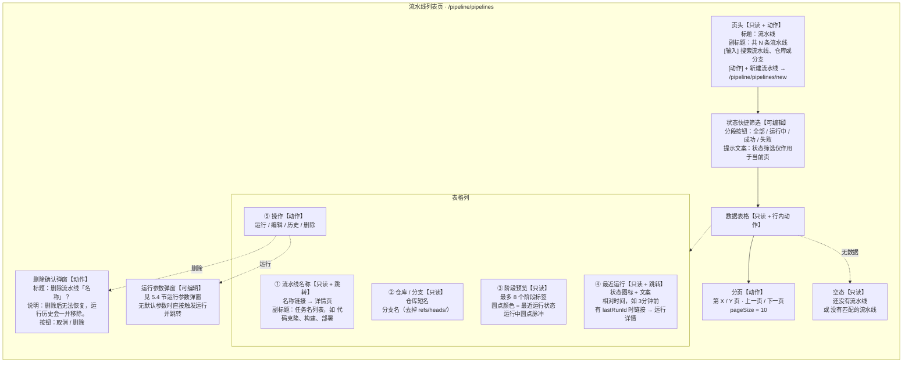
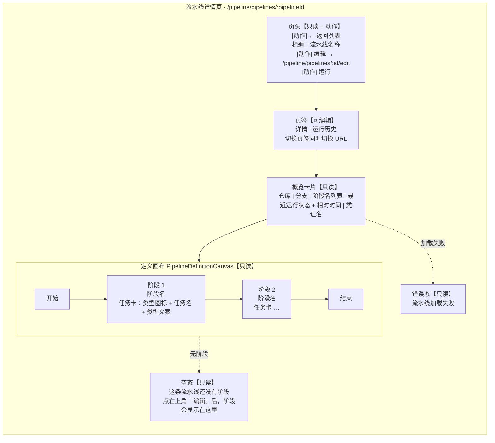
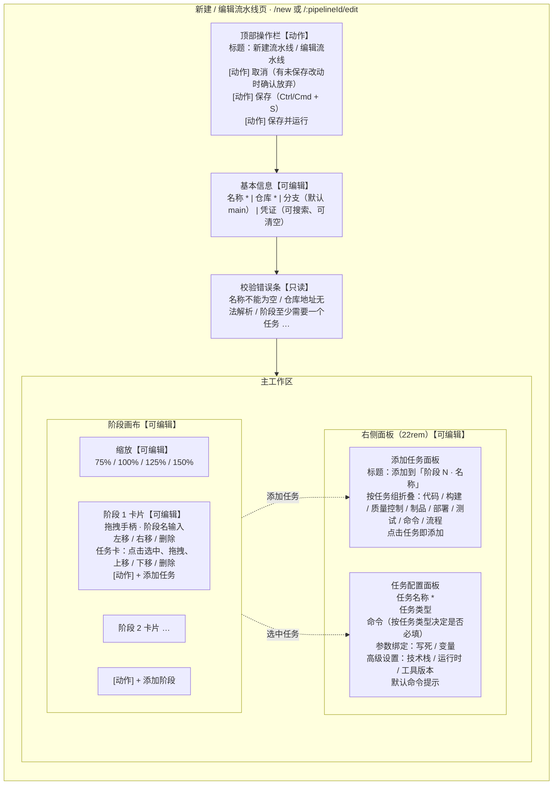
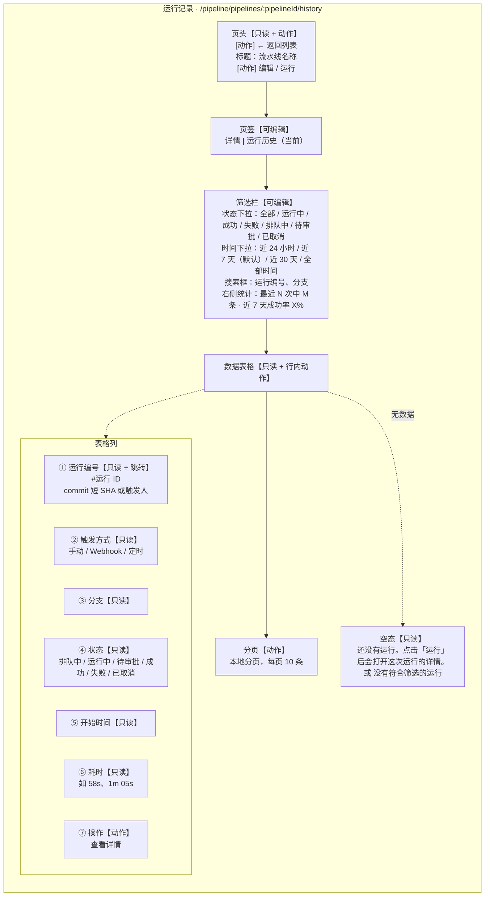
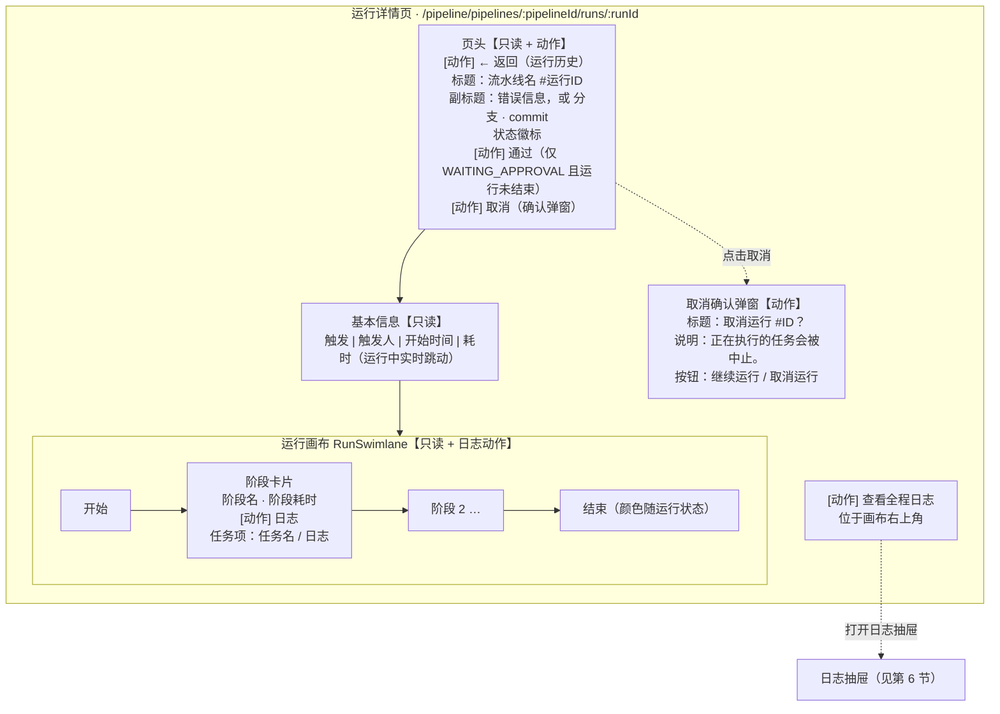
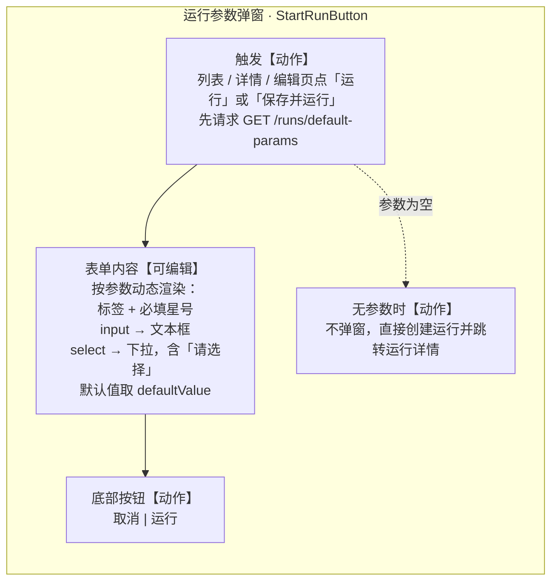
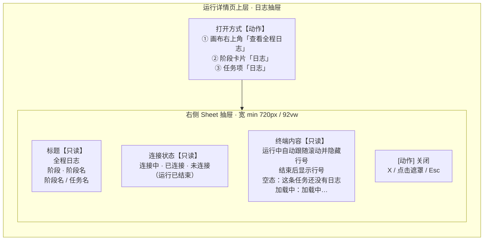
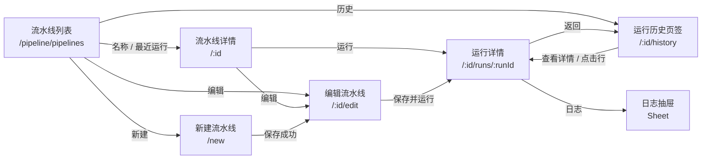

# 流水线管理前端页面原型

> 日期：2026-10-17
> 版本：v0.1

### 变更记录

| 版本 | 日期 | 变更说明 |
|------|------|----------|
| v0.1 | 2026-10-17 | 初版：基于 pipeline-core 后端、frontend/src/modules/pipeline、pipeline schema 与 Tekton 配置还原 6 个管理后台界面原型 |

---

## 0. 原型说明

### 0.1 依据

- 后端接口与 VO：`backend/pipeline-core/`、`docs/pipeline/pipeline-core-api.md`
- 前端页面与组件：`frontend/src/modules/pipeline/`、`frontend/src/router.tsx`
- 库表：`deploy/charts/backend/files/db/05-pipeline-schema.sql`、`10-add-runtime-params.sql`、`11-add-task-kind-resource-limits.sql`、`12-add-pipeline-job-param-bindings.sql`、`15-task-kind-version-visibility.sql`
- 执行侧配置：`deploy/tekton/`（Tekton Pipeline / Task 由后端生成，界面上只暴露任务定义，不直接编辑 YAML）

### 0.2 图例

| 标记 | 含义 |
|------|------|
| 【只读】 | 仅展示，用户不能修改 |
| 【可编辑】 | 用户可输入、选择、拖拽 |
| 【动作】 | 点击后触发接口调用、跳转或弹层 |
| 虚线 | 非主流程的条件分支或弹层触发关系 |

> 说明：以下全部是 `flowchart` 布局原型，模拟管理后台的界面区域，不是 CI/CD 执行时序图。

### 0.3 页面清单与实际路由

| 需求页面 | 实际实现 | 路由 | 主要代码 |
|----------|----------|------|----------|
| 流水线列表页 | `PipelineListPage` | `/pipeline/pipelines` | `frontend/src/modules/pipeline/pages/PipelineListPage.tsx` |
| 流水线详情页 | `PipelineDetailPage` 的「详情」页签 | `/pipeline/pipelines/:pipelineId` | `PipelineDetailPage.tsx`、`PipelineDefinitionCanvas.tsx` |
| 新建 / 编辑流水线页 | `PipelineEditorPage` | `/pipeline/pipelines/new`、`/pipeline/pipelines/:pipelineId/edit` | `PipelineEditorPage.tsx` |
| 流水线运行记录页 | `PipelineDetailPage` 的「运行历史」页签 | `/pipeline/pipelines/:pipelineId/history` | `PipelineDetailPage.tsx`、`runHistory.ts` |
| 运行详情页 | `PipelineRunDetailPage` | `/pipeline/pipelines/:pipelineId/runs/:runId` | `PipelineRunDetailPage.tsx`、`RunSwimlane.tsx` |
| 流水线日志弹窗 | 右侧 `Sheet` 抽屉 + `LogPanel` | 叠加在运行详情页上 | `PipelineRunDetailPage.tsx`、`components/console/LogPanel.tsx` |

> 注意：运行记录不是独立顶级页面，日志也不是居中 Modal，而是详情页页签和右侧抽屉。原型按现有实现还原，避免文档与代码脱节。

### 0.4 运行状态枚举

| 值 | 界面文案 | 说明 |
|----|----------|------|
| 空 | 未运行 | 流水线还没有任何运行记录 |
| `QUEUED` | 排队中 | 等待调度 |
| `RUNNING` | 运行中 | 执行中，界面轮询刷新 |
| `WAITING_APPROVAL` | 待审批 | 命中人工卡点，运行详情页出现「通过」按钮 |
| `SUCCEEDED` | 成功 | 终态 |
| `FAILED` | 失败 | 终态 |
| `CANCELLED` | 已取消 | 终态 |

### 0.5 触发方式枚举

| 值 | 界面文案 | 现状 |
|----|----------|------|
| `MANUAL` | 手动 | 当前后端唯一实际写入值 |
| `WEBHOOK` | Webhook | 前端已支持展示，后端暂未写入 |
| `SCHEDULE` / `SCHEDULED` / `CRON` / `TIMER` | 定时 | 前端已支持展示，后端暂未写入 |

---

## 1. 流水线列表页

### 1.1 布局原型

### 1.2 数据与控件

| 区域 | 字段 / 控件 | 来源 | 说明 |
|------|-------------|------|------|
| 页头 | 标题、总数 | `total` | 只读 |
| 页头 | 搜索框 | `keyword` | 300ms 防抖后写入 URL `?q`，服务端过滤，重置页码 |
| 页头 | 新建流水线 | — | 跳转 `/pipeline/pipelines/new` |
| 筛选 | 全部 / 运行中 / 成功 / 失败 | `lastRunStatus` | 仅过滤当前页数据，不调后端 |
| 表格 | 流水线名称 | `name` | 链接到详情 |
| 表格 | 任务摘要 | `stages[].jobs[].name` | 无任务时显示「尚未配置阶段」 |
| 表格 | 仓库 / 分支 | `repoUrl`、`gitRef` | 仓库取短名 |
| 表格 | 阶段预览 | `stages[]`、`lastRunStatus` | 最多 8 个；无阶段但有运行状态时只显示一个状态点 |
| 表格 | 最近运行 | `lastRunStatus`、`lastRunTime`、`lastRunId` | 状态图标 + 相对时间 |
| 表格 | 操作 | — | 运行、编辑、历史、删除 |
| 分页 | 页码、上一页 / 下一页 | `total`、`pages` | 默认每页 10 条 |
| 弹窗 | 删除确认 | — | 危险操作，需二次确认 |

### 1.3 页面功能与核心交互

页面用于浏览全部流水线、快速发起运行和进入编辑/历史。搜索走后端分页接口，状态筛选只作用于当前页（界面已明确提示），所以翻页后筛选结果会变化。点击「运行」会先请求 `GET /pipeline/pipelines/{id}/runs/default-params`：有运行时参数就先弹出参数表单，没有则直接创建运行并跳转到运行详情。删除为不可恢复操作，必须经过确认弹窗。

---

## 2. 流水线详情页

### 2.1 布局原型

### 2.2 数据与控件

| 区域 | 字段 / 控件 | 来源 | 说明 |
|------|-------------|------|------|
| 页头 | 返回 / 编辑 / 运行 | — | 运行按钮复用运行参数弹窗 |
| 页签 | 详情、运行历史 | URL | `history` 路由对应运行历史 |
| 概览 | 仓库 | `repoUrl` | 短名显示 |
| 概览 | 分支 | `gitRef` | 去前缀 |
| 概览 | 阶段 | `stages[].name` | 按 `sortOrder` 排序后用 `·` 连接 |
| 概览 | 最近运行 | `lastRunStatus`、`lastRunTime` | 无运行显示「未运行」 |
| 概览 | 凭证 | `credentialId` | 从凭证列表解析名称；未配置显示「未配置」 |
| 画布 | 阶段、任务 | `stages[]`、`stages[].jobs[]` | 只读，按 `sortOrder` 排列 |

### 2.3 页面功能与核心交互

详情页是流水线定义的只读视图：顶部展示仓库、分支、阶段和最近运行，正文用横向泳道画布展示「开始 → 阶段 → 任务 → 结束」。所有修改都必须点「编辑」进入编排页，详情页不提供行内编辑。运行历史页签与详情页签共用一个页面壳，切换时只改 URL，不重新挂载整个页面。

---

## 3. 新建 / 编辑流水线页

### 3.1 布局原型

### 3.2 表单输入项

| 区域 | 输入项 | 必填 | 说明 |
|------|--------|------|------|
| 基本信息 | 名称 | 是 | 提交前 trim |
| 基本信息 | 仓库 | 有 CLONE 任务时必填 | 仅支持 `http` / `https`，需有主机和路径 |
| 基本信息 | 分支 | 否 | 默认 `main`；保存时会同步到 CLONE 的 `GIT_REF` 固定绑定 |
| 基本信息 | 凭证 | 否 | 异步搜索凭证，可清空为「不使用凭证」 |
| 阶段卡片 | 阶段名称 | 是 | 行内输入 |
| 任务卡 | 任务名称 | 是 | 右侧检查器编辑 |
| 任务配置 | 任务类型 | 是 | 受约束过滤，见 3.4 |
| 任务配置 | 命令 | 按类型 | `CLONE`、`APPROVAL` 等不需要命令；其余需要 |
| 任务配置 | 参数绑定 | 否 | 每个可见参数一行：`写死` 或 `变量`（运行时填写） |
| 任务配置 | 技术栈 / 运行时 / 工具版本 | 否 | 级联选择，来自 `/pipeline/toolchains` |
| 添加任务 | 任务组、任务 | — | 数据来自 `/pipeline/task-kinds`，禁用任务不显示 |

### 3.3 交互与校验

- **保存**：校验通过后调用 `POST /pipeline/pipelines` 或 `PUT /pipeline/pipelines/{id}`；新建成功后跳到编辑路由。
- **保存并运行**：先保存，再走运行参数弹窗 / 直接运行。
- **脏检查**：草稿 JSON 与保存快照不一致时，取消会弹「放弃未保存的修改？」；关闭或刷新页面触发浏览器离开确认。
- **快捷键**：`Ctrl/Cmd + S` 保存。
- **拖拽**：阶段和任务都支持拖拽排序，也保留左移/右移、上移/下移按钮。
- **任务选择**：点击任务卡在右侧打开检查器；点击「添加任务」把右侧切到任务市场列表。

### 3.4 编排约束

| 约束 | 触发时机 | 表现 |
|------|----------|------|
| 流水线至多一个 CLONE 任务 | 添加 / 修改类型 / 保存 | 报错并阻止 |
| 审批任务必须独占一个阶段 | 添加 / 修改类型 / 保存 | 报错；从阶段添加时提示并自动放到新阶段 |
| 同一阶段不能并行多个 IMAGE 任务 | 添加 / 修改类型 / 保存 | 报错并阻止 |
| 阶段至少一个任务 | 保存 | 报错 |
| 阶段名称、任务名称不能为空 | 保存 | 报错 |
| 必填参数不能为空 | 保存 | 报错；绑定方式为「变量」时跳过 |

### 3.5 任务类型

添加面板按任务组展示，任务类型由后端 `pipeline_task_kind` 动态提供；前端 `jobCatalog.ts` 提供兜底名称和默认命令。

| 任务组 | 任务类型 |
|--------|----------|
| 代码 | `CLONE` 代码克隆 |
| 构建 | `BUILD` 构建、`IMAGE` 镜像构建 |
| 质量控制 | `LINT_SEMGREP`、`LINT_SONAR`、`FORMAT`、`DEPENDENCY_ANALYSIS`、`SCAN`、`DEPENDENCY_TRACK` |
| 制品 | `PACKAGE`、`PUBLISH`、`UPLOAD` |
| 部署 | `DEPLOY` 部署、`KUBECTL` K8s 命令 |
| 测试 | `TEST` |
| 命令 | `CUSTOM` |
| 流程 | `APPROVAL` 人工卡点、`NOTIFY` 通知 |

### 3.6 页面功能与核心交互

这是流水线的编排器，不是传统表单：上面一行是基础信息，左侧是可拖拽的阶段/任务画布，右侧是任务市场或任务检查器。所有编辑先落在前端草稿里，只有点保存才写后端；运行前同样要先通过校验并保存。人工卡点、镜像构建、克隆任务的约束在前端即时拦截，后端保存时也会做一致性校验。

---

## 4. 流水线运行记录页（运行历史页签）

### 4.1 布局原型

### 4.2 筛选条件

| 筛选项 | 可选值 | 说明 |
|--------|--------|------|
| 状态 | 全部、运行中、成功、失败、排队中、待审批、已取消 | 客户端过滤 |
| 时间 | 近 24 小时、近 7 天（默认）、近 30 天、全部时间 | 按 `startedAt` 过滤 |
| 关键词 | 运行编号、分支 | 300ms 防抖，匹配 `id`、`gitRef` |

### 4.3 数据与交互

- 数据来源：`GET /pipeline/pipelines/{id}/runs?pageNo=1&pageSize=200`，一次最多拉 200 条历史。
- 有非终态运行时每 4 秒轮询；全部结束后停止。
- 状态、时间、关键词都写入 URL 查询参数，刷新后保持筛选条件。
- 页面内分页是本地分页，不是服务端分页。
- 成功率只统计时间窗口内 `SUCCEEDED` / `FAILED` / `CANCELLED` 的运行，没有已结束运行时显示 `—`。
- 点击行或「查看详情」进入运行详情页。

### 4.4 页面功能

运行历史用来回看某条流水线的执行结果、定位失败运行并进入日志。它复用详情页的页头和页签，是一个页面级页签而不是独立路由；筛选和分页都在前端完成，因为一次已经拉取了最近 200 条记录。

---

## 5. 运行详情页

### 5.1 布局原型

### 5.2 数据与控件

| 区域 | 字段 / 控件 | 来源 | 说明 |
|------|-------------|------|------|
| 页头 | 标题 | `pipelineName`、`id` | 只读 |
| 页头 | 副标题 | `errorMessage` 或 `gitRef` + `commitSha` | 失败原因优先 |
| 页头 | 状态 | `status` | 状态徽标 |
| 页头 | 通过 | — | 仅 `WAITING_APPROVAL` 显示，调用 approve 接口 |
| 页头 | 取消 | — | 非终态显示，二次确认后调用 cancel 接口 |
| 信息 | 触发 / 触发人 / 开始 / 耗时 | `trigger`、`triggeredByName`、`startedAt`、`finishedAt` | 耗时运行中按当前时间计算 |
| 画布 | 阶段状态 | 阶段内任务聚合 | 边框颜色反映状态 |
| 画布 | 阶段耗时 | `startedAt` / `finishedAt` | 最早开始到最晚结束 |
| 画布 | 任务状态 | `jobs[].status` | 任务项展示 |
| 画布 | 日志入口 | — | 全程 / 阶段 / 任务三种粒度 |

### 5.3 核心交互

- 运行未结束时每 3 秒轮询一次；进入终态后停止。
- 点「查看全程日志」看全部任务日志；点阶段卡片的「日志」看该阶段聚合日志；点任务项看单任务日志。
- 三种入口都会在右侧打开同一个日志抽屉，标题随焦点变化。
- 运行中「耗时」每秒刷新；结束后固定为 `finishedAt - startedAt`。
- 审批和取消成功后同时刷新运行详情、运行历史列表和流水线列表。

### 5.4 运行参数弹窗（StartRunButton）

列表页、详情页、编辑页的「运行 / 保存并运行」共用同一个弹窗组件。

| 字段 | 类型 | 说明 |
|------|------|------|
| `paramKey` | string | 参数键，提交时作为 `params` 的 key |
| `paramLabel` | string | 展示标签 |
| `paramType` | `input` / `select` / `api_select` | `select` 且有 options 时渲染下拉，其余渲染文本框 |
| `defaultValue` | string | 初始值 |
| `required` | boolean | 必填校验，空值阻止提交 |
| `options` | string[] | 下拉选项 |
| `placeholder` | string | 输入提示 |

提交调用 `POST /pipeline/pipelines/{id}/runs`，请求体为 `{ "params": { "KEY": "VALUE" } }`；成功后跳转运行详情。

---

## 6. 流水线日志弹窗（右侧抽屉）

### 6.1 布局原型

### 6.2 内容说明

| 焦点 | 标题 | 内容来源 |
|------|------|----------|
| 全程 | 全程日志 | 按阶段顺序拼接全部任务 `logText` |
| 阶段 | 阶段 · 阶段名 | 该阶段下全部任务日志 |
| 任务 | 阶段名 / 任务名 | 单任务 `logText` |

- 抽屉使用终端配色（`--term-bg` / `--term-fg`），等宽字体、自动换行。
- 运行中隐藏行号（内容在变，行号会跳），结束后显示行号。
- 运行中自动跟随最新日志；用户上滚后仍可查看历史内容。
- 焦点对应的任务/阶段被删除或不存在时自动关闭抽屉。

### 6.3 页面功能

日志抽屉承担「看执行现场」的职责，不单独占一个路由。它以任务为最小粒度，同时支持阶段聚合和全程聚合，方便从失败任务一路向上排查；抽屉状态完全由运行详情页的焦点状态驱动，不额外发请求。

---

## 7. 页面跳转关系

---

## 8. 与需求的对应关系与差异

| 需求项 | 还原结果 |
|--------|----------|
| 流水线列表页 | 已还原，含搜索、当前页状态筛选、阶段预览、行内运行/编辑/历史/删除 |
| 流水线详情页 | 已还原，定义为只读画布，运行历史为页签 |
| 新建/编辑流水线表单页 | 实际是画布式编排器：基础信息 + 阶段/任务拖拽 + 右侧检查器，不是传统纵向表单 |
| 流水线运行记录页 | 实际是详情页的「运行历史」页签（`/history`），不是独立顶级路由 |
| 流水线日志弹窗 | 实际是运行详情页上的右侧 Sheet 抽屉，支持全程/阶段/任务三种焦点 |
| 状态枚举 | 列表筛选只暴露 4 种；运行历史和运行详情展示完整 6 种状态 |
| 触发方式 | 前端支持手动 / Webhook / 定时三种展示，后端当前只写入 `MANUAL` |

---

## 9. 接口对照

| 界面动作 | 接口 |
|----------|------|
| 列表分页 / 搜索 | `POST /pipeline/pipelines/page` |
| 详情 | `GET /pipeline/pipelines/{id}` |
| 新建 | `POST /pipeline/pipelines` |
| 更新 | `PUT /pipeline/pipelines/{id}` |
| 删除 | `DELETE /pipeline/pipelines/{id}` |
| 触发运行 | `POST /pipeline/pipelines/{id}/runs` |
| 运行前默认参数 | `GET /pipeline/pipelines/{id}/runs/default-params` |
| 运行历史 | `GET /pipeline/pipelines/{id}/runs?pageNo=1&pageSize=200` |
| 运行详情 | `GET /pipeline/pipelines/{id}/runs/{runId}` |
| 取消运行 | `POST /pipeline/pipelines/{id}/runs/{runId}/cancel` |
| 审批通过 | `POST /pipeline/pipelines/{id}/runs/{runId}/approve` |
| 任务类型 / 任务组 | `GET /pipeline/task-kinds` |
| 工具链级联 | `GET /pipeline/toolchains` |
| 凭证选择 | `POST /pipeline/credentials/page` |
