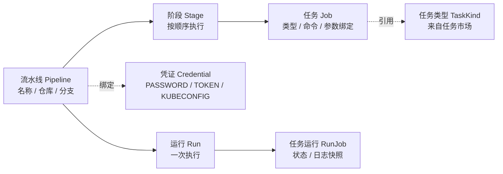
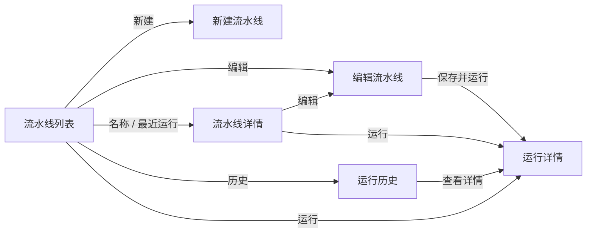

# 流水线用户操作手册

> 日期：2026-10-18
> 版本：v0.1
> 状态：基于当前实现整理（页面文案与接口行为以代码为准，未附真实环境截图）
> 适用读者：研发工程师、SRE、平台管理员
> 数据来源：`frontend/src/modules/pipeline/`、`backend/pipeline-core/`、`backend/server/src/main/resources/db/pipeline-schema.sql`、`docs/pipeline/`、`docs/product/02-features/modules/pipeline.md`

### 变更记录

| 版本 | 日期 | 变更说明 |
|------|------|----------|
| v0.1 | 2026-10-18 | 初版：按真实页面与接口梳理流水线的概念、快速开始、列表、编排、运行、日志、审批、历史、凭证、任务市场、权限与排错 |

---

## 1. 手册说明

### 1.1 本手册覆盖什么

本手册面向平台最终用户，说明如何在 HFWAS DevOps 中完成流水线相关操作：

- 浏览、搜索、删除流水线；
- 新建和编辑流水线（阶段、任务、参数、工具链）；
- 触发运行、填写运行时参数；
- 查看运行详情、日志、审批和取消；
- 查看运行历史；
- 管理 Git / 镜像仓库 / kubeconfig 凭证；
- 浏览任务市场，以及管理员维护任务类型、参数和版本。

### 1.2 使用前提

| 前提 | 说明 |
|------|------|
| 平台账号 | 账号由 Keycloak 统一登录；未登录访问流水线页面会自动跳转登录 |
| 租户 | 流水线、凭证按租户隔离。列表为空时先确认顶部当前租户是否正确 |
| 执行集群 | 由平台管理员在后端配置 `PIPELINE_KUBECONFIG` 与 `PIPELINE_NAMESPACE`。**页面上不能选择执行集群** |
| 浏览器 | 推荐使用最新版 Chrome / Edge；画布拖拽与快捷键在主流桌面浏览器可用 |
| 权限 | 流水线的新建、编辑、运行、删除对已登录用户开放；任务市场的编辑/启停/版本操作仅界面上的 `admin` 角色可用 |

### 1.3 与其它文档的关系

| 想了解 | 看哪里 |
|--------|--------|
| 功能规则、异常与已知问题 | [docs/product/02-features/modules/pipeline.md](../product/02-features/modules/pipeline.md) |
| 接口字段与错误码 | [docs/pipeline/pipeline-core-api.md](pipeline-core-api.md) |
| 页面原型与状态矩阵 | [docs/pipeline/pipeline-management-ui-prototype.md](pipeline-management-ui-prototype.md)、[prototype/README.md](prototype/README.md) |
| 测试用例 | [docs/product/05-testing/cases/pipeline.md](../product/05-testing/cases/pipeline.md) |

---

## 2. 核心概念

### 2.1 对象关系



### 2.2 概念对照

| 概念 | 说明 |
|------|------|
| 流水线 | 用户定义的 CI 流程，包含名称、Git 仓库、分支、凭证和若干阶段 |
| 阶段 | 流水线的执行步骤，按页面从左到右的顺序执行；同一阶段内的任务并行执行 |
| 任务 | 阶段内的一次具体动作，如代码克隆、构建、镜像构建、人工审批 |
| 任务类型 | 任务的种类模板，由任务市场统一维护默认镜像、默认命令、参数和资源限制 |
| 运行 | 点击「运行」后产生的一次执行记录，拥有独立的运行编号和状态 |
| 任务运行 | 运行中每个任务的状态与日志快照；后续修改流水线不会改写历史运行 |
| 运行时参数 | 任务类型定义、流水线绑定的参数；绑定为「变量」时在每次运行前填写 |
| 凭证 | 访问私有 Git 仓库或 Kubernetes 集群使用的凭据，加密存储 |

### 2.3 状态速查

运行和任务共用同一套状态：

| 状态值 | 界面文案 | 含义 |
|--------|----------|------|
| （空） | 未运行 | 该流水线还没有运行记录 |
| `QUEUED` | 排队中 | 已创建，等待执行或等待并发名额 |
| `RUNNING` | 运行中 | 正在执行 |
| `WAITING_APPROVAL` | 待审批 | 命中人工卡点，等待点击「通过」 |
| `SUCCEEDED` | 成功 | 终态 |
| `FAILED` | 失败 | 终态，页面会显示错误信息 |
| `CANCELLED` | 已取消 | 终态，用户主动取消或集群侧取消 |

---

## 3. 快速开始：创建并运行第一条流水线

下面以一条「拉取代码 → 构建 → 人工确认」的流水线为例。

### 步骤 1：登录并进入流水线

1. 打开平台地址，在 Keycloak 登录页输入账号密码。
2. 登录后进入工作台，通过顶部产品切换器选择「流水线」。
3. 左侧导航选择「流水线」，进入 `/pipeline/pipelines`。

### 步骤 2：确认任务市场可用

进入「任务市场」，确认至少存在「代码克隆」「构建」「人工卡点」等任务类型，且状态为「启用」。
如果任务类型被停用，它不会出现在流水线编辑器的添加列表里。

### 步骤 3：（可选）准备凭证

如果要拉取私有仓库：

1. 左侧导航进入「凭证」；
2. 点击「新建凭证」，填写名称、类型、用户名和密钥；
3. 保存后，在流水线的基本信息里选择该凭证。

公开仓库可以不使用凭证。

### 步骤 4：新建流水线

在流水线列表点击「新建流水线」，进入编辑器。

| 字段 | 填写示例 | 说明 |
|------|----------|------|
| 名称 | `demo-java` | 必填 |
| 仓库 | `https://github.com/acme/demo.git` | 含「代码克隆」任务时必填，仅支持 http / https |
| 分支 | `main` | 默认为 `main` |
| 凭证 | 不选择 | 私有仓库时选择已创建的凭证 |

### 步骤 5：添加阶段和任务

1. 点击画布下方的「添加阶段」，阶段默认名为「未命名」，可直接修改。
2. 点击阶段底部的「添加任务」，右侧切换为任务市场列表。
3. 点击「代码克隆」把它加入第一个阶段。
4. 再次「添加阶段」，命名为「构建」，添加「构建」任务，在右侧任务配置的「命令」中填写例如：
   ```bash
   mvn -B clean package
   ```
5. 添加第三个阶段，命名为「人工确认」，添加「人工卡点」任务。
   人工卡点必须独占一个阶段，编辑器会自动处理或提示。

### 步骤 6：保存或保存并运行

- 点击「保存」：只保存定义，成功提示「已保存」。
- 点击「保存并运行」：先校验并保存，再进入运行参数流程。

如果所有参数都是「写死」绑定，点击运行后会直接创建运行并跳转到运行详情；如果存在「变量」绑定，会先弹出「运行参数」对话框。

### 步骤 7：查看运行

1. 创建运行后自动进入运行详情页。
2. 前两个阶段执行完成后，运行状态变为「待审批」。
3. 点击页头的「通过」，继续执行后续阶段。
4. 全部完成后状态变为「成功」；点击画布右上角「查看全程日志」可查看完整日志。

---

## 4. 界面与导航

### 4.1 侧栏

流水线产品左侧固定三个入口：

| 菜单 | 路由 | 用途 |
|------|------|------|
| 流水线 | `/pipeline/pipelines` | 流水线列表、详情、编辑、运行历史 |
| 任务市场 | `/pipeline/task-kinds` | 任务类型列表与详情 |
| 凭证 | `/pipeline/credentials` | Git / kubeconfig 凭证管理 |

### 4.2 页面路由

| 页面 | 路由 | 说明 |
|------|------|------|
| 流水线列表 | `/pipeline/pipelines` | 支持 `?q=` 搜索、`?page=` 分页 |
| 新建流水线 | `/pipeline/pipelines/new` | 空画布 |
| 编辑流水线 | `/pipeline/pipelines/:pipelineId/edit` | 加载已有定义 |
| 流水线详情 | `/pipeline/pipelines/:pipelineId` | 只读画布 |
| 运行历史 | `/pipeline/pipelines/:pipelineId/history` | 详情页的「运行历史」页签 |
| 运行详情 | `/pipeline/pipelines/:pipelineId/runs/:runId` | 状态、日志、审批、取消 |
| 凭证列表 | `/pipeline/credentials` | — |
| 凭证详情 | `/pipeline/credentials/:credentialId` | 编辑与删除 |
| 任务市场 | `/pipeline/task-kinds` | — |
| 任务详情 | `/pipeline/task-kinds/:kind` | 支持 `?tab=概览|参数|版本` |

> 运行历史不是独立顶级页面，而是流水线详情页的页签；日志也不是独立页面，而是运行详情页上的右侧抽屉。

### 4.3 页面跳转关系



---

## 5. 流水线列表

### 5.1 页面元素

| 区域 | 内容 |
|------|------|
| 页头标题 | 「流水线」 |
| 页头副标题 | 「共 N 条流水线」 |
| 搜索框 | 「搜索流水线、仓库或分支」 |
| 主按钮 | 「新建流水线」 |
| 状态筛选 | 「全部 / 运行中 / 成功 / 失败」 |
| 表格列 | 流水线名称、仓库 / 分支、阶段预览、最近运行、操作 |
| 分页 | 默认每页 10 条，底部显示「第 X / Y 页」 |

### 5.2 搜索

1. 在搜索框输入关键词，停止输入约 300 毫秒后自动搜索。
2. 关键词由服务端按流水线名称过滤，并重置到第一页。
3. 关键词写入地址栏 `?q=`，刷新页面后仍保留。

> 搜索框提示包含「仓库或分支」，但当前服务端实际按流水线名称匹配。

### 5.3 状态筛选

点击「全部 / 运行中 / 成功 / 失败」只过滤**当前页**已加载的数据，不会重新请求后端。

页面会明确提示「状态筛选仅作用于当前页」。翻页后筛选结果会变化；需要跨页查找时请使用搜索框。

### 5.4 列表字段说明

| 列 | 说明 |
|----|------|
| 流水线名称 | 点击进入详情；名称下方显示任务名列表，未配置时显示「尚未配置阶段」 |
| 仓库 / 分支 | 仓库显示短名，分支去掉 `refs/heads/` 前缀 |
| 阶段预览 | 最多显示 8 个阶段标签，圆点颜色取自最近一次运行状态 |
| 最近运行 | 状态图标 + 相对时间；有运行记录时点击进入运行详情 |
| 操作 | 运行、编辑、历史、删除 |

### 5.5 行内操作

| 操作 | 结果 |
|------|------|
| 运行 | 请求默认运行参数；无参数直接创建运行，有参数弹出「运行参数」对话框 |
| 编辑 | 进入 `/pipeline/pipelines/:id/edit` |
| 历史 | 进入该流水线的运行历史页签 |
| 删除 | 弹出确认框「删除流水线「名称」？」 |

删除确认说明为「删除后无法恢复，运行历史会一并移除。」，按钮为「取消 / 删除」。
删除成功后列表刷新并提示「已删除」。

### 5.6 空态与错误

| 场景 | 页面文案 |
|------|----------|
| 没有任何流水线 | 「还没有流水线」 |
| 搜索或筛选无结果 | 「没有匹配的流水线」 |
| 列表加载失败 | 「流水线列表加载失败」 |

---

## 6. 新建与编辑流水线

### 6.1 页面布局

编辑页由四部分组成：

1. 顶部操作栏：标题、「取消」「保存」「保存并运行」；
2. 基本信息：名称、仓库、分支、凭证；
3. 左侧阶段画布：阶段卡片与任务卡片，可拖拽排序；
4. 右侧面板：添加任务列表，或选中任务后的「任务配置」。

顶部标题在新建时为「新建流水线」，编辑时为「编辑流水线」。

### 6.2 基本信息

| 字段 | 必填 | 默认值 | 说明 |
|------|------|--------|------|
| 名称 | 是 | 空 | 保存前自动去除首尾空格 |
| 仓库 | 含代码克隆任务时必填 | 空 | 仅支持 `http` / `https`，必须包含主机和路径 |
| 分支 | 否 | `main` | 会同步到代码克隆任务的 `GIT_REF` 写死绑定 |
| 凭证 | 否 | 不使用 | 支持搜索；清空项为「不使用凭证」 |

仓库地址的常见校验提示：

- 「仓库地址不能为空」
- 「仓库地址无法解析」
- 「仓库地址需要 http 或 https 协议」
- 「仓库地址缺少主机或路径」

### 6.3 画布操作

#### 阶段

| 操作 | 方式 |
|------|------|
| 添加阶段 | 点击画布下方「添加阶段」 |
| 重命名 | 直接编辑阶段卡片中的名称输入框 |
| 排序 | 拖拽左侧手柄，或点击「左移阶段 / 右移阶段」 |
| 删除 | 点击「删除阶段」 |
| 缩放 | 右上角选择 75% / 100% / 125% / 150% |

新建阶段默认名为「未命名」。

#### 任务

| 操作 | 方式 |
|------|------|
| 添加任务 | 点击阶段底部「添加任务」 |
| 选择任务 | 点击任务卡片，右侧打开「任务配置」 |
| 排序 | 拖拽任务卡片，或点击「上移 / 下移」 |
| 删除 | 点击「删除」并确认「删除任务「名称」？」 |

添加任务面板标题为「添加任务到「阶段 N · 名称」」，任务按分组展示：

| 分组 | 包含任务类型 |
|------|--------------|
| 代码 | 代码克隆 |
| 构建 | 构建、镜像构建 |
| 质量控制 | Semgrep 检查、Sonar 检查、代码格式化、依赖分析、安全扫描、依赖漏洞扫描 |
| 制品 | 打包、发布制品、上传对象存储 |
| 部署 | 部署、K8s 命令 |
| 测试 | 测试 |
| 命令 | 自定义命令 |
| 流程 | 人工卡点、通知 |

点击任务项即添加到当前阶段。被停用的任务类型不会出现在列表中。

### 6.4 任务配置

选中任务后，右侧「任务配置」包含：

| 字段 | 说明 |
|------|------|
| 任务名称 | 必填 |
| 任务类型 | 下拉选择；当前阶段不允许的类型会被过滤 |
| 命令 | 由任务类型决定是否显示；不需要命令时提示「这个任务类型不需要命令」 |
| 默认命令 | 显示该任务类型的默认命令，可参考后修改 |
| 参数绑定 | 每个可见参数一行，选择「写死」或「变量」 |
| 高级设置 | 技术栈、运行时、工具版本级联选择 |

「代码克隆」的命令由平台生成，不需要填写；「人工卡点」也不执行命令。

### 6.5 参数绑定

任务类型的参数来自任务市场。流水线层为每个参数选择取值方式：

| 绑定方式 | 行为 |
|----------|------|
| 写死 | 在流水线里固定值；运行时不会出现在参数弹窗 |
| 变量 | 每次运行前在「运行参数」对话框中填写 |

补充规则：

- `GIT_REF` 使用「写死」时显示「使用分支」，值取基本信息中的分支。
- 参数类型为「枚举」且配置了选项时，写死模式显示下拉框，空选项为「请选择」。
- 可见性为「仅管理员」的参数不会显示在任务配置和运行弹窗中，运行时使用任务市场默认值。
- 绑定方式为「变量」时，保存阶段不校验该参数是否为空，由运行前填写。
- 以 `CMD_` 开头的参数会替换命令中的 `${CMD_XXX}` 占位符；其它 `${...}` 不会被替换。

### 6.6 编排约束

| 约束 | 触发时机 | 页面表现 |
|------|----------|----------|
| 全局至多一个代码克隆任务 | 添加、修改类型、保存 | 阻止并提示 |
| 人工卡点必须独占阶段 | 添加、修改类型、保存 | 阻止；从阶段添加时可能自动新建阶段并提示 |
| 同一阶段不能并行多个镜像构建 | 添加、修改类型、保存 | 阻止并提示 |
| 每个阶段至少一个任务 | 保存 | 报错 |
| 阶段名称、任务名称不能为空 | 保存 | 报错 |
| 需要命令的任务必须填写命令 | 保存 | 报错 |
| 写死参数不能为空 | 保存 | 报错；绑定为「变量」时跳过 |

向不兼容的阶段添加任务时，编辑器可能自动把任务放到新阶段，并提示「{原因}，已添加到新阶段」。

### 6.7 保存与离开

| 操作 | 行为 |
|------|------|
| 保存 | 前端校验 → 新建调用创建接口 / 编辑调用更新接口 → 提示「已保存」 |
| 保存并运行 | 先执行保存，再进入运行参数流程 |
| 快捷键 | `Ctrl + S`（Windows / Linux）或 `Cmd + S`（macOS） |
| 取消 | 有未保存改动时弹出「放弃未保存的修改？」 |
| 关闭或刷新 | 有未保存改动时浏览器弹出离开确认 |

新建保存成功后，地址会从 `/new` 替换为 `/:id/edit`，可以继续编辑或运行。

### 6.8 校验错误对照

| 错误文案 | 处理 |
|----------|------|
| 名称不能为空 | 填写流水线名称 |
| 流水线至少需要一个阶段 | 点击「添加阶段」 |
| 阶段名称不能为空 | 填写阶段名称 |
| 阶段「X」至少需要一个任务 | 为该阶段添加任务 |
| 流水线至多一个克隆任务 | 删除多余的「代码克隆」 |
| 审批任务必须独占一列 | 把人工卡点移到独立阶段 |
| 镜像构建不能与其它镜像构建并行 | 同一阶段只保留一个镜像构建 |
| 任务名称不能为空 | 填写任务名称 |
| 任务「X」需要命令 | 在任务配置中填写命令 |
| 任务「X」的参数 Y 不能为空 | 填写写死参数，或改为「变量」 |
| 仓库地址无法解析 | 检查是否为完整的 http / https 地址 |
| 保存失败 | 查看提示中的后端错误信息；常见原因是无权限或定义不合法 |

---

## 7. 运行流水线

### 7.1 运行入口

三个入口共用同一套运行逻辑：

| 入口 | 位置 |
|------|------|
| 列表行「运行」 | `/pipeline/pipelines` |
| 详情页「运行」 | `/pipeline/pipelines/:id` |
| 编辑器「保存并运行」 | `/pipeline/pipelines/new` 或 `/:id/edit` |

### 7.2 运行参数对话框

点击运行后，页面先请求该流水线的默认运行参数：

- **没有需要填写的参数**：不弹窗，直接创建运行，提示「已开始运行」并跳转运行详情。
- **存在运行时参数**：弹出「运行参数」对话框。

对话框中每个参数显示：

| 元素 | 说明 |
|------|------|
| 标签 | 参数名称；必填时带 `*` |
| 默认值 | 取自任务类型配置或流水线写死值 |
| 枚举参数 | 下拉框，空选项为「请选择」 |
| 其它参数 | 文本框 |
| 按钮 | 「取消」「运行」 |

必填参数为空时不会提交，提示「请填写{参数名}」。

> 参数类型为「远程接口」时，当前页面仍显示为文本框，不会渲染远程选项下拉；直接输入期望值即可。

### 7.3 运行状态与排队

创建成功后：

- 如果平台已配置执行集群且未超过并发上限，运行进入「运行中」；
- 如果当前租户运行数达到上限（默认 10 个），运行保持「排队中」，按创建顺序等待；
- 如果第一个阶段是人工卡点，运行直接进入「待审批」。

### 7.4 未配置执行集群

平台未配置执行集群时，运行会立即失败：

- 运行状态为「失败」；
- 运行详情副标题显示包含「未配置执行集群」的错误信息；
- 所有任务状态为失败。

这是平台配置问题，请联系管理员配置 `PIPELINE_KUBECONFIG` 和 `PIPELINE_NAMESPACE`，用户无法在页面选择集群。

---

## 8. 运行详情

### 8.1 页头

| 元素 | 说明 |
|------|------|
| 返回 | 回到该流水线的运行历史 |
| 标题 | 「流水线名 #运行编号」 |
| 副标题 | 失败时显示错误信息，否则显示「分支 · 短 commit」 |
| 状态徽标 | 排队中 / 运行中 / 待审批 / 成功 / 失败 / 已取消 |
| 通过 | 仅「待审批」时显示 |
| 取消 | 运行未结束时显示 |

### 8.2 运行信息

页面展示「触发」「触发人」「开始」「耗时」：

- 运行中耗时每秒刷新；
- 结束后固定为开始到结束的时长；
- 空值显示「—」。

> 「触发」字段当前直接显示原始值（如 `MANUAL`），运行历史页则显示为「手动」。

### 8.3 执行画布

画布按「开始 → 阶段 → 结束」展示：

- 阶段卡片显示阶段名称、阶段耗时和「日志」按钮；
- 阶段内多任务时，任务卡显示「日志」按钮；
- 阶段颜色由任务状态聚合：失败优先，其次取消、待审批、运行中、排队、成功；
- 右上角「查看全程日志」打开完整日志。

没有任务时显示「这次运行没有任务」。

### 8.4 日志抽屉

三种入口都会在右侧打开同一个日志抽屉：

| 入口 | 抽屉标题 | 内容 |
|------|----------|------|
| 「查看全程日志」 | 全程日志 | 按阶段顺序拼接全部任务日志 |
| 阶段卡片「日志」 | 阶段 · 阶段名 | 该阶段全部任务日志 |
| 任务卡片「日志」 | 阶段名 / 任务名 | 单个任务日志 |

使用说明：

- 运行中每 3 秒刷新，日志自动跟随最新内容；
- 向上滚动后出现「跟随最新」按钮，点击可回到最新位置；
- 运行中隐藏行号，运行结束后显示行号；
- 没有日志时显示「这条任务还没有日志」；
- 敏感信息（凭证密钥、`SONAR_TOKEN`、`COSIGN_PRIVATE_KEY`、`S3_SECRET_KEY`）会显示为掩码；
- 单个任务日志超过 512 KB 会被截断；
- 关闭方式：右上角关闭、点击遮罩或按 `Esc`。

### 8.5 审批

运行进入「待审批」后，页头出现「通过」按钮：

1. 点击「通过」；
2. 当前审批任务立即标记为成功；
3. 如果还有下一个审批，运行继续保持「待审批」；
4. 如果没有后续阶段，运行变为「成功」；
5. 如果还有执行阶段，运行继续排队/执行。

当前只提供「通过」，没有「驳回」和审批意见输入。

### 8.6 取消运行

1. 在运行详情页点击「取消」；
2. 确认框标题为「取消运行 #编号？」，说明「正在执行的任务会被中止。」；
3. 选择「取消运行」后，运行状态变为「已取消」，并尽力取消集群侧执行；
4. 选择「继续运行」则关闭确认框，不做任何操作。

> 已知现象：取消后运行状态会变为「已取消」，但个别任务卡片可能仍显示原状态，刷新后以运行状态为准。

### 8.7 自动刷新

运行未结束时页面每 3 秒刷新一次；运行进入终态后停止刷新。
审批和取消成功后，会同时刷新运行详情、运行历史和流水线列表。

---

## 9. 运行历史

### 9.1 进入方式

在流水线详情页点击「运行历史」页签，或从列表行点击「历史」。

### 9.2 筛选条件

| 筛选项 | 可选值 | 说明 |
|--------|--------|------|
| 状态 | 全部、运行中、成功、失败、排队中、待审批、已取消 | 客户端过滤 |
| 时间 | 近 24 小时、近 7 天、近 30 天、全部时间 | 默认近 7 天，按开始时间过滤 |
| 搜索 | 运行编号、分支 | 300 毫秒防抖，匹配运行编号和分支 |

筛选条件写入 URL 查询参数，刷新页面后保持。

### 9.3 统计与列表

工具条右侧显示「最近 N 次中 M 条 · 近 7 天成功率 X%」。
成功率只统计时间窗口内已结束的运行；没有已结束运行时显示「—」。

表格列：

| 列 | 说明 |
|----|------|
| 运行编号 | `#编号`；下方显示短 commit 或触发人 |
| 触发方式 | 手动 / Webhook / 定时；当前后端实际只产生「手动」 |
| 分支 | 本次运行使用的分支 |
| 状态 | 完整 6 种状态 |
| 开始时间 | 运行开始时间 |
| 耗时 | 紧凑格式，如 `58s`、`1m 05s` |
| 操作 | 「查看详情」 |

点击行或「查看详情」进入运行详情。

### 9.4 数据范围与刷新

- 页面一次最多拉取最近 200 条运行；
- 筛选和分页都在前端完成，每页 10 条；
- 存在非终态运行时每 4 秒刷新，全部结束后停止。

### 9.5 空态与错误

| 场景 | 文案 |
|------|------|
| 没有任何运行 | 「还没有运行。点击「运行」后会打开这次运行的详情。」 |
| 筛选无结果 | 「没有符合筛选的运行」 |
| 加载失败 | 「运行记录加载失败」 |

---

## 10. 凭证管理

### 10.1 凭证类型

| 界面文案 | 类型值 | 用途 |
|----------|--------|------|
| 用户名密码 | `PASSWORD` | 私有 Git 仓库 HTTPS 拉取 |
| 令牌 | `TOKEN` | 使用访问令牌拉取私有仓库 |
| Kubeconfig | `KUBECONFIG` | K8s 任务访问目标集群 |

### 10.2 新建凭证

1. 左侧导航进入「凭证」；
2. 点击「新建凭证」；
3. 填写表单：

| 字段 | 必填 | 说明 |
|------|------|------|
| 名称 | 是 | 用于在流水线中选择 |
| 类型 | 是 | 默认「用户名密码」 |
| 用户名 | 视类型 | 「用户名密码」必须填写；「令牌」不填时平台使用 `x-access-token` |
| 密钥 | 创建时必填 | 密码或令牌内容；编辑时留空表示不修改 |

4. 点击「保存」，成功提示「凭证已保存」。

### 10.3 编辑与删除

- 在列表点击凭证名称进入详情；
- 「新密钥」留空表示保留原密钥；
- 保存成功提示「凭证已更新」；
- 列表和详情都可以删除，删除前需要二次确认；
- 凭证被流水线引用时不能删除，会提示「凭证仍被流水线引用，无法删除」，需先解除流水线绑定。

### 10.4 安全说明

- 密钥加密存储，接口和页面都不会回显明文；
- 运行日志中的凭证值会被掩码；
- 当前没有「连接测试」功能，保存后需通过实际运行验证凭证是否可用；
- 当前不校验凭证重名，建议用清晰的名称区分环境。

---

## 11. 任务市场

任务市场维护平台可用的任务类型。普通用户可以浏览；`admin` 角色可以编辑概览、参数和版本，并启停任务类型。

### 11.1 浏览任务

1. 左侧导航进入「任务市场」；
2. 使用搜索框「搜索名称、标识或分组」；
3. 使用分组按钮过滤「全部 / 代码 / 构建 / 质量控制 / 制品 / 部署 / 测试 / 命令 / 流程」；
4. 点击卡片进入详情。

卡片展示：名称、分组、版本（未发布显示「—」）、描述或提示、启用/停用状态。

### 11.2 任务详情

详情页包含三个页签：

| 页签 | 内容 |
|------|------|
| 概览 | 描述、版本、镜像、CPU/内存请求与上限、排序、提示、命令模板 |
| 参数 | 参数列表；管理员可编辑 |
| 版本 | 已发布版本列表；管理员可发布和切换 |

管理员在概览页点击「编辑概览」可修改名称、分组、排序、镜像、描述、提示、资源限制和命令模板。
保存只更新当前工作副本，**不会发布新版本**，提示「已保存，版本号未变化」。

### 11.3 参数管理

普通用户看到只读表格：名称、键、类型、可见性、必填、默认值。

管理员可以：

| 操作 | 说明 |
|------|------|
| 添加参数 | 新增一条参数定义 |
| 上移 / 下移 | 调整运行弹窗中的展示顺序 |
| 删除 | 删除参数 |
| 保存 | 全量保存当前参数列表，不升版本 |

参数字段：

| 字段 | 说明 |
|------|------|
| 键 | 必填，匹配 `[A-Za-z_][A-Za-z0-9_]*`，同一任务类型内不能重复 |
| 名称 | 展示名称；为空时回退为键 |
| 类型 | 静态值 / 枚举 / 远程接口 |
| 默认值 | 运行弹窗的初始值 |
| 可见性 | 对用户开放 / 仅管理员 |
| 占位提示 | 输入框提示 |
| 必填 | 运行时是否强制填写 |
| 枚举选项 | 仅「枚举」类型，每行一个，至少一个 |
| 方法 / 接口地址 / 响应路径 / 请求头 | 仅「远程接口」类型；可点击「预览选项」验证 |

「仅管理员」的参数不会出现在流水线参数绑定和运行弹窗中，运行时使用默认值。

### 11.4 版本发布与切换

| 操作 | 说明 |
|------|------|
| 基于当前配置发布版本 | 把当前配置打成快照 |
| 版本号 | 留空时自动递增：首次 `1.0.0`，之后 patch + 1 |
| 显式版本号 | 必须是 `x.y.z` 形式，例如 `1.2.0`；重复版本会拒绝 |
| 备注 | 可填写发布说明 |
| 设为当前 | 用历史版本快照覆盖当前工作副本和参数 |

> 切换版本会覆盖未发布的修改，操作前请确认。
> 发布版本不会自动固定已有流水线的行为；运行时读取的是任务类型的当前配置。

### 11.5 启用与停用

管理员可以在列表卡片或详情页点击「停用 / 启用」：

- 停用后，该任务类型不会出现在流水线编辑器的「添加任务」列表中；
- 已存在引用该类型的流水线不会被自动修改；
- 启用后重新可选。

### 11.6 普通用户权限

非 `admin` 用户：

- 可以浏览任务市场、查看概览、参数和版本；
- 看不到「编辑概览」「参数」编辑入口和「停用 / 启用」「发布版本」「设为当前」按钮；
- 概览页会提示「只有管理员可以编辑概览、参数和版本」。

---

## 12. 权限与租户

### 12.1 角色

| 角色 | 流水线相关能力 |
|------|----------------|
| 平台管理员 `admin` | 使用全部流水线功能；维护任务市场 |
| 普通用户 `user` | 使用流水线、凭证和运行功能；任务市场只读 |
| 租户管理员 `tenant_admin` | 租户成员管理；流水线数据仍受租户隔离 |
| 租户成员 `member` | 使用所在租户的流水线数据 |

### 12.2 租户隔离

- 流水线和凭证按租户隔离，只能看到当前租户的数据；
- 切换租户后，列表和凭证会随当前租户变化；
- 任务类型当前是平台全局数据，不按租户隔离；
- 跨租户访问流水线或凭证会返回不存在或无权访问。

### 12.3 界面权限说明

当前流水线模块的权限控制分两层：

- 界面层：任务市场的编辑、启停、版本操作按 `role=admin` 隐藏；
- 接口层：流水线、凭证接口要求已登录并按租户过滤，但**没有对任务市场编辑再做强制的角色校验**。

如果企业环境需要严格的界面与接口一致授权，请以平台管理员账号策略为准，并关注后续权限模型更新。

---

## 13. 常见问题与排错

### 13.1 登录与可见性

| 现象 | 可能原因 | 处理 |
|------|----------|------|
| 打开流水线页面跳到登录页 | 未登录或会话过期 | 完成 Keycloak 登录 |
| 看不到某条流水线 | 当前租户不对，或没有该租户权限 | 切换顶部租户后重试 |
| 普通用户看不到任务市场编辑按钮 | 任务市场编辑仅对 `admin` 开放 | 使用管理员账号，或联系管理员维护 |
| 页面提示「无权访问」 | 接口返回 403 | 确认账号角色与租户成员关系 |

### 13.2 保存与编辑

| 现象 | 可能原因 | 处理 |
|------|----------|------|
| 保存时提示名称不能为空 | 名称为空或只有空格 | 填写有效名称 |
| 保存时提示至少需要一个阶段 | 画布为空 | 添加阶段和任务 |
| 提示审批任务必须独占一列 | 人工卡点与其它任务在同一阶段 | 把人工卡点独立成阶段 |
| 提示至多一个克隆任务 | 多个阶段都添加了代码克隆 | 只保留一个 |
| 提示镜像构建不能并行 | 同阶段有多个镜像构建 | 拆分到不同阶段 |
| 提示仓库地址无法解析 | 地址不是完整 http / https URL | 补全协议、主机和路径 |
| 刷新页面后修改丢失 | 未点击保存 | 使用「保存」或 `Ctrl/Cmd + S` |

### 13.3 运行

| 现象 | 可能原因 | 处理 |
|------|----------|------|
| 点击运行后立即失败 | 平台未配置执行集群 | 联系管理员配置 `PIPELINE_KUBECONFIG` / `PIPELINE_NAMESPACE` |
| 运行一直排队中 | 租户并发运行数达到上限（默认 10） | 等待已有运行结束，或取消不需要的运行 |
| 运行一直待审批 | 命中了人工卡点 | 在运行详情点击「通过」 |
| 点击通过后仍待审批 | 后面还有人工卡点 | 依次通过每一个审批节点 |
| 运行失败 | 命令退出码非 0、镜像拉取失败、凭证错误等 | 打开对应任务日志查看具体错误 |
| 任务日志为空 | 任务尚未开始或日志尚未回写 | 稍等后刷新；确认任务状态 |
| 日志中出现 `***` | 敏感信息被平台掩码 | 正常现象；不要在命令中回显密钥 |
| 日志不完整 | 单任务日志超过 512 KB 被截断 | 精简输出，或把详细日志上传为制品（当前界面暂无制品入口） |
| 取消后任务仍显示运行中 | 已知现象，运行状态已变为已取消 | 以运行状态为准，刷新页面 |

### 13.4 凭证与任务市场

| 现象 | 可能原因 | 处理 |
|------|----------|------|
| 删除凭证失败 | 凭证仍被流水线引用 | 先在流水线编辑器中解除绑定 |
| 私有仓库拉取失败 | 凭证类型、用户名或令牌错误 | 检查凭证内容；当前没有连接测试，建议用最小流水线验证 |
| 保存凭证时提示密钥不能为空 | 新建时未填写密钥 | 填写密码或令牌；编辑时可留空表示不修改 |
| 任务市场中不能编辑 | 当前账号不是 `admin` | 使用管理员账号 |
| 编辑器里找不到某个任务类型 | 该类型已被停用 | 由管理员在任务市场中启用 |
| 运行弹窗没有某个参数 | 参数可见性为「仅管理员」，或绑定方式为「写死」 | 由管理员调整可见性，或在流水线中改为「变量」 |
| 参数是远程接口但显示文本框 | 当前前端未渲染远程下拉 | 直接输入期望值；按任务定义填写 |

---

## 14. 当前版本限制

以下能力在后端或设计文档中存在，但当前页面尚未开放，使用前请知悉：

| 能力 | 当前状态 |
|------|----------|
| 失败任务重试 / 按原参数重跑 | 无接口、无按钮 |
| 审批驳回 / 审批意见 | 仅支持「通过」 |
| 实时日志推送 | 页面按 3 秒 / 4 秒轮询，不是流式日志 |
| 执行集群 / 资源池选择 | 平台全局配置，页面不可选 |
| Pod 终端（容器内执行命令） | 后端可用，前端无入口 |
| 运行产物 / SBOM 下载 | 后端可用，前端无入口 |
| CodeMirror 脚本编辑器与在线语法校验 | 页面使用普通文本域 |
| Webhook / 定时触发 | 运行历史可展示，后端目前只产生「手动」 |
| 新增 / 删除任务类型 | 只能编辑、启停和发布版本，不能新增或删除类型 |
| 运行历史全量浏览 | 最多拉取最近 200 条 |
| 列表状态筛选跨页 | 只过滤当前页 |
| 任务类型按租户隔离 | 当前为平台全局 |
| 删除流水线级联删除运行记录 | 页面提示会移除历史，但后端当前不级联删除运行数据 |
| 任务市场接口级角色校验 | 界面按管理员隐藏，后端未强制 |

---

## 15. 附录

### 15.1 内置任务类型

平台当前内置 19 种任务类型，其中 `IMAGE_COSIGN` 是镜像构建的内部子步骤，默认停用，不作为独立任务出现在编辑器中。

| 类型值 | 名称 | 分组 | 说明 |
|--------|------|------|------|
| `CLONE` | 代码克隆 | 代码 | 平台生成克隆命令，支持凭证、代理和失败重试 |
| `BUILD` | 构建 | 构建 | 编译与打包源码 |
| `IMAGE` | 镜像构建 | 构建 | Buildah 多架构构建并签名镜像 |
| `LINT_SEMGREP` | Semgrep 检查 | 质量控制 | Semgrep 静态检查 |
| `FORMAT` | 代码格式化 | 质量控制 | 格式化后自动提交并推送 |
| `LINT_SONAR` | Sonar 检查 | 质量控制 | SonarScanner 静态检查 |
| `DEPENDENCY_ANALYSIS` | 依赖分析 | 质量控制 | 生成 CycloneDX SBOM，可回传平台 |
| `SCAN` | 安全扫描 | 质量控制 | Trivy 漏洞、密钥与配置扫描 |
| `DEPENDENCY_TRACK` | 依赖漏洞扫描 | 质量控制 | 上传 SBOM 到 Dependency-Track 并做门禁 |
| `PACKAGE` | 打包 | 制品 | 产出可分发制品 |
| `PUBLISH` | 发布制品 | 制品 | 发布到制品仓库 |
| `UPLOAD` | 上传对象存储 | 制品 | 通过 rclone 上传到 S3/MinIO |
| `DEPLOY` | 部署 | 部署 | 默认执行 `kubectl apply` |
| `KUBECTL` | K8s 命令 | 部署 | 挂载 KUBECONFIG 执行任意 kubectl |
| `TEST` | 测试 | 测试 | 单元 / 集成测试 |
| `CUSTOM` | 自定义命令 | 命令 | 在工具链镜像中执行任意命令 |
| `APPROVAL` | 人工卡点 | 流程 | 暂停运行，等待人工通过；必须独占阶段 |
| `NOTIFY` | 通知 | 流程 | HTTP / Webhook 通知 |
| `IMAGE_COSIGN` | 镜像签名（内部） | 构建 | `IMAGE` 的子步骤，默认停用 |

### 15.2 快捷键

| 快捷键 | 作用 |
|--------|------|
| `Ctrl + S` / `Cmd + S` | 在编辑器中保存 |
| `Esc` | 关闭日志抽屉或对话框 |

### 15.3 状态与枚举

| 类别 | 取值 |
|------|------|
| 运行 / 任务状态 | `QUEUED`、`RUNNING`、`WAITING_APPROVAL`、`SUCCEEDED`、`FAILED`、`CANCELLED` |
| 触发方式 | `MANUAL`、`WEBHOOK`、`SCHEDULE`、`SCHEDULED`、`CRON`、`TIMER` |
| 凭证类型 | `PASSWORD`、`TOKEN`、`KUBECONFIG` |
| 参数类型 | `input`、`select`、`api_select` |
| 参数可见性 | `user`、`hidden` |
| 技术栈 | `JAVA_MAVEN`、`NODE`、`GO`、`PYTHON` |

### 15.4 相关文档

- [流水线功能规格](../product/02-features/modules/pipeline.md)
- [流水线接口文档](pipeline-core-api.md)
- [流水线页面原型](pipeline-management-ui-prototype.md)
- [流水线测试用例](../product/05-testing/cases/pipeline.md)
- [运行时参数设计](runtime-param-design.md)
- [任务市场设计](pipeline-task-marketplace-design.md)
- [任务脚本模板设计](task-script-template-design.md)
- [Pod 终端设计](pod-exec-terminal-design.md)
