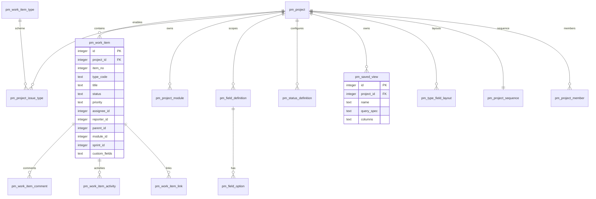

# 项目管理模块设计文档

> 日期：2026-10-21
> 版本：v2.8
> 状态：原型 v1.11 已冻结；阶段 1 已交付；阶段 2A（列表工作台 + 批量弹层）已交付并通过独立校验
> 视觉基线：[PM 模块总原型](../product/06-prototype/pm/README.md) v1.9
> 接口基线：[pm-api.md](./pm-api.md) v1.4
> 适用范围：hfwas-devops 项目管理（PM）子系统

### 变更记录

| 版本 | 日期 | 变更说明 |
|------|------|----------|
| v1.0 | 2026-07-03 | 初版：统一 WorkItem 领域模型、SQLite 表结构、pm-core 分层、API 清单与 Vue 3 + Naive UI 前端设计 |
| v2.0 | 2026-10-20 | 按 PM 模块总原型 v1.7 重构：新增文档地图与权威顺序、纠正技术栈为 React、事项类型扩为 5 内置 + 自定义、补齐工作台/筛选构建器/批量操作/导入导出/可编辑详情与操作记录、登记接口与数据库缺口、给出实施顺序 |
| v2.1 | 2026-10-20 | 确认四项决策（分页 10/20/50/100 默认 10、支持迭代、截止时间 `end_time`、迁移从 18 开始）；记录原型 v1.8 独立评审结论与修复范围 |
| v2.2 | 2026-10-20 | 记录 v1.9 复评修复：导出字段勾选、删除动作启用态、保存配置/视图、跳页校验、预览 404 |
| v2.3 | 2026-10-20 | 第三次独立验证通过，4 个阻断项关闭；等待产品 / 前端 / 测试签字冻结 |
| v2.4 | 2026-10-21 | 角色评审通过；数据库目标切换为 MySQL 8 + Flyway，更新数据迁移规则 |
| v2.5 | 2026-10-21 | 移除项目监控入口；项目工作台左侧导航改由项目内菜单承载（全部项目、启用类型、看板、工作流） |
| v2.6 | 2026-10-21 | 原型冻结；阶段 1 落地 V3 迁移、单字段/批量接口、活动分页、批量配置、类型元数据、查询修复与共享列表组件；更新缺口状态与下一步 |
| v2.7 | 2026-10-22 | 阶段 2A：列表工作台（全部工作项、URL 状态、视图/列配置、搜索、筛选构建器、排序分页、选择与批量编辑/流转/删除）；新增 NOT_LIKE 运算符；更新现状与后续范围 |
| v2.8 | 2026-10-22 | 阶段 2A 独立校验通过；记录本地即时预览、全部工作项启用类型限定、批量版本字符串兼容与后续阶段范围 |

---

## 0. 文档地图

PM 设计内容分散在多个目录。**本文件是模块级权威入口**，只写跨功能的规则与边界；细节按下面分工维护，不重复抄写。

| 主题 | 权威文档 | 版本 | 说明 |
|------|----------|------|------|
| 模块级设计（本文） | `docs/pm/pm-design.md` | v2.0 | 领域模型、信息架构、跨功能规则、接口/数据缺口、实施顺序 |
| 视觉与交互基线 | [PM 模块总原型](../product/06-prototype/pm/README.md) | v1.9（评审通过，待签字冻结） | 页面、弹层、状态、画板；唯一 PM 原型入口 |
| 原型契约 | [prototype-contract.md](../product/06-prototype/pm/prototype-contract.md) | v0.12 | A2 对齐、必须一致项、允许差异、组件对账 |
| 列表配置 / 批量 / 详情 | [20261019-pm-list-config-bulk/design.md](../superpowers/features/20261019-pm-list-config-bulk/design.md) | v0.8 | 本模块最细的行为设计 |
| 列表工作台与共享组件 | [20261019-pm-workbench-redesign/design.md](../superpowers/features/20261019-pm-workbench-redesign/design.md) | v0.1 | 列表骨架、组件职责与列表交互 |
| 事项类型管理 | [20261019-pm-work-item-types/design.md](../superpowers/features/20261019-pm-work-item-types/design.md) | v0.1 | 类型 CRUD、模板、字段布局、项目启用范围 |
| HTTP 接口 | [pm-api.md](./pm-api.md) + [Postman](./pm-api.postman_collection.json) | v1.4 | 请求/响应、错误码、示例 |
| 表结构 | [V1__initial_schema.sql](../../backend/db-migration/src/main/resources/db/migration/V1__initial_schema.sql)、[PM 数据字典](../product/03-database/tables/pm.md) | — | MySQL 基线中的 `pm_*` 表 |
| 产品功能概览 | [modules/pm.md](../product/02-features/modules/pm.md) | v0.1 | 面向产品的功能清单，细节以本文件为准 |
| 竞品与演进 | [pm-jira-comparison.md](./pm-jira-comparison.md)、[pm-evolution-roadmap.md](./pm-evolution-roadmap.md) | — | 背景参考，不作为验收依据 |

**冲突处理顺序**：

1. 业务规则与交互行为：本文 → 功能 `design.md`；
2. 接口字段、错误码：`pm-api.md`；
3. 视觉与状态覆盖：冻结后的原型与 `prototype-contract.md`；
4. 表结构：schema SQL 与数据字典；
5. 产品功能概览只做摘要，不作为验收依据。

若以上文档互相矛盾，以本条顺序裁决，并把差异登记到 §13。**v1.0 中 Vue 3 + Naive UI 技术栈的描述已作废**，以 §1.3 为准。

---

## 1. 概述

### 1.1 目标

构建 Jira 式的项目协作模块，支持：

- **项目**管理与项目级访问上下文；
- 统一 **WorkItem（事项）** 模型：需求、任务、缺陷、迭代、测试用例与自定义类型；
- **类型方案**驱动的项目启用范围与左侧类型导航；
- **配置驱动的列表工作台**：显示列、搜索字段、筛选字段、密度、排序、保存视图；
- **可视化筛选构建器**：字段 / 操作符 / 值，AND/OR 条件组，表达式预览；
- **批量操作闭环**：批量编辑、批量流转、导入、导出、删除，可配置启停、角色、上限、确认与字段白名单；
- **可编辑事项详情**：双栏、页签、单字段内联更新、Markdown 描述、状态流转、评论与操作记录；
- 动态字段、工作流、看板、评论、关联与活动日志。

### 1.2 设计原则

| 原则 | 说明 |
|------|------|
| 统一事项模型 | 多类型共用 `pm_work_item` + `type_code`，避免重复 CRUD 与查询逻辑 |
| 配置驱动 | 类型、字段、布局、视图、批量动作均由配置决定，前端不写死 |
| 内核与接入分离 | `pm-core` 承载领域逻辑，`server` 只做 HTTP 适配 |
| 列表即工作台 | 视图、查询、展示、批量四类配置在同一表格上下文内完成 |
| 单字段优先 | 高频修改走内联更新，完整编辑只用于多字段一起保存 |
| 可分享状态 | 搜索、筛选、排序、列、分页写入 URL，刷新/分享/回退不丢 |
| 安全默认 | Markdown 先转义后渲染；批量与删除默认最小权限并二次确认 |

### 1.3 技术栈

| 层级 | 技术 |
|------|------|
| 后端 | Java 21、Spring Boot 3、MyBatis-Plus |
| 前端 | React 19 + TypeScript + Vite、Tailwind CSS v4、shadcn/ui、React Router、TanStack Query、Zustand |
| 数据库 | MySQL 8（Flyway 迁移，`backend/db-migration`） |
| 测试 | 后端 JUnit + Testcontainers MySQL；前端 Vitest；原型与页面走查使用 Playwright |

> 前端栈以 `AGENTS.md` v0.26 与 `frontend/package.json` 为准，禁止引入 Vue、Pinia、Naive UI。

### 1.4 范围与非目标

本版设计覆盖原型 P00–P06（总览、列表、类型筛选、类型管理、视图设置、批量配置、详情）及其弹层 O01–O12。

非目标（后续版本再设计）：

- 看板列映射、迭代燃尽、工时与容量、自动化规则；
- 跨项目批量操作与服务端异步导出任务；
- 批量操作回滚 UI（首版只记录审计与结果明细）；
- 工作流画布编辑器、类型层级（Epic → Story → Sub-task）；
- 跨页选择与"全选全部结果"；
- 移动端适配（仅覆盖 1280 / 1440 桌面）；
- 原始 JQL / 表达式编辑（首版只提供可视化构建器）。

---

## 2. 领域模型

### 2.1 统一 WorkItem

需求、任务、缺陷、迭代、测试用例与自定义类型**不建独立业务表**，统一存 `pm_work_item`，由 `type_code` 区分。事项编号为 `项目编码-序号`（`pm_project_sequence` 维护 `item_no`）。

优势：动态字段、查询构建器、列表/看板跨类型复用；新增类型只需注册类型元数据与字段 schema；API 统一为 `/pm/work-items/*`。

### 2.2 事项类型

| code | 名称 | 来源 | 说明 |
|------|------|------|------|
| `requirement` | 需求 | 内置 | 产品/业务需求 |
| `task` | 任务 | 内置 | 开发/执行项 |
| `bug` | 缺陷 | 内置 | 问题跟踪 |
| `iteration` | 迭代 | 内置 | 项目周期容器；V3 已补种子与默认工作流（§8.2 G-01） |
| `test_case` | 测试用例 | 内置 | 测试项 |
| `story` | 用户故事 | 自定义（示例） | 项目按需创建 |
| `tech_debt` | 技术债 | 自定义（示例） | 项目按需创建 |

规则：

1. 内置类型不可删除、不可改 `code`；名称、图标、颜色展示以系统定义为准；字段布局与工作流可配置。
2. 自定义类型可新建、复制、编辑、停用、删除；编码创建后不可改，格式 `^[a-z][a-z0-9_]{1,31}$`。
3. 有事项引用时禁止删除，只能停用；无引用时二次确认删除。
4. 新建自定义类型必须选模板（默认"任务"），继承字段布局与工作流。
5. 类型全局创建、项目内启用；在项目设置新建类型时需明示"全局类型"。

### 2.3 类型方案与项目启用

- `pm_work_item_type`：全局类型注册表（`enabled` 控制全局可用）。
- `pm_project_issue_type`：项目启用集合与顺序（`sort_order`）。左侧导航顺序 = scheme 顺序。
- 停用类型不进入左侧导航与新建菜单；已有事项仍可按链接打开。
- 类型数量 `workItemCount` 由后端聚合（接口缺口，见 §7.2 A-07）；未就绪时前端进入项目时一次性聚合。

原型示例数据：全部 128 = 需求 24 + 任务 52 + 缺陷 18 + 迭代 6 + 测试用例 14 + 用户故事 9 + 技术债 5。

### 2.4 字段模型

| 分类 | 字段 | 存储 | 状态 |
|------|------|------|------|
| 系统字段 | `item_no` / 编号、`type_code`、`title`、`description`、`status`、`priority`、`assignee_id`、`reporter_id`、`parent_id`、`module_id`、`sprint_id` | `pm_work_item` 列 | 已存在 |
| 系统字段（待补） | `end_time`（截止时间） | 新增列（已确认字段名） | 缺口 G-02 |
| 自定义字段 | 故事点、风险、修复版本、标签、关注者、环境等 | `custom_fields` JSON | 由字段定义驱动 |
| 系统字段（只读） | 编号、创建时间、更新时间、创建人 | `pm_work_item` 列 | 不可内联编辑 |

查询规则：系统字段直接映射列；自定义字段使用 `custom.{field_key}` 前缀，通过 `json_extract()` 查询，并做白名单校验（仅系统字段 + 已定义自定义字段可进入 SQL）。

字段显示位置（`pm_type_field_layout.layout_config`）：列表列、创建表单、详情页；`searchFields` 决定搜索范围；筛选字段由视图配置再做一层收敛。

### 2.5 ER 关系



---

## 3. 信息架构与路由

### 3.1 模块结构

```text
PM 模块
├─ 模块总览                     原型 #/overview
├─ 项目列表                     /pm/projects
└─ 项目工作台                   /pm/projects/:projectId
   ├─ 左侧导航（全部项目、项目启用类型、看板、工作流）
   ├─ 工作项（左侧为项目启用类型）
   │  ├─ 全部工作项
   │  ├─ 需求 / 任务 / 缺陷 / 迭代 / 测试用例
   │  ├─ 自定义类型（用户故事、技术债……）
   │  └─ 管理事项类型          /pm/projects/:projectId/settings/types
   ├─ 事项详情                 /pm/projects/:projectId/items/:typeCode/:itemId
   ├─ 看板                     /pm/projects/:projectId/board/:typeCode
   └─ 设置
      ├─ 工作流                /pm/projects/:projectId/settings/workflow/:typeCode
      ├─ 视图与搜索            /pm/projects/:projectId/settings/views
      └─ 批量操作              /pm/projects/:projectId/settings/bulk-actions
```

### 3.2 页面矩阵

| ID | 页面 | 生产路由 | 原型 Hash | 状态覆盖 |
|----|------|----------|-----------|----------|
| P00 | 模块总览 | `/pm/overview` | `#/overview` | default |
| P01 | 项目工作项列表 | `/pm/projects/:projectId/items/:typeCode` | `#/workbench` | default / empty / loading / error / permission / dense / long / selected |
| P02 | 类型筛选 | 同 P01 + `typeCode` | `#/workbench?type=bug` | default |
| P03 | 事项类型管理 | `/pm/projects/:projectId/settings/types` | 专题原型 | default / empty / loading / error / permission / invalid / dense |
| P04 | 视图与搜索设置 | `/pm/projects/:projectId/settings/views` | `#/settings/views` | default |
| P05 | 批量操作配置 | `/pm/projects/:projectId/settings/bulk-actions` | `#/settings/bulk-actions` | default |
| P06 | 事项详情 | `/pm/projects/:projectId/items/:typeCode/:itemId` | `#/items/1` | default / edit / invalid / permission / comments / activity / loading / error |

弹层：O01 视图配置、O02 批量编辑、O03 导入、O04 导出、O05 保存视图、O06 动作编辑、O07 筛选构建器、O08 批量删除、O09 快速预览、O10 状态流转、O11 放弃修改、O12 删除事项。

> 原型 hash 路由只用于演示；生产路由以 React Router 为准。列表状态通过查询参数持久化（§4.9）。

---

## 4. 列表工作台

### 4.1 信息层级

```text
左侧：项目切换 / 模块总览 / 工作项类型（全部 + 启用类型 + 数量）/ 协作 / 配置
页头：当前类型 / 项目 / 视图名 / 总数 / 更新时间       [导入] [导出] [新建]
视图页签：研发待办 | 我的事项 | 本周到期 | 阻塞风险 | + 保存视图
工具栏：搜索（N 个字段）| 筛选 | 显示 | 排序 | 密度            共 N 条
条件行：条件 chip / 添加筛选 / 清空
批量栏：已选 N 项 | 批量编辑 | 状态流转 | 导出 | 删除 | 取消
表格：选择 / 配置列（默认 8 列）/ 操作
分页：总数 / 每页 10 / 页码 / 跳页
```

默认 8 列：编号、类型、标题、状态、优先级、负责人、截止时间、故事点。列宽策略：编号 96、类型 88、标题弹性、状态 104、优先级 88、负责人 140、截止 112、故事点 80。

### 4.2 类型导航

- 数据来源：`POST /pm/projects/issue-types/list`，顺序按项目 scheme。
- 展示：全部工作项 + 每个启用类型的名称、来源标记（内置/自定义）与数量。
- 点击类型写入查询参数 `type`，列表查询带 `typeCode`，页头与页签同步。
- 停用类型不显示；"管理事项类型"无权限时隐藏。
- 数量合计必须等于"全部工作项"。

### 4.3 视图

| 类别 | 内容 |
|------|------|
| 系统视图 | 研发待办、我的事项、本周到期、阻塞风险（快速筛选另有"未分配"） |
| 用户视图 | 基于当前查询"另存为"，出现在页签末尾 |
| 共享视图 | 项目管理员可保存为项目共享视图 |

- 当前视图被修改后页签显示脏标记，提供"保存 / 另存为 / 重置"。
- 视图保存 `querySpec` + `columns`（列、搜索字段、筛选字段、密度、排序）。
- 视图切换保留显示配置与密度；切换后页码回到第 1 页。

### 4.4 视图配置（显示 / 搜索 / 筛选）

入口：工具栏"显示"。

| Tab | 配置项 | 行为 |
|-----|--------|------|
| 显示列 | 勾选列、上移/下移、恢复默认；密度（标准/紧凑）；默认排序 | 保存后立即重绘表格；字段顺序即列顺序 |
| 搜索字段 | 勾选参与搜索的字段，至少 1 个 | 搜索提示与匹配范围同步 |
| 筛选字段 | 勾选筛选面板字段 | 筛选面板只展示勾选项 |

职责边界：字段布局（`pm_type_field_layout`）提供**默认值**，视图配置做**覆盖**；视图配置不修改字段定义本身。

### 4.5 搜索

- 输入防抖 350ms（列表组件默认 300ms，PM 取 350ms）；回车立即查询。
- 匹配范围由"搜索字段"决定；搜索框右侧显示范围 chip，如"4 个字段"，悬停展示字段名。
- 无结果空态保留筛选条件，提供"清空搜索"。
- 搜索条件写入 URL `q`；条件变化时页码重置为 1。

### 4.6 筛选构建器

结构：

```text
根：AND
├─ 状态 属于 [进行中, 已阻塞]
├─ 优先级 属于 [最高, 高]
└─ 组：OR
   ├─ 负责人 是 陈思远
   └─ 负责人 是 林小满
```

规则：

1. 字段来自视图配置的"筛选字段"，不可超出该集合。
2. 根级与每个条件组各自只能选择一种关系（AND 或 OR），不能混用。
3. 最多 2 层：根 + 条件组；组内可增删条件。
4. 操作符随字段类型变化：

| 字段类型 | 操作符 |
|----------|--------|
| 文本（标题、描述、编号） | 包含、不包含、等于、不等于、为空、不为空 |
| 枚举（状态、优先级、风险、迭代） | 属于、不属于、是、不是、为空、不为空 |
| 用户（负责人、报告人） | 是、不是、属于、不属于、为空、不为空 |
| 日期（截止时间） | 等于、早于、晚于、在区间、今天、本周、为空 |
| 数字（故事点） | 等于、大于、小于、大于等于、小于等于、在区间、为空 |

5. 值编辑器随操作符变化：`属于 / 不属于` 用多值 chip；`在区间` 用两个输入；`为空 / 不为空 / 今天 / 本周` 不显示值编辑器。
6. 实时展示"预计匹配 N 条"与表达式预览。
7. 存在缺值条件时禁止应用，顶部汇总提示；修正后自动清除错误。
8. 快速筛选：我的工作项、本周到期、阻塞风险、未分配。
9. 首版不提供原始 JQL / 表达式编辑；表达式预览只读。

QuerySpec 映射：

```json
{
  "logic": "AND",
  "conditions": [
    { "field": "status", "operator": "IN", "value": ["in_progress", "blocked"] },
    { "field": "priority", "operator": "IN", "value": ["highest", "high"] }
  ],
  "groups": [
    {
      "logic": "OR",
      "conditions": [
        { "field": "assignee_id", "operator": "EQ", "value": 1001 },
        { "field": "assignee_id", "operator": "EQ", "value": 1002 }
      ]
    }
  ]
}
```

- `IN / NOT_IN` 直接映射数组；`为空 / 不为空` 映射 `IS_NULL / IS_NOT_NULL`；日期 `BEFORE / AFTER / BETWEEN` 映射 `LT / GT / BETWEEN`。
- 前端提交前把枚举显示值、用户名转换为 `optionKey` / 用户 ID。**查询条件一律传 ID，不传显示名**（功能设计 v0.2 示例中的中文姓名只用于原型演示）。

### 4.7 排序

- 点击表头按 升序 → 降序 → 默认 循环；当前列显示箭头。
- `Shift + 点击` 追加多列排序，URL 记录 `sort=priority:ASC,updated:DESC`。
- 默认按"更新时间倒序"；排序变化时页码回到第 1 页。

### 4.8 分页

- 服务端分页，默认每页 **10**，可选 **10 / 20 / 50 / 100**（2026-10-20 已确认，与 `DEFAULT_PAGE_SIZE` 一致）。
- 显示"共 128 条 · 第 3 / 7 页"，支持上一页 / 页码 / 下一页 / 跳页；页数多时省略号收拢。
- 搜索、筛选、排序、每页条数变化时回到第 1 页。
- 原型、规格与实现统一使用这四档；原型画板需展示页大小选项与第 2 页状态。

### 4.9 选择与批量栏

- 表头复选框全选**当前页**；选中行高亮；选择状态写入 URL `sel`。
- 选中后底部出现批量栏：批量编辑、状态流转、导出、删除、取消。
- 跨页选择首版不支持；翻页清空选择，批量栏文案注明"已选当前页 N 项"。
- 删除必须二次确认，按钮文案写明"删除 N 个工作项"。

### 4.10 URL 状态

| 参数 | 取值 | 说明 |
|------|------|------|
| `type` | 类型 code | 左侧类型筛选 |
| `view` | 视图 ID | 当前视图 |
| `q` | 文本 | 搜索 |
| `cols` | 字段 key 列表 | 显示列 |
| `search` | 字段 key 列表 | 搜索字段 |
| `ff` | 字段 key 列表 | 筛选字段 |
| `density` | `standard` / `compact` | 密度 |
| `sort` | `field:ASC\|DESC` | 排序 |
| `sel` | 行 ID 列表 | 当前页选中 |
| `f` | JSON | 筛选条件树 |
| `page` / `size` | 数字 | 页码 / 每页条数 |

### 4.11 键盘

| 按键 | 行为 |
|------|------|
| `/` | 聚焦搜索（输入框内不触发） |
| `x` | 选中/取消当前行 |
| `Shift + ↑/↓` | 连续选择 |
| `Cmd/Ctrl + A` | 全选当前页 |
| `↑` / `↓` | 行间移动焦点 |
| `Enter` | 打开当前行详情 |
| `Esc` | 清除选择 / 关闭弹层 / 清空搜索 |
| `Cmd/Ctrl + Enter` | 提交批量编辑 |

### 4.12 列表状态

| 状态 | 表现 | 参数 |
|------|------|------|
| 默认 | 完整列表、类型导航、分页 | — |
| 空态 | 插画位 + 文案 + 清空搜索/筛选入口 | `state=empty` |
| 加载 | 表头保留 + 6~8 行骨架 | `state=loading` |
| 失败 | 错误说明 + 重试，区分网络/业务 | `state=error` |
| 无权限 | 隐藏新建、导入、批量编辑、删除，保留查看与（按配置）导出 | `state=permission` |
| 大数据量 | 紧凑密度、列宽稳定、分页边界 | `state=dense` |
| 长文本 | 单行省略，悬停提示 | `state=long` |
| 选中态 | 批量栏出现，行高亮 | `state=selected` |

---

## 5. 事项详情

### 5.1 布局与页签

```text
返回 / 编号 / 类型 / 复制链接
标题                                           [状态流转] [编辑] [删除]
状态 / 优先级 / 风险 / 更新时间 / 迭代
详情 | 操作记录 8 | 评论 3
┌──────────────────────────────┬────────────────┐
│ 当前页签内容                 │ 属性（可编辑）  │
│ 详情：描述（阅读/编辑）       │ 状态 / 优先级   │
│ 操作记录：时间线 + 分页      │ 负责人 / 报告人 │
│ 评论：列表 + 输入            │ 截止 / 迭代     │
│                              │ 故事点 / 风险   │
│                              │ 标签 / 关注者   │
└──────────────────────────────┴────────────────┘
[未保存的更改]                    [取消] [保存修改]
```

- 页签固定在标题与属性行下方、内容区上方；默认"详情"。
- 右栏属性在三个页签下常驻，便于跨页签编辑。
- 编辑态只保留"详情"页签，并提示"编辑中 · 保存后可查看操作记录与评论"。
- 操作记录与评论是顶层页签，不放在描述卡片内部。

### 5.2 三种编辑方式

| 方式 | 入口 | 保存 | 适用 |
|------|------|------|------|
| 单字段内联更新 | 阅读态点击字段 | 选项选中即存；输入类点"保存" | 日常高频修改 |
| 完整编辑 | 顶部"编辑" | 底部保存条，多字段一起提交 | 一次改多个字段 |
| 状态流转 | 顶部"状态流转" | 选择目标状态提交 | 走工作流校验 |

### 5.3 单字段内联更新矩阵

| 字段 | 编辑器 | 保存方式 | 约束 |
|------|--------|----------|------|
| 标题 | 行内输入框 | 保存 / 取消 | 必填，2–120 字符 |
| 描述 | Markdown 编辑器 | 保存 / 取消 | 存 Markdown 源文本 |
| 状态 | 选项菜单 | 选中即保存 | 仅允许工作流合法目标，非法项置灰并标注"工作流不允许" |
| 优先级 | 选项菜单 | 选中即保存 | 枚举校验 |
| 类型 | 选项菜单 | 选中即保存 | 生产需二次确认并校验字段/工作流兼容性（当前原型未实现确认，见 §13 Q-06） |
| 负责人 / 报告人 | 用户选择 | 选中即保存 | 必须为项目成员 |
| 迭代 / 风险 / 修复版本 / 模块 / 父事项 | 选项菜单 | 选中即保存 | 父事项禁止自引用与环 |
| 截止时间 | 日期输入 | 保存 | 日期格式 |
| 故事点 | 数字输入 | 保存 | 非负；`≤ 0` 为校验失败 |
| 标签 | 文本输入 | 保存 | 多值按约定分隔 |
| 环境 | 文本输入 | 保存 | — |
| 关注者 | 多选切换 | 添加/移除即时保存 | — |
| 编号 / 创建时间 / 更新时间 | 只读 | — | 不在内联范围 |

交互反馈：

1. 选择后立即更新界面（乐观更新），显示"已保存"toast。
2. 失败时回滚到旧值并提示原因。
3. 点击外部或 `Esc` 关闭，不保存。
4. 只读成员不能打开内联编辑器；服务端仍做二次校验。
5. 选项菜单当前值标记"当前"。

### 5.4 状态流转

- 只展示工作流允许的目标状态；流转前校验必填字段与后置函数。
- 不允许的目标置灰并标注原因。
- 成功后记录操作记录；失败保持原状态并提示。
- 批量流转逐条走同一套校验，不允许的条目跳过并进入结果明细。

### 5.5 Markdown 描述

1. 阅读态渲染：标题、加粗/斜体、删除线、链接、有序/无序列表、任务列表、引用、代码块、表格、分隔线。
2. 编辑态提供"编辑 / 预览"页签：编辑为等宽 textarea + 工具栏（H、B、I、行内代码、链接、列表、任务列表、引用）；预览用当前内容实时渲染，不触发页面重渲染。
3. 字符数实时显示；保存 Markdown 源文本，不存 HTML。
4. 安全：先 HTML 转义再渲染；链接仅允许 `http://`、`https://`、`mailto:`；不支持原始 HTML 与脚本。
5. 评论、快速预览与描述共用同一渲染器，保证展示一致。
6. 首版不支持图片上传、@ 提及、内联评论；后续接入统一编辑器时保持 Markdown 源文本兼容。

### 5.6 操作记录

事件类型：创建、字段变更、状态流转、关联、评论。

每条记录包含：操作人、字段名、旧值/新值（`old_label` / `new_label`）、时间；批量操作带 `batch_id`。展示规则：

1. 每次单字段更新追加一条；完整编辑保存时逐字段对比，每个变更各记一条；评论发表追加"添加了评论"。
2. 默认**最新在前**；展示为时间线。
3. 分页：每页 5 / 10 / 20 条，默认 5；显示总条数、当前页/总页数、上一页/页码/下一页。
4. 新增记录后数量实时更新，回到第一页顶部可看到最新记录。
5. 原型把页码与每页条数写入 URL（`actPage` / `actSize`）；生产实现同样保留在查询状态中。

### 5.7 评论

- 评论列表 + 输入框；支持 Markdown 与 @ 提及（@ 提及首版不实现）。
- 发表后追加到列表与操作记录；删除评论走二次确认。
- 评论与字段编辑分开提交，评论失败不阻塞字段保存。

### 5.8 校验、未保存与权限

| 场景 | 行为 |
|------|------|
| 标题为空 / 超长 | 顶部汇总 + 字段级错误；阻止保存 |
| 故事点 ≤ 0 | 顶部汇总 + 字段级错误 |
| 保存失败 | 保留编辑态与本地草稿 |
| 编辑态返回/取消 | 弹层"放弃未保存的修改？" |
| 只读成员 | 隐藏编辑、状态流转、删除、评论输入；属性栏标注"只读" |
| 删除 | 二次确认；成功后返回列表 |
| 加载 / 失败 | 骨架屏；失败提供重试与返回列表 |

### 5.9 接口映射

| 场景 | 接口 | 状态 |
|------|------|------|
| 详情 | `GET /pm/work-items/{id}` | 已有 |
| 完整编辑保存 | `POST /pm/work-items/save` | 已有 |
| 单字段更新 | `PATCH /pm/work-items/{id}/fields` | ✅ 已实现（A-01，含 version 乐观锁与 transitionId） |
| 状态流转 | `POST /pm/work-items/{id}/transition` | 已有 |
| 评论列表 / 发表 / 删除 | `/pm/work-items/{id}/comments`、`/pm/work-items/comments/save|delete` | 已有 |
| 操作记录 | `GET /pm/work-items/{id}/activities` | 已有，分页参数待补（A-09） |
| 关联 | `/pm/work-items/{id}/links`、`/pm/work-items/links/save` | 已有 |

并发：

- 保存与单字段更新携带版本号（或 `updateTime`），服务端做乐观锁；冲突时提示刷新并保留本地草稿。
- 当前 `pm_work_item` 无版本列，需在 §8.2 G-03 补齐。

---

## 6. 批量操作与导入导出

### 6.1 动作清单

| 动作 | 是否需要选择 | 说明 |
|------|--------------|------|
| 批量编辑字段 | 是 | 选字段 → 设值/清空 → 预览 → 确认 |
| 批量状态流转 | 是 | 按工作流校验，不允许的流转跳过并提示 |
| 复制事项 | 是 | 复制标题、描述与字段；可指定目标类型 |
| 导出所选 | 是 | 选择字段集，导出 Excel |
| 删除事项 | 是 | 危险操作，二次确认写明数量 |
| 导入事项 | 否 | 模板 → 映射 → 校验 → 执行 |

### 6.2 批量编辑字段

- 可选字段来自批量操作配置的字段白名单，且必须对**所有选中事项**可见。
- 支持"设置为…"与"清空值"。
- 编辑器由字段类型驱动：单选/状态/优先级 → 下拉；负责人 → 用户选择；日期 → 日期；数字 → 数字；多选 → 多选。
- 提交前预览：受影响 N 项、将跳过 M 项（工作流不允许 / 无权限 / 字段不可见）、示例前 3 行。
- 提交后展示成功 / 跳过 / 失败，可下载失败明细。
- 单次上限由配置决定：默认 100，最大 1000。

### 6.3 导入

三段式：

1. **上传**：选择类型、下载模板、选择文件、导入模式（新建 / UPSERT）、字段集。
2. **映射**：检测表头 → Excel 列映射到系统字段；必填缺失、类型不匹配、重复列实时提示。
3. **校验与执行**：总行数、有效行、警告、错误；先校验后导入；执行后展示新建/更新/跳过/失败。

约束：

- 仅项目管理员或具备"导入事项"权限的角色可用。
- 单次行数上限默认 5000。
- 失败行不影响已成功行（首版）；结果页提供错误明细下载。
- 文件编码 UTF-8；模板列顺序固定，允许列增删。

### 6.4 导出

- 范围：选中项 / 当前查询结果 / 全部。
- 字段集：默认取导出配置，可在弹层增删；至少 1 个字段。
- 显示预计条数与上限；超限禁用导出并提示缩小范围。
- 格式：Excel（首版同步导出）。

### 6.5 批量操作配置

页面：`/pm/projects/:projectId/settings/bulk-actions`，仅项目管理员可见。

| 配置项 | 说明 |
|--------|------|
| 动作启停 | 每个动作独立开关；关闭后批量栏不出现 |
| 允许角色 | 项目管理员 / 项目成员 / 只读成员（只读永不出现写操作） |
| 单次上限 | 批量 1–1000；导入/导出 1–5000 |
| 二次确认 | 删除、状态流转、清空字段默认开启 |
| 可编辑字段 | 仅批量编辑；字段白名单与顺序 |
| 默认导出字段 | 导出弹层默认勾选 |
| 默认导入模式 | CREATE / UPSERT |
| 审计 | 操作人、动作、数量、字段、时间、结果 |

### 6.6 权限与审计

- 只读成员只能搜索、筛选、按配置导出；不能编辑、删除、导入。
- 批量编辑只能修改白名单字段；状态流转走工作流校验。
- 删除默认关闭，需管理员显式开启，且必须二次确认。
- 批量操作统一写活动日志（`pm_work_item_activity.batch_id`），失败明细可下载。
- 首版不导出敏感字段。

---

## 7. 接口与数据

### 7.1 复用接口

| 场景 | 接口 |
|------|------|
| 项目启用类型 | `POST /pm/projects/issue-types/list`、`/save` |
| 工作项分页 | `POST /pm/work-items/page`（QuerySpec） |
| 工作项详情/保存/删除 | `GET /pm/work-items/{id}`、`POST /pm/work-items/save`、`POST /pm/work-items/delete` |
| 状态流转 | `POST /pm/work-items/{id}/transition` |
| 评论 | `GET /pm/work-items/{id}/comments`、`POST /pm/work-items/comments/save` |
| 活动 | `GET /pm/work-items/{id}/activities` |
| 字段定义 / 布局 | `POST /pm/fields/definitions/*`、`POST /pm/fields/layout/get|save` |
| 工作流 | `POST /pm/status/workflow/*` |
| 导入导出 | `GET /pm/work-items/io/columns`、`POST /pm/work-items/io/import/template|import/preview|import|export` |
| 保存视图 | `POST /pm/views/save|list|delete` |
| 事项类型 | `POST /pm/meta/types`、`/save`、`/delete` |
| 看板 | `POST /pm/board` |

字段级定义、错误码与示例见 [pm-api.md](./pm-api.md) 与 [Postman collection](./pm-api.postman_collection.json)。

### 7.2 增量接口（阶段 1 已落地）

| 编号 | 能力 | 实现接口 / 变更 | 阶段 1 状态 |
|------|------|-----------------|-------------|
| A-01 | 单字段更新 | `PATCH /pm/work-items/{id}/fields`，body `{ field, value, version, transitionId? }` | ✅ 已实现 |
| A-02 | 批量更新字段 | `POST /pm/work-items/batch-update`，逐条隔离、dryRun、success/skipped/failed 明细 | ✅ 已实现 |
| A-03 | 批量状态流转 | `POST /pm/work-items/batch-transition`，逐条校验与 dryRun | ✅ 已实现 |
| A-04 | 批量操作配置 | `GET/POST /pm/projects/{id}/batch-action-configs` + `pm_batch_action_config` | ✅ 已实现 |
| A-05 | 字段批量属性 | `pm_field_definition.batch_editable` / `batch_order` | ✅ 已实现（API 字段待阶段 2 暴露） |
| A-06 | 视图持久化 | `pm_saved_view.columns` 支持扩展 JSON | ⏳ 结构已支持，前端视图阶段接入 |
| A-07 | 类型数量 | 项目类型列表补 `workItemCount` / `fieldCount` | ✅ 已实现 |
| A-08 | 结果明细下载 | 批量接口返回逐条明细；文件下载待阶段 2 | ⏳ 部分实现 |
| A-09 | 活动分页 | `GET /pm/work-items/{id}/activities/page`，旧全量接口保留兼容 | ✅ 已实现 |
| A-10 | 类型元数据 | 类型补 `built_in` / `description` / `template_code`，列表补 `fieldCount`；新增模板接口 | ✅ 已实现 |
| A-11 | 内置迭代种子 | V3 新增 `iteration` 类型与默认工作流 | ✅ 已实现 |

### 7.3 QuerySpec 协议

```json
{
  "projectId": 1,
  "typeCode": "task",
  "logic": "AND",
  "conditions": [
    { "field": "status", "operator": "IN", "value": ["open", "in_progress"] },
    { "field": "custom.severity", "operator": "EQ", "value": "critical" }
  ],
  "groups": [
    {
      "logic": "OR",
      "conditions": [
        { "field": "assignee_id", "operator": "EQ", "value": 1001 },
        { "field": "assignee_id", "operator": "IS_NULL", "value": null }
      ]
    }
  ],
  "sort": [{ "field": "create_time", "order": "DESC" }],
  "pageNo": 1,
  "pageSize": 20
}
```

支持运算符：`EQ`、`NE`、`GT`、`GTE`、`LT`、`LTE`、`LIKE`、`IN`、`NOT_IN`、`BETWEEN`、`IS_NULL`、`IS_NOT_NULL`。前端类型定义见 `frontend/src/modules/pm/types/index.ts`。

---

## 8. 数据库与迁移

### 8.1 表清单（15 张）

| 表 | 说明 |
|----|------|
| `pm_project` | 项目主表 |
| `pm_project_member` | 项目成员 |
| `pm_work_item_type` | 全局事项类型 |
| `pm_project_issue_type` | 项目启用类型与顺序 |
| `pm_work_item` | 统一事项表 |
| `pm_project_sequence` | 项目事项编号序列 |
| `pm_project_module` | 模块树 |
| `pm_field_definition` | 字段元数据 |
| `pm_field_option` | 字段选项 |
| `pm_work_item_link` | 事项关联 |
| `pm_work_item_comment` | 评论 |
| `pm_work_item_activity` | 活动/操作记录 |
| `pm_status_definition` | 状态与流转规则 |
| `pm_saved_view` | 保存视图 |
| `pm_type_field_layout` | 类型字段布局 |

详细字段见 [PM 数据字典](../product/03-database/tables/pm.md)。

### 8.2 缺口（阶段 1 更新）

| 编号 | 缺口 | 影响 | 处理方向 |
|------|------|------|----------|
| G-01 | 缺 `iteration` 类型 | 原型 5 个内置类型无法落地 | ✅ V3 已补种子与默认工作流 |
| G-02 | 无截止时间列 | 筛选、排序、导入导出缺系统字段 | ✅ V3 已补 `end_time`，查询/排序/IO 已接入 |
| G-03 | 无版本列 | 内联更新无法做乐观锁 | ✅ V3 已补 `version`，单字段/批量更新条件更新 |
| G-04 | 批量操作配置无存储 | 配置页无法持久化 | ✅ 新表 `pm_batch_action_config` |
| G-05 | 关注者无存储 | 详情右栏"关注者"不可持久化 | ⏳ V3 已建 `pm_work_item_watcher`，接口待阶段 2 |
| G-06 | `pm_saved_view.columns` 形状未定义 | 视图配置无法完整持久化 | ⏳ JSON 扩展无需 DDL，阶段 2 定义并接入 |
| G-07 | 操作记录分页无接口参数 | 详情分页不可用 | ✅ A-09 已实现 |

### 8.3 迁移规则

- 迁移文件位于 `backend/db-migration/src/main/resources/db/migration/`，由 Flyway 执行；V1/V2 为 MySQL 基线，后续变更从 **V3** 起新增，禁止修改已执行文件。
- 本地/CI 使用 Testcontainers MySQL，生产由 Helm pre-upgrade Job 执行 Flyway；应用默认不执行迁移。
- 重建库不迁旧数据；需要重置时 `DROP DATABASE` 后重跑 Flyway，不写 SQLite 兼容分支。
- 涉及表结构变更时，同一变更内更新本文件、数据字典与 `docs/product/03-database/data-dictionary.md`。

---

## 9. 前端实现

### 9.1 现状

`frontend/src/modules/pm/` 已有项目列表、工作项列表、详情、看板、工作流页面；进入项目后左侧栏切换为项目内菜单。阶段 2A 已将列表页改造为原型工作台：全部工作项哨兵 `items/all`、URL 驱动状态、四个内置视图与已保存视图、视图配置、搜索、两级筛选、排序分页、当前页选择与批量编辑/流转/删除。详情页与类型管理页仍待后续阶段。

### 9.2 目录与组件

| 层次 | 位置 | 组件 |
|------|------|------|
| 业务无关列表骨架 | `src/components/console/` | `ListPageShell`（新增）、`SearchInput`（新增）、`FilterBar`（新增）、`DataTable`（扩展）、`Pagination`（扩展）、`BulkActionBar`（新增）、`EmptyState` / `ErrorState` / `NoPermissionState` |
| PM 语义组件 | `src/modules/pm/components/` | `ProjectTypeNav`、`ViewTabs`、`ViewConfigDrawer`、`FilterBuilder`、`BulkEditDialog`、`ImportWizard`、`ExportDialog`、`BatchActionSettingsTable`、`ActionEditDialog`、`DetailPageShell`、`InlinePropertyEditor`、`ActivityTimeline`、`CommentThread`、`MarkdownRenderer`、`MarkdownEditor`、`TypeIcon`、`TypeEditorShell`、`FieldLayoutTable`、`WorkflowPreview` |
| 状态与工具 | `src/modules/pm/` | `useListUrlState`、TanStack Query hooks、Zustand（跨页客户端状态） |
| UI 基础 | `src/components/ui/` | shadcn/ui 组件；`Switch` 需 `npx shadcn add switch` |

约束：

1. 业务页面不得自写表格、搜索框、分页器；只允许组合上述组件。
2. 颜色、圆角、间距只用语义 token（`bg-background`、`text-muted-foreground` 等），禁止业务代码写死十六进制。
3. 状态不只靠颜色：状态 pill 带文案，优先级带图标 + 文案，负责人带姓名。
4. 共享组件采用"复用 → 可选 props → 页面级覆盖 → 新增共享组件"的顺序，不重写既有 `DataTable` / `Pagination`。

### 9.3 实现对齐

- 以冻结原型 + `prototype-contract.md`（A2）为验收基线。
- `changes.md` 必须记录"原型 → 路由 → 实现文件 → 共享组件"映射。
- 写页面前完成共享组件对账；实现后对真实应用截图与冻结原型逐页逐状态对比，差异按 `prototype-first-standard.md` §10.5 分类登记。
- 原型未冻结前不得开始页面编码。

---

## 10. 状态矩阵（汇总）

| 状态 | 触发 | 表现 | 原型参数 |
|------|------|------|----------|
| 默认 | 有数据 | 完整列表、类型导航、分页 | `#/workbench` |
| 类型筛选 | 点击左侧类型 | 页头与查询同步 | `?type=bug` |
| 空态 | 查询无结果 | 清空入口 | `?state=empty` |
| 加载 | 首次加载 | 表头 + 骨架 | `?state=loading` |
| 失败 | 请求失败 | 说明 + 重试 | `?state=error` |
| 无权限 | 只读成员 | 隐藏写操作 | `?state=permission` |
| 大数据量 | 2486 条 | 紧凑密度、分页边界 | `?state=dense` |
| 长文本 | 长标题/负责人 | 省略不撑破 | `?state=long` |
| 选中 | 勾选行 | 批量栏出现 | `?state=selected` |
| 视图配置 | 工具栏"显示" | 三个页签 | `?overlay=view-config` |
| 批量编辑 | 批量栏 | 字段/值/预览 | `?overlay=bulk-edit` |
| 批量编辑校验失败 | 未设值 | 字段错误 + 汇总 | `?overlay=bulk-edit&invalid=1` |
| 导入 | 页头"导入" | 上传/映射/结果 | `?overlay=import&step=*` |
| 导出 | 页头/批量栏 | 范围 + 字段 | `?overlay=export` |
| 筛选构建器 | 工具栏"筛选" | 条件树 + 预览 | `?overlay=filter` |
| 筛选缺值 | 条件缺值 | 禁止应用 + 汇总 | `?overlay=filter&filterInvalid=1` |
| 详情 | 点击标题 | 三页签 + 右栏 | `#/items/1` |
| 详情编辑 | "编辑" | 保存条 + 仅详情页签 | `?edit=1` |
| 详情校验失败 | 标题空 / 故事点 ≤ 0 | 汇总 + 红框 | `?edit=1&invalid=1` |
| 详情只读 | 只读成员 | 隐藏写操作 | `?state=permission` |
| 单字段内联更新 | 点击字段 | 选项/输入 | `?inline=status` 等 |
| 操作记录 | 页签 | 时间线 + 分页 | `?tab=activity&actPage=2` |
| 评论 | 页签 | 列表 + 输入 | `?tab=comments` |
| 状态流转 | 顶部按钮 | 合法目标 | `?overlay=transition` |
| 放弃修改 | 编辑态返回 | 二次确认 | `?edit=1&overlay=discard` |
| 危险操作 | 批量删除 | 二次确认写明数量 | `?overlay=delete` |

---

## 11. 权限与安全

| 主体 | 能力 |
|------|------|
| 项目管理员 | 项目设置、类型与工作流、视图共享、批量操作配置、导入导出、批量删除（需开启） |
| 项目成员 | 查看、创建、编辑、流转、评论、按配置批量操作与导出 |
| 只读成员 | 查看、搜索、筛选、按配置导出；无编辑/删除/导入/批量写操作 |

安全要求：

1. 所有按 `id` / `projectId` 的入口校验项目归属与租户（`pm-api.md` §1.2.1）。
2. Markdown 先转义后渲染，链接白名单；评论与描述同策略。
3. 查询字段与排序字段必须走白名单，禁止拼接任意 SQL。
4. 批量与删除写审计；失败不写成功记录。
5. 类型变更、字段删除、工作流修改等危险操作二次确认。
6. 前端隐藏按钮不替代服务端校验。

---

## 12. 验收标准索引

验收标准按功能文档编号，不在此重复：

| 范围 | 编号 | 文档 |
|------|------|------|
| 列表配置、筛选、批量、导入导出、详情、内联、操作记录 | AC-01–AC-25 | [list-config-bulk/design.md](../superpowers/features/20261019-pm-list-config-bulk/design.md) §8 |
| 列表骨架、搜索、视图、展示、排序、分页、选择、快速预览 | AC-01–AC-12 | [workbench-redesign/design.md](../superpowers/features/20261019-pm-workbench-redesign/design.md) §9 |
| 类型列表、创建向导、项目启用范围、停用/删除 | AC-01–AC-12 | [work-item-types/design.md](../superpowers/features/20261019-pm-work-item-types/design.md) §9 |
| 原型对齐（A2） | 必须一致项 | [prototype-contract.md](../product/06-prototype/pm/prototype-contract.md) §3 |

编号存在跨文档重复（AC-01 等），引用时必须带文档名。

---

## 13. 风险、冲突与待确认

### 13.1 已确认决策（2026-10-20）

| 编号 | 决策 | 落地要求 |
|------|------|----------|
| D-01 | 分页每页条数固定为 **10 / 20 / 50 / 100**，默认 10 | 原型、规格、契约与实现统一；画板补页大小选项与第 2 页状态 |
| D-02 | **支持迭代**：`iteration` 作为内置事项类型 | 项目启用后进入左侧导航；补类型种子与默认工作流（A-11 / G-01） |
| D-03 | 截止时间字段名统一为 **`end_time`** | 作为系统字段新增列；查询、排序、导入导出、批量编辑、详情内联全部使用该 key（G-02） |
| D-04 | 迁移编号以 Flyway 版本为准，当前基线为 V1/V2，下一个为 **V3** | `AGENTS.md` 已更新到 v0.26；新建 PM 迁移使用 `V3__*.sql` |

### 13.2 待确认

| 编号 | 事项 | 影响 | 建议 / 责任 |
|------|------|------|-------------|
| Q-01 | 原型 v1.9 三轮评审通过但未冻结 | 按规范不得进入编码 | 等待产品 / 前端 / 测试在 `prototype/README.md` §7 与 contract §9 签字并填写冻结版本与提交 |
| Q-05 | 批量接口未落地 | 大批量操作效率与一致性 | 首版可逐条调用并限制 50 条，接口就绪后切换 |
| Q-06 | 类型内联变更无二次确认 | 误改类型导致字段/工作流不兼容 | 生产加确认，服务端校验兼容性 |
| Q-07 | 无乐观锁版本列 | 并发覆盖 | 增加 `version` 或 `update_time` 校验（G-03） |
| Q-08 | 批量操作配置存储未定 | 配置无法持久化 | 项目 `settings` JSON 或新表（G-04） |
| Q-09 | 活动接口无分页 | 操作记录分页只能前端截断 | 补 `pageNo` / `pageSize`（A-09） |
| Q-10 | 原型内置轻量 Markdown 渲染器 | 与生产渲染结果可能有差异 | 生产使用统一渲染器并跑 XSS 用例 |
| Q-11 | 查询示例用姓名、实际需 ID | 枚举/用户值类型错误会导致查询为空 | 前端统一转换 ID；接口文档补示例 |
| Q-13 | 视图配置与字段布局职责重叠 | 两处配置冲突 | 字段布局提供默认值，视图配置覆盖 |

---

## 14. 实施顺序与前置条件

```text
✅ 1. 原型评审冻结（Q-01，提交 6741712）
✅ 2. 阶段 1 功能目录 docs/superpowers/features/20261021-pm-backend-shared-foundation/
✅ 3. 后端增量接口与数据迁移（A-01、A-02、A-03、A-04、A-07、A-09、A-10、A-11、G-01~G-04）
✅ 4. 前端共享组件（ListPageShell、SearchInput、FilterBar、BulkActionBar、DataTable/Pagination 扩展）
5. 阶段 2：列表工作台（类型导航、视图、视图配置、筛选构建器、选择与批量栏）
6. 阶段 2：批量操作 UI、导入导出、批量配置页
7. 阶段 3：事项详情（双栏、页签、内联更新、Markdown、操作记录、评论）
8. 阶段 3：事项类型管理页
9. 逐页逐状态对照冻结原型，独立 agent 校验并写回 changes.md
```

前置条件：

- 冻结的原型版本与提交写入 `prototype/README.md`。
- `prototype-contract.md` 的共享组件对账完成（`Switch`、`Sheet` 宽度、`DataTable` 动态列）。
- 增量接口确认后再进入对应页面；未确认的能力按 Q-05 的降级方案实现，并在 `changes.md` 登记偏差。

---

## 15. 关键文件索引

| 路径 | 说明 |
|------|------|
| `backend/pm-core/` | PM 内核源码 |
| `backend/server/src/main/java/com/hfwas/devops/pm/api/` | REST Controller |
| `backend/db-migration/src/main/resources/db/migration/` | Flyway 基线 V1/V2 与后续迁移 |
| `deploy/charts/backend/templates/job-migrate.yaml` | 生产迁移 Job |
| `frontend/src/modules/pm/` | PM 前端模块 |
| `frontend/src/components/console/` | 跨模块列表与详情骨架 |
| `docs/pm/pm-design.md` | 本文档（模块级权威设计） |
| `docs/pm/pm-api.md` | 接口文档 |
| `docs/product/06-prototype/pm/` | 模块总原型与契约 |
| `docs/superpowers/features/20261019-pm-*/` | 功能级设计与进度日志 |
