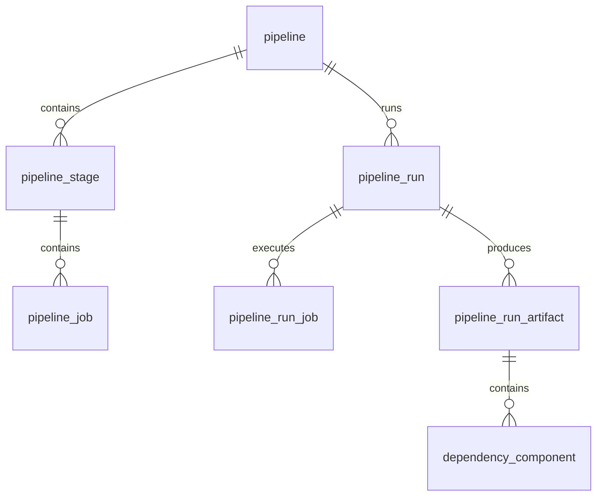
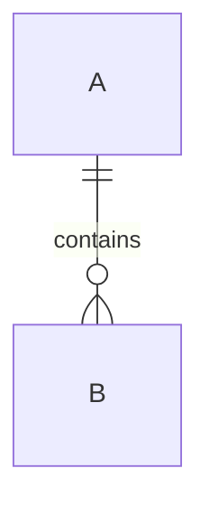

# 数据库文档规范

> 日期：2026-10-18
> 版本：v0.1
> 状态：生效（新建/变更数据库文档必须遵循）
> 适用范围：`docs/product/03-database/` 及所有模块的数据库设计、数据字典、ER 图与迁移说明
> 数据来源：仓库现有 schema、`docs/backend/db_design.md`、GitLab Database Dictionary、DBML/dbdocs、tbls、SchemaSpy、llmschema、公开数据库设计模板

### 变更记录

| 版本 | 日期 | 变更说明 |
|------|------|----------|
| v0.1 | 2026-10-18 | 初版：文档结构、命名、10 列数据字典、ER/枚举/JSON/迁移规范、评审清单与模板 |

---

## 1. 目的

当前数据库文档以“表 + 字段清单”为主，存在以下问题：

- 字段缺少类型、长度、空否、默认值、索引、外键等关键信息；
- 枚举值、JSON 结构、敏感字段没有统一写法；
- ER 图、表清单、迁移脚本分散，读者无法从模块入口快速建立整体认识；
- 文档与 schema 容易漂移，新表/新字段没有强制文档要求。

本规范定义一个**可评审、可校验、可长期维护**的数据库文档格式。后续新建模块、修改表结构、新增字段时，数据库文档必须按本规范编写。

## 2. 基本原则

| 原则 | 要求 |
|------|------|
| 单一事实来源 | 物理结构以 schema SQL 为准；文档描述必须与 SQL 一致，不允许“文档写一套、代码建一套” |
| 自顶向下 | 模块概览 → ER 图 → 表清单 → 表级数据字典 → 字段级说明 |
| 字段级完整 | 每个字段都必须有中文名、类型、空否、默认值、说明；不允许空描述 |
| 创建即文档 | 新增表/字段/索引/枚举的同一个变更内必须更新文档 |
| 版本化 | 文档遵循仓库规范：文首日期/版本/变更记录，实质性修改升版本 |
| 机器可读 | ER 图优先 Mermaid `erDiagram`；可选 DBML；表格使用标准 Markdown 表格 |
| 安全优先 | 敏感字段（凭证、密钥、Token、个人信息）必须标注并说明加密/脱敏方式 |
| 不重复 DDL | DDL 以 SQL 文件为准；文档列出文件、差异与迁移编号，不复制大段建表语句 |

## 3. 文档结构（每个模块固定四节）

每个模块的数据库文档按以下顺序组织，节名和顺序不可变：

```text
[模块名] 数据库文档
├── 1. 模块概览与 ER 图
├── 2. 表清单
├── 3. 数据字典（逐表）
└── 4. 迁移与 DDL
```

### 3.1 模块概览与 ER 图

- 模块职责、数据边界、租户隔离方式；
- Mermaid `erDiagram`（必需）；
- 实体清单表：实体名 / 物理表 / 说明 / 主要关系（1:1、1:N、M:N）。

### 3.2 表清单

| 序号 | 表名 | 中文名 | 表类型 | 用途 | 写入方 | 预估量级 | 租户字段 | 逻辑删除 |
|------|------|--------|--------|------|--------|----------|----------|----------|
| 1 | `pipeline_run` | 流水线运行 | 事务表 | 一次运行实例 | `PipelineRunService` | 十万级 | `tenant_id` | 无 |

表类型建议使用：主档表、明细表、关系表、日志表、配置表、快照表、统计表。

### 3.3 数据字典

每张表一节，包含：

1. 表级元数据（见第 5 节）；
2. 10 列字段字典（见第 6 节）；
3. 索引与约束清单（见第 7 节）；
4. 枚举说明（如有，见第 8 节）；
5. JSON 字段结构（如有，见第 8 节）；
6. 关联关系与删除策略。

### 3.4 迁移与 DDL

- 列出该模块的 schema 文件、增量迁移文件、执行模式（embedded/external）；
- 说明本次变更涉及的编号、幂等性、回滚方式；
- 注明 embedded 与 external 是否存在差异；
- DDL 正文以 SQL 文件为准，文档只保留文件路径与关键差异。

## 4. 命名规范

### 4.1 表命名

本仓库以 SQLite 为主，统一使用**小写 snake_case + 单数名词**：

| 规则 | 示例 |
|------|------|
| 模块前缀 | `sys_`、`pm_`、`api_`、`pipeline_`、`cluster_`、`registry_`、`helm_`、`image_`、`dependency_` |
| 业务含义 | `pm_work_item`、`pipeline_run_artifact`、`helm_chart_artifact` |
| 关系表 | `<a>_<b>` 或语义名，如 `sys_tenant_member`、`pm_work_item_link` |
| 日志/快照 | `_log`、`_version`、`_history` 后缀，如 `sys_oper_log`、`pipeline_task_kind_version` |
| 禁止 | 保留字裸用、拼音、无模块前缀的新表、大小写混用 |

> 历史表名（如 `api_definition`、`cluster_info`）保持不变；新表必须遵循本规范。

### 4.2 字段命名

| 类型 | 规范 | 示例 |
|------|------|------|
| 主键 | `id` | `id` |
| 外键 | `<实体>_id` | `pipeline_id`、`tenant_id`、`user_id` |
| 时间 | `_time` 或 `_at`（历史两套并存） | `create_time`、`created_at` |
| 布尔 | `is_*`、`*_flag` 或 0/1 语义字段 | `enabled`、`del_flag`、`read_flag` |
| JSON | `_json` 后缀 | `config_json`、`snapshot_json`、`runtime_params` |
| 加密/敏感 | `_enc` 或明确名称 | `secret_enc` |
| 状态/类型 | `_status`、`_type`、`_kind` | `status`、`param_type`、`kind` |
| 排序 | `sort_order` | `sort_order` |

- 同一字段在 DB、接口、文档中的英文名必须可一一映射；接口 camelCase 与 DB snake_case 的映射在 API 文档中注明。
- 禁止使用数据库保留字（`order`、`group`、`level`、`desc`、`type`）作为裸字段名。

### 4.3 索引命名

| 类型 | 格式 | 示例 |
|------|------|------|
| 普通索引 | `idx_<表名>_<字段>` | `idx_pipeline_run_pipeline` |
| 唯一索引 | `uk_<表名>_<字段>` | `uk_dep_comp_pipeline_identity` |
| 联合索引 | `idx_<表名>_<字段1>_<字段2>` | `idx_collection_item_collection` |
| 主键 | SQLite 隐式 `pk` | `id INTEGER PRIMARY KEY` |

## 5. 表级元数据（每表必填）

每张表在数据字典前必须先给出以下元数据：

| 项目 | 说明 |
|------|------|
| 表名 | 物理表名 |
| 中文名 | 业务名称 |
| 用途 | 一句话说明存什么、解决什么问题 |
| 所属模块 | user / pm / pipeline / container / api-test / image / helm 等 |
| 写入方 | 主要 Service/Controller/执行器；跨模块写入需列出 |
| 读取方 | 主要查询方（页面/接口/报表） |
| 租户隔离 | `tenant_id` / `project_id` / 无；说明如何过滤 |
| 逻辑删除 | `del_flag` / `deleted` / 无；0/1 语义 |
| 预估量级 | 千/万/十万/百万；用于索引与归档评估 |
| 保留策略 | 永久 / N 天 / 按运行清理 / 未定义 |
| 关联表 | 主要父子表与外键关系 |
| 敏感数据 | 是否包含凭证、Token、个人信息；加密/脱敏方式 |

示例：

```text
表名：pipeline_run
中文名：流水线运行实例
用途：记录一次流水线触发的参数、状态、Tekton 名称与起止时间
所属模块：pipeline
写入方：PipelineRunService、TektonPipelineExecutor
读取方：运行详情页、运行历史、审批接口
租户隔离：tenant_id
逻辑删除：无（运行记录保留）
预估量级：十万级
保留策略：未定义（建议按租户保留 N 天）
敏感数据：runtime_params 可能含敏感参数，接口返回需脱敏
```

## 6. 数据字典格式（10 列，唯一权威格式）

每张表一张 10 列表格，列不可增删：

| 序号 | 字段名 | 中文名 | 主/外键 | 索引 | 类型 | 长度/精度 | 空否 | 默认值 | 说明 |
|------|--------|--------|---------|------|------|-----------|------|--------|------|
| 1 | `id` | 主键 | PK | 是 | bigint | - | N | - | 雪花 ID |
| 2 | `pipeline_id` | 流水线 ID | FK | 是 | bigint | - | N | - | 关联 `pipeline.id` |
| 3 | `status` | 运行状态 | - | 是 | varchar | 32 | N | `QUEUED` | 见状态枚举 |
| 4 | `runtime_params` | 运行时参数 | - | 否 | json | - | Y | - | JSON，见 8.2 |
| 5 | `create_time` | 创建时间 | - | 否 | datetime | - | N | `datetime('now')` | 系统字段 |

### 6.1 列填写规则

| 列 | 规则 |
|----|------|
| 序号 | 从 1 连续递增，系统字段放在业务字段之后 |
| 字段名 | 物理字段名，snake_case，与 SQL 完全一致 |
| 中文名 | 业务术语，禁止空白或仅写英文 |
| 主/外键 | `PK` / `FK` / `UK` / 空；复合键写 `PK(1/2)` |
| 索引 | `是` / `是(UK)` / `是(IDX)` / `否`；与第 7 节索引清单一致 |
| 类型 | 逻辑类型：`bigint`、`int`、`varchar`、`text`、`decimal`、`datetime`、`date`、`boolean`、`json`、`blob` |
| 长度/精度 | varchar 写逻辑长度；decimal 写 `精度,小数`；无则 `-` |
| 空否 | `N`（NOT NULL）/ `Y`（可空） |
| 默认值 | SQL 默认值或应用层默认值；无则 `-` |
| 说明 | 必填：取值范围/枚举、关联表、单位、敏感标记、业务规则 |

### 6.2 SQLite 类型映射

| 逻辑类型 | SQLite 物理类型 | 说明 |
|----------|-----------------|------|
| bigint / int | `INTEGER` | 雪花 ID、外键、计数 |
| varchar / text | `TEXT` | 长度由应用层校验 |
| decimal | `REAL` 或 `TEXT` | 金额建议 `TEXT` 或整数分 |
| datetime / date | `TEXT` | ISO-8601 或 `datetime('now')` |
| boolean | `INTEGER` | 0/1 |
| json | `TEXT` | 文档必须给出 JSON Schema 与示例 |
| blob | `BLOB` | 文件内容（当前少用） |

### 6.3 示例：`pipeline_run`

| 序号 | 字段名 | 中文名 | 主/外键 | 索引 | 类型 | 长度/精度 | 空否 | 默认值 | 说明 |
|------|--------|--------|---------|------|------|-----------|------|--------|------|
| 1 | `id` | 主键 | PK | 是 | bigint | - | N | - | 雪花 ID |
| 2 | `pipeline_id` | 流水线 ID | FK | 是 | bigint | - | N | - | 关联 `pipeline.id` |
| 3 | `tenant_id` | 租户 ID | - | 否 | bigint | - | N | - | 租户隔离 |
| 4 | `status` | 运行状态 | - | - | varchar | 32 | N | `QUEUED` | `QUEUED`/`RUNNING`/`WAITING_APPROVAL`/`SUCCEEDED`/`FAILED`/`CANCELLED` |
| 5 | `trigger` | 触发方式 | - | - | varchar | 32 | Y | - | 当前手动为 `MANUAL` |
| 6 | `git_ref` | Git 引用 | - | - | varchar | 255 | Y | - | 分支/Tag/Commit |
| 7 | `commit_sha` | 提交 SHA | - | - | varchar | 64 | Y | - | 从 CLONE 日志回写 |
| 8 | `triggered_by_name` | 触发人 | - | - | varchar | 128 | Y | - | 显示名 |
| 9 | `stack` | 技术栈 | - | - | varchar | 32 | Y | - | `JAVA_MAVEN`/`NODE`/`GO`/`PYTHON` |
| 10 | `image` | 运行镜像 | - | - | varchar | 255 | Y | - | 工具链镜像 |
| 11 | `tekton_name` | Tekton 名称 | - | - | varchar | 255 | Y | - | PipelineRun/TaskRun |
| 12 | `segment_index` | 审批分段 | - | - | int | - | Y | - | 审批分段索引 |
| 13 | `error_message` | 失败原因 | - | - | text | - | Y | - | 失败/未配置集群说明 |
| 14 | `runtime_params` | 运行时参数 | - | - | json | - | Y | - | 见 8.2 |
| 15 | `started_at` | 开始时间 | - | - | datetime | - | Y | - | 创建时写入 |
| 16 | `finished_at` | 结束时间 | - | - | datetime | - | Y | - | 终态写入 |
| 17 | `create_by` | 创建人 | - | - | bigint | - | Y | - | 用户 ID |
| 18 | `create_time` | 创建时间 | - | - | datetime | - | N | `datetime('now')` | 系统字段 |

## 7. 索引与约束

### 7.1 每表索引清单

每张表必须列出索引：

| 索引名 | 类型 | 字段 | 用途 |
|--------|------|------|------|
| `idx_pipeline_run_pipeline` | 普通 | `pipeline_id` | 按流水线查运行 |
| `idx_pipeline_run_tenant_status` | 普通 | `tenant_id, status` | 租户并发统计（建议） |

### 7.2 约束规则

- 业务唯一性必须由 `uk_*` 唯一索引保证，不能只靠应用层判重；
- 外键字段必须有索引；
- 区分度低的字段（状态、布尔）不单独建索引，可作为联合索引次列；
- 单表索引建议 ≤5，写多读少的表从严；
- 当前 schema 多数为**逻辑外键**（仅 container/helm 声明 FK），文档必须写明关联表与删除策略；
- 逻辑删除表必须在文档中说明查询是否默认附加 `deleted = 0` / `del_flag = 0`；
- 多租户表必须说明租户过滤字段与索引。

## 8. 枚举、JSON 与敏感字段

### 8.1 枚举

每个枚举一张表：

| 枚举名 | 值 | 含义 | 来源/约束 |
|--------|----|------|-----------|
| `pipeline_run.status` | `QUEUED` | 等待调度 | 应用层字符串 |
| `pipeline_run.status` | `RUNNING` | 执行中 | 执行器回写 |
| `pipeline_run.status` | `WAITING_APPROVAL` | 等待审批 | 审批计划 |
| `pipeline_run.status` | `SUCCEEDED` | 成功 | 终态 |
| `pipeline_run.status` | `FAILED` | 失败 | 终态 |
| `pipeline_run.status` | `CANCELLED` | 已取消 | 终态 |

要求：

- 枚举值必须与代码/种子数据一致；
- 新增枚举值必须同步代码校验、前端展示与文档；
- 不使用“等”“其他”模糊描述。

### 8.2 JSON 字段

每个 JSON 字段必须给出：

1. 字段名与用途；
2. 结构（字段、类型、必填、说明）；
3. 完整示例；
4. 版本/兼容策略（如有）；
5. 敏感字段标记。

示例：`pipeline_run.runtime_params`

```json
{
  "GIT_REF": "feature/x",
  "PROFILE": "prod",
  "CMD_VERSION": "1.2.3"
}
```

| 键 | 类型 | 必填 | 说明 |
|----|------|------|------|
| `GIT_REF` | string | 否 | 覆盖流水线分支 |
| `PROFILE` | string | 否 | 运行环境 |
| `CMD_VERSION` | string | 否 | 替换命令 `${CMD_VERSION}` |

### 8.3 敏感字段

- 在“说明”列标注 `[敏感]`；
- 写明存储方式（明文/哈希/AES-GCM/外部 Secret）；
- 写明接口是否脱敏、日志是否掩码；
- 示例值必须使用 `******` 或假数据，禁止写入真实密钥。

## 9. ER 图规范

- 每个模块至少一张 Mermaid `erDiagram`；
- 实体名使用物理表名；
- 只画主键、外键与关键业务字段，完整字段见数据字典；
- 关系标签写清基数与含义；
- 复杂模块可按子域拆多张图，并在图下注明范围。

示例：



可选：维护 `database.dbml` 并使用 dbdocs/dbdiagram 生成可视化文档；DBML 与 Mermaid 二选一作为权威图，另一份作为辅助。

## 10. 迁移与 DDL

| 项目 | 要求 |
|------|------|
| 文件命名 | `NN-<描述>.sql`，两位数递增；继承当前最大编号 |
| 变更方式 | 新增文件，不修改已执行文件；语句幂等 |
| 双模式 | 所有变更必须说明 embedded 与 external 的落点，并保证建表结果一致 |
| 执行记录 | `migrate.py` 使用 `schema_migrations`，`migrate.sh` 使用 `_schema_migrations`；不得混用 |
| DDL 文档 | 文档列出文件路径、编号、变更摘要与差异，不复制全文 |
| 回滚 | 说明回滚方式（重建/补偿 SQL/备份恢复） |
| 校验 | 发布前对比 `CREATE TABLE` 清单与生产库，确认无漂移 |

## 11. 版本与维护

- 文档文首必须包含日期、版本、状态、数据来源；
- 变更记录放在文首，新版本追加在表格底部；
- 新建文档从 v0.1 起；实质性修改升次版本；重大重写升主版本；
- 每次 schema 变更必须同步更新：
  1. 模块数据库文档；
  2. `docs/product/03-database/data-dictionary.md` 的表清单/状态；
  3. 相关 API 文档中的字段说明（如接口字段受影响）。
- 删除表/字段时不要直接抹掉历史：在文档中标记“已废弃/已删除”，写清版本与替代字段。

## 12. 评审清单

提交数据库文档前逐项检查：

- [ ] 模块四节齐全：ER、表清单、数据字典、迁移
- [ ] 每张表有表级元数据（用途、写入方、租户、软删、量级、保留策略）
- [ ] 每个字段有中文名、类型、长度/精度、空否、默认值、说明
- [ ] PK / FK / UK / 索引标注与索引清单一致
- [ ] 枚举值完整且与代码一致
- [ ] JSON 字段有结构说明与示例
- [ ] 敏感字段已标注存储与脱敏方式
- [ ] ER 图与表清单一致
- [ ] 迁移文件编号、幂等性、embedded/external 差异已说明
- [ ] 文档版本与变更记录已更新
- [ ] 文档内相对链接可访问
- [ ] 与 schema SQL 交叉核对无漂移

## 13. 模板

````markdown
## <模块名> 数据库文档

### 1. 模块概览与 ER 图

<模块职责、边界、租户隔离>



| 实体 | 物理表 | 说明 | 主要关系 |
|------|--------|------|----------|
| A | `a` | …… | 1:N B |

### 2. 表清单

| 序号 | 表名 | 中文名 | 表类型 | 用途 | 写入方 | 预估量级 | 租户字段 | 逻辑删除 |
|------|------|--------|--------|------|--------|----------|----------|----------|
| 1 | `a` | A 表 | 主档 | …… | `AService` | 万级 | `tenant_id` | `deleted` |

### 3. 数据字典

#### 3.1 `a`

表名：`a`
中文名：A 表
用途：……
所属模块：……
写入方：……
读取方：……
租户隔离：`tenant_id`
逻辑删除：`deleted`（0/1）
预估量级：万级
保留策略：……
关联表：……
敏感数据：……

| 序号 | 字段名 | 中文名 | 主/外键 | 索引 | 类型 | 长度/精度 | 空否 | 默认值 | 说明 |
|------|--------|--------|---------|------|------|-----------|------|--------|------|
| 1 | `id` | 主键 | PK | 是 | bigint | - | N | - | 雪花 ID |

索引：

| 索引名 | 类型 | 字段 | 用途 |
|--------|------|------|------|
| `idx_a_tenant` | 普通 | `tenant_id` | 租户过滤 |

枚举：……

JSON：……

### 4. 迁移与 DDL

| 文件 | 模式 | 说明 |
|------|------|------|
| `backend/.../a-schema.sql` | embedded | 建表 |
````

## 14. 参考规范与成熟文档

| 来源 | 可借鉴点 | 链接 |
|------|----------|------|
| GitLab Database Dictionary | 每表一份 YAML 元数据；必填 `table_name`、`feature_categories`、`milestone`、`gitlab_schema`、`table_size`；删除表迁移到 `deleted_tables/` | [GitLab Docs](https://docs.gitlab.com/development/database/database_dictionary/) · [GitHub 镜像](https://github.com/gitlabhq/gitlabhq/blob/3396d8eca00790628c5ac45ece32194fb17079b0/doc/development/database/database_dictionary.md) |
| 数据库设计规范（中文，10 列数据字典） | 命名、索引、固定四节文档结构、10 列数据字典、34 项验证清单 | [GitHub](https://github.com/ChenyCHENYU/wl-skills-design/blob/b9123067668e32c94a64f8c90f55db5498b83b5b/files/.github/standards/03-database.md) |
| SQL Schema Design Template | 列详情、关系、范式检查、索引策略、约束清单、迁移计划 | [GitHub](https://github.com/vasilyu1983/AI-Agents-public/blob/main/frameworks/shared-skills/skills/data-sql-optimization/assets/cross-platform/template-schema-design.md) |
| DBML / dbdocs | 数据库无关的 DSL；表、列、枚举、索引、关系、注释；可生成可视化文档 | [DBML GitHub](https://github.com/holistics/dbml) · [DBML 文档](https://dbml.dbdiagram.io/docs/) · [dbdocs](https://dbdocs.io) |
| tbls | CI 友好的 Markdown 数据库文档生成；支持 ER 图、注释、覆盖率与 lint | [GitHub](https://github.com/k1LoW/tbls) |
| SchemaSpy | Java/JDBC 生成 HTML 文档与 ER 图；适合评审与浏览 | [文档](https://schemaspy.readthedocs.io/) · [GitHub](https://github.com/schemaspy/schemaspy) |
| llmschema | 从数据库提取 Markdown：表、列、类型、索引、外键；支持单文件/每表一文件 | [GitHub](https://github.com/tordrt/llmschema) |
| Metabase — How to document data | 按系统→库→Schema→表→字段分层；优先文档化 Top 10% 高频表；命名一致；术语表 | [Metabase](https://www.metabase.com/community-posts/how-to-document-data) |
| Frictionless Table Schema | 用 JSON 描述表格字段、类型与约束；可作为机器可读数据字典补充 | [Table Schema](https://specs.frictionlessdata.io/table-schema/) |

### 14.1 本规范的取舍

- **文档字段用 snake_case**：与仓库 SQLite schema 和代码一致，避免 camelCase/snake_case 双写；接口 camelCase 映射在 API 文档注明。
- **保留 10 列数据字典**：但把“长度”扩展为“长度/精度”，适配 SQLite 与 decimal。
- **不强制复制 DDL**：schema SQL 是事实来源，文档只引用文件与差异，降低漂移。
- **ER 图用 Mermaid**：GitHub/GitLab/IDE 原生渲染；DBML 作为可选增强。
- **承认历史差异**：现有逻辑删除有 `del_flag`/`deleted` 两套、时间有 `_time`/`_at` 两套，文档必须如实说明，新表统一选择一套。

## 15. 落地要求

1. 本规范生效后，**新建模块和新增/修改表**必须按本规范编写，否则视为文档未完成。
2. 现有模块文档在下次实质性修改时按本规范重构；优先顺序：pipeline → pm → user/tenant → api-test → container/helm → image。
3. 数据库变更 PR/提交必须同时包含：schema SQL、模块数据库文档、数据字典索引更新。
4. 评审时使用第 12 节清单逐项检查；不通过不得合并。
